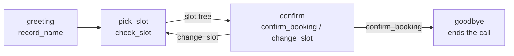
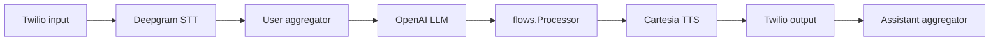

# Appointment booking flow

This recipe builds a phone receptionist for a dental clinic that books an appointment in four clear steps. You get a complete program built on `src/flows`, the commands to run it, and an explanation of nodes, transitions and shared state.

## What you build

The bot greets the caller, takes their name, offers free slots, confirms the chosen slot and hangs up. Each step is a **node** with its own instructions and functions, so the LLM only sees the tools that make sense at that moment.



The pipeline is the usual voice pipeline with one extra processor, `flows.Processor`, after the LLM:



Terms used on this page: **STT** is speech-to-text, **TTS** is text-to-speech, the **context** is the list of messages the LLM sees, and a **frame** is a message that flows through the **pipeline**.

## Before you begin

- Go 1.25 or newer and the module set up as in [Installation](../getting-started/installation.md).
- A Twilio number and a tunnel, as in [Your first phone bot](../getting-started/first-phone-bot.md).
- API keys: `DEEPGRAM_API_KEY`, `OPENAI_API_KEY`, `CARTESIA_API_KEY`, `CARTESIA_VOICE_ID`, plus `TWILIO_ACCOUNT_SID` and `TWILIO_AUTH_TOKEN` for hang-up.
- Read the [flows guide](../guides/flows.md) if you want the full model; this recipe explains what it uses.

## The code

```go
package main

import (
	"context"
	"log"
	"net/http"
	"os"
	"os/signal"
	"strings"
	"sync"
	"syscall"

	"github.com/square-key-labs/strawgo-ai/src/flows"
	"github.com/square-key-labs/strawgo-ai/src/llm"
	"github.com/square-key-labs/strawgo-ai/src/logger"
	"github.com/square-key-labs/strawgo-ai/src/pipeline"
	"github.com/square-key-labs/strawgo-ai/src/processors"
	"github.com/square-key-labs/strawgo-ai/src/processors/aggregators"
	"github.com/square-key-labs/strawgo-ai/src/serializers"
	"github.com/square-key-labs/strawgo-ai/src/services/cartesia"
	"github.com/square-key-labs/strawgo-ai/src/services/deepgram"
	"github.com/square-key-labs/strawgo-ai/src/services/openai"
	"github.com/square-key-labs/strawgo-ai/src/transports"
)

type calendar struct {
	mu     sync.Mutex
	free   map[string]bool
	booked map[string]string
}

func newCalendar() *calendar {
	return &calendar{
		free: map[string]bool{
			"monday 9am": true, "monday 2pm": true,
			"tuesday 10am": true, "wednesday 4pm": true,
		},
		booked: map[string]string{},
	}
}

func (c *calendar) freeSlots() string {
	c.mu.Lock()
	defer c.mu.Unlock()
	var out []string
	for slot, ok := range c.free {
		if ok {
			out = append(out, slot)
		}
	}
	return strings.Join(out, ", ")
}

func (c *calendar) book(slot, name string) bool {
	c.mu.Lock()
	defer c.mu.Unlock()
	if !c.free[slot] {
		return false
	}
	c.free[slot] = false
	c.booked[slot] = name
	return true
}

func (c *calendar) isFree(slot string) bool {
	c.mu.Lock()
	defer c.mu.Unlock()
	return c.free[slot]
}

var (
	patientName flows.Key[string] = "patient_name"
	chosenSlot  flows.Key[string] = "slot"
)

type nameArgs struct {
	Name string `json:"name" desc:"The caller's full name"`
}

type slotArgs struct {
	Slot string `json:"slot" desc:"Day and time, lower case, e.g. monday 9am"`
}

type confirmArgs struct{}

func buildFlow(cal *calendar) *flows.Node {
	goodbye := &flows.Node{
		Name:         "goodbye",
		TaskMessages: []llm.Message{llm.Developer("Tell {{ patient_name }} the appointment on {{ slot }} is booked, then say goodbye in one sentence.")},
		PostActions:  []flows.Action{flows.EndConversation{}},
	}
	confirm := &flows.Node{Name: "confirm"}
	pick := &flows.Node{Name: "pick_slot"}

	pick.TaskMessages = []llm.Message{llm.Developer("Offer these free slots to {{ patient_name }}: " + cal.freeSlots() + ". Ask which one suits them.")}
	pick.Functions = []flows.Function{
		flows.Typed("check_slot", "Check whether the slot the caller chose is free.",
			func(ctx context.Context, args slotArgs, m *flows.Manager) (any, *flows.Node, error) {
				slot := strings.ToLower(strings.TrimSpace(args.Slot))
				if !cal.isFree(slot) {
					return map[string]any{"free": false, "free_slots": cal.freeSlots()}, nil, nil
				}
				chosenSlot.Set(m.State(), slot)
				return map[string]any{"free": true}, confirm, nil
			}),
	}

	confirm.TaskMessages = []llm.Message{llm.Developer("Read back the booking: {{ patient_name }} on {{ slot }}. Ask the caller to confirm.")}
	confirm.Functions = []flows.Function{
		flows.Typed("confirm_booking", "The caller confirmed the booking.",
			func(ctx context.Context, _ confirmArgs, m *flows.Manager) (any, *flows.Node, error) {
				name, _ := patientName.Get(m.State())
				slot, _ := chosenSlot.Get(m.State())
				if !cal.book(slot, name) {
					return map[string]any{"booked": false, "reason": "slot was just taken"}, pick, nil
				}
				log.Printf("booked %s for %s", slot, name)
				return map[string]any{"booked": true}, goodbye, nil
			}),
		flows.Typed("change_slot", "The caller wants a different slot.",
			func(ctx context.Context, _ confirmArgs, m *flows.Manager) (any, *flows.Node, error) {
				return map[string]any{"ok": true}, pick, nil
			}),
	}

	return &flows.Node{
		Name:         "greeting",
		RoleMessage:  "You are the receptionist of Bright Smile Dental on a phone call. Speak in short sentences without lists or markdown.",
		TaskMessages: []llm.Message{llm.Developer("Greet the caller and ask for their full name to book an appointment.")},
		Functions: []flows.Function{
			flows.Typed("record_name", "Store the caller's name once they have said it.",
				func(ctx context.Context, args nameArgs, m *flows.Manager) (any, *flows.Node, error) {
					patientName.Set(m.State(), args.Name)
					return map[string]any{"saved": args.Name}, pick, nil
				}),
		},
	}
}

func main() {
	logger.Init()
	cal := newCalendar()
	srv, err := transports.NewServer(transports.ServerConfig{
		Addr: ":8080",
		Path: "/media",
		NewSerializer: func(*http.Request) serializers.FrameSerializer {
			return serializers.NewTwilioFrameSerializer(serializers.TwilioConfig{
				AccountSID: os.Getenv("TWILIO_ACCOUNT_SID"),
				AuthToken:  os.Getenv("TWILIO_AUTH_TOKEN"),
			})
		},
		Handler: func(ctx context.Context, s *transports.Session) error { return runCall(ctx, s, cal) },
	})
	if err != nil {
		log.Fatal(err)
	}
	ctx, stop := signal.NotifyContext(context.Background(), os.Interrupt, syscall.SIGTERM)
	defer stop()
	if err := srv.ListenAndServe(ctx); err != nil {
		log.Fatal(err)
	}
}

func runCall(ctx context.Context, s *transports.Session, cal *calendar) error {
	stt := deepgram.NewSTTService(deepgram.STTConfig{APIKey: os.Getenv("DEEPGRAM_API_KEY"), Model: "nova-3", Language: "en"})
	llmSvc := openai.NewLLMService(openai.LLMConfig{APIKey: os.Getenv("OPENAI_API_KEY"), Model: "gpt-4.1-mini"})
	tts := cartesia.NewTTSService(cartesia.TTSConfig{APIKey: os.Getenv("CARTESIA_API_KEY"), VoiceID: os.Getenv("CARTESIA_VOICE_ID")})

	conversation := llm.NewContext()
	pair := aggregators.NewContextAggregatorPair(conversation, aggregators.ContextAggregatorPairParams{})
	flowProc := flows.NewProcessor()
	task := pipeline.NewPipelineTask(pipeline.NewPipeline([]processors.FrameProcessor{
		s.Input(), stt, pair.User(), llmSvc, flowProc, tts, s.Output(), pair.Assistant(),
	}))

	manager, err := flows.NewManager(flows.Config{LLM: llmSvc, Task: task, Context: conversation, Processor: flowProc})
	if err != nil {
		return err
	}
	defer manager.Close()
	if err := manager.Initialize(ctx, buildFlow(cal)); err != nil {
		return err
	}
	return task.Run(ctx)
}
```

> [!NOTE]
> `src/flows` is tested with a fake LLM provider in `src/flows/flows_test.go`. It has not been run against a live LLM, so check that your model calls the functions as intended.

## Run it

```sh
export DEEPGRAM_API_KEY=YOUR_DEEPGRAM_API_KEY
export OPENAI_API_KEY=YOUR_OPENAI_API_KEY
export CARTESIA_API_KEY=YOUR_CARTESIA_API_KEY
export CARTESIA_VOICE_ID=YOUR_CARTESIA_VOICE_ID
export TWILIO_ACCOUNT_SID=YOUR_TWILIO_ACCOUNT_SID
export TWILIO_AUTH_TOKEN=YOUR_TWILIO_AUTH_TOKEN
go run .
```

Point your Twilio number at `wss://YOUR_TUNNEL_HOST/media` with a `<Connect><Stream>` TwiML response, as in [Your first phone bot](../getting-started/first-phone-bot.md). Call it and book "Monday 9am".

To see the graph, print `flows.Mermaid(buildFlow(newCalendar()))` and paste it into any Mermaid viewer.

## How it works

**Each node scopes the LLM.** When the manager enters a node it sets the node's `RoleMessage` as the system instruction (the greeting's role message stays until a later node sets another), appends the node's `TaskMessages` to the context, and offers only that node's functions. In `pick_slot` the model cannot call `confirm_booking`, because that function is not registered there.

**Functions return the next node.** A `flows.Typed` handler returns `(result, next, err)`. Returning a node moves the conversation on once every call from the same LLM response has finished. Returning `nil` stays in the current node; `check_slot` does that when the slot is taken, so the model can offer another one.

**State lives in the manager.** `flows.Key[string]` gives typed access to `m.State()`. `record_name` stores the name; later nodes read it with `patientName.Get` and in their messages with `{{ patient_name }}`. A placeholder whose key is missing is an error when the node is entered, so set state before you transition.

**Argument schemas come from structs.** `flows.Typed` builds the JSON schema from the struct: `json` names the field, `desc` describes it, and non-pointer fields without `omitempty` are required.

**The goodbye node ends the call.** Its `EndConversation{}` post-action queues an `EndFrame` after the node's LLM reply, so the goodbye is spoken, then the Twilio output hangs up.

**`manager.Initialize` runs before `task.Run`.** The frames it queues wait in the task until the pipeline starts, so the bot speaks first using the greeting node.

## Variations

Ask the caller for a callback number in every node with a global function:

```go
func callbackFunction(phone flows.Key[string]) flows.Function {
	type phoneArgs struct {
		Number string `json:"number" desc:"Callback phone number, digits only"`
	}
	return flows.Typed("record_callback_number", "Store a callback number whenever the caller gives one.",
		func(ctx context.Context, args phoneArgs, m *flows.Manager) (any, *flows.Node, error) {
			phone.Set(m.State(), args.Number)
			return map[string]any{"saved": true}, nil, nil
		})
}
```

Pass it as `flows.Config{GlobalFunctions: []flows.Function{callbackFunction("callback_number")}, …}`.

Keep the context short by summarising it when the caller reaches the confirmation step:

```go
func summarisingConfirmNode() *flows.Node {
	return &flows.Node{
		Name:         "confirm",
		TaskMessages: []llm.Message{llm.Developer("Read back the booking and ask the caller to confirm.")},
		ContextStrategy: &flows.ContextStrategy{
			Kind:          flows.ResetWithSummary,
			SummaryPrompt: "Summarise the caller's name and chosen slot in one sentence.",
		},
	}
}
```

Speak a fixed line when a node is entered, without the LLM:

```go
func pickSlotWithPrompt() *flows.Node {
	return &flows.Node{
		Name:         "pick_slot",
		PreActions:   []flows.Action{flows.TTSSay{Text: "Let me check the calendar."}},
		TaskMessages: []llm.Message{llm.Developer("Offer the free slots and ask which one suits the caller.")},
	}
}
```

## Next steps

- [Flows guide](../guides/flows.md): JSON flow definitions, actions and context strategies.
- [Flows reference](../reference/flows.md): every type in `src/flows`.
- [Customer support bot](customer-support-bot.md): plain function calling without nodes.
- [Outbound call with voicemail](outbound-call-with-voicemail.md): call patients to remind them of the booking.
