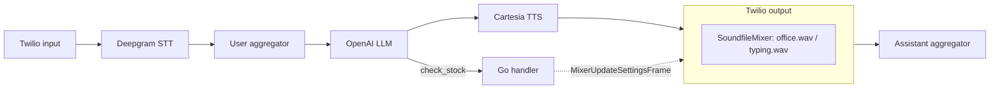

# Background ambience

This recipe plays a quiet office background sound under a phone bot's voice and swaps it for a typing sound while the bot looks something up. You get a complete program, the commands to prepare the sound files, and an explanation of how the transport mixes audio.

## What you build

A Twilio bot for a hardware store. Callers hear soft office noise for the whole call, including the silences. When the bot checks stock, the background changes to keyboard typing for the length of the lookup, then goes back to office noise.



Terms used on this page: **STT** is speech-to-text, **TTS** is text-to-speech, a **frame** is a message flowing through the **pipeline**, and a **mixer** adds a second audio source on top of the bot's voice.

## Before you begin

- Go 1.25 or newer and the module set up as in [Installation](../getting-started/installation.md).
- A Twilio number and a tunnel, as in [Your first phone bot](../getting-started/first-phone-bot.md).
- API keys: `DEEPGRAM_API_KEY`, `OPENAI_API_KEY`, `CARTESIA_API_KEY`, `CARTESIA_VOICE_ID`.
- Two sound files you have the rights to use, converted to 16-bit PCM WAV. The mixer reads only 16-bit PCM WAV; it converts any sample rate and channel count itself. With `ffmpeg`:

  ```sh
  ffmpeg -i office-source.mp3 -c:a pcm_s16le office.wav
  ffmpeg -i typing-source.mp3 -c:a pcm_s16le typing.wav
  ```

## The code

```go
package main

import (
	"context"
	"log"
	"net/http"
	"os"
	"os/signal"
	"syscall"
	"time"

	"github.com/square-key-labs/strawgo-ai/src/audio/mixer"
	"github.com/square-key-labs/strawgo-ai/src/frames"
	"github.com/square-key-labs/strawgo-ai/src/llm"
	"github.com/square-key-labs/strawgo-ai/src/logger"
	"github.com/square-key-labs/strawgo-ai/src/pipeline"
	"github.com/square-key-labs/strawgo-ai/src/processors"
	"github.com/square-key-labs/strawgo-ai/src/processors/aggregators"
	"github.com/square-key-labs/strawgo-ai/src/serializers"
	"github.com/square-key-labs/strawgo-ai/src/services/cartesia"
	"github.com/square-key-labs/strawgo-ai/src/services/deepgram"
	"github.com/square-key-labs/strawgo-ai/src/services/openai"
	"github.com/square-key-labs/strawgo-ai/src/transports"
)

var sounds = map[string]string{
	"office": "office.wav",
	"typing": "typing.wav",
}

var tools = llm.Tools{Functions: []llm.FunctionSchema{{
	Name:        "check_stock",
	Description: "Check how many units of a product are in stock.",
	Properties: map[string]any{
		"product": map[string]any{"type": "string", "description": "Product name, e.g. cordless drill"},
	},
	Required: []string{"product"},
}}}

func main() {
	logger.Init()
	for _, path := range sounds {
		if _, err := os.Stat(path); err != nil {
			log.Fatalf("sound file missing: %v", err)
		}
	}
	srv, err := transports.NewServer(transports.ServerConfig{
		Addr: ":8080",
		Path: "/media",
		NewSerializer: func(*http.Request) serializers.FrameSerializer {
			return serializers.NewTwilioFrameSerializer(serializers.TwilioConfig{
				AccountSID: os.Getenv("TWILIO_ACCOUNT_SID"),
				AuthToken:  os.Getenv("TWILIO_AUTH_TOKEN"),
			})
		},
		Handler: runCall,
		Params: transports.TransportParams{
			NewOutputMixer: func() mixer.Mixer {
				return mixer.NewSoundfileMixer(sounds, "office", mixer.WithVolume(0.15), mixer.WithLoop(true))
			},
		},
	})
	if err != nil {
		log.Fatal(err)
	}
	ctx, stop := signal.NotifyContext(context.Background(), os.Interrupt, syscall.SIGTERM)
	defer stop()
	if err := srv.ListenAndServe(ctx); err != nil {
		log.Fatal(err)
	}
}

func runCall(ctx context.Context, s *transports.Session) error {
	stt := deepgram.NewSTTService(deepgram.STTConfig{APIKey: os.Getenv("DEEPGRAM_API_KEY"), Model: "nova-3", Language: "en"})
	llmSvc := openai.NewLLMService(openai.LLMConfig{
		APIKey:       os.Getenv("OPENAI_API_KEY"),
		Model:        "gpt-4.1-mini",
		SystemPrompt: "You answer the phone at Oak Street Hardware. Use check_stock for stock questions. Keep replies short, without lists or markdown.",
	})
	tts := cartesia.NewTTSService(cartesia.TTSConfig{APIKey: os.Getenv("CARTESIA_API_KEY"), VoiceID: os.Getenv("CARTESIA_VOICE_ID")})

	conversation := llm.NewContext()
	conversation.SetTools(tools)
	pair := aggregators.NewContextAggregatorPair(conversation, aggregators.ContextAggregatorPairParams{})
	task := pipeline.NewPipelineTask(pipeline.NewPipeline([]processors.FrameProcessor{
		s.Input(), stt, pair.User(), llmSvc, tts, s.Output(), pair.Assistant(),
	}))

	setSound := func(name string) {
		if err := task.QueueFrame(frames.NewMixerUpdateSettingsFrame(map[string]any{"sound": name})); err != nil {
			log.Printf("mixer: %v", err)
		}
	}
	llmSvc.RegisterFunction("check_stock", func(ctx context.Context, p llm.FunctionCallParams) (llm.FunctionResult, error) {
		setSound("typing")
		defer setSound("office")
		product, _ := p.Arguments["product"].(string)
		select {
		case <-ctx.Done():
			return llm.FunctionResult{}, ctx.Err()
		case <-time.After(3 * time.Second):
		}
		return llm.FunctionResult{Value: map[string]any{"product": product, "in_stock": 7, "aisle": 12}}, nil
	})

	if err := task.QueueFrame(frames.NewTTSSpeakFrame("Oak Street Hardware, how can I help?")); err != nil {
		return err
	}
	return task.Run(ctx)
}
```

## Run it

Put `office.wav` and `typing.wav` next to `main.go`, then:

```sh
export DEEPGRAM_API_KEY=YOUR_DEEPGRAM_API_KEY
export OPENAI_API_KEY=YOUR_OPENAI_API_KEY
export CARTESIA_API_KEY=YOUR_CARTESIA_API_KEY
export CARTESIA_VOICE_ID=YOUR_CARTESIA_VOICE_ID
go run .
```

Point your Twilio number at `wss://YOUR_TUNNEL_HOST/media`, call it, and ask "do you have cordless drills in stock?".

## How it works

**The mixer lives in the transport output.** `TransportParams.NewOutputMixer` is called once per call, so every call gets its own `SoundfileMixer` with its own playback position. Use the factory rather than `OutputMixer`, which would share one mixer between all calls.

**It mixes continuously.** When the output starts, it calls `Start(sampleRate)` with the output rate; the mixer loads every file, converts it to mono and resamples it. Each 20 ms audio chunk the output sends passes through `Mix`, which adds the current sound at the configured volume. While the bot is silent, the output keeps sending silent chunks so the background keeps playing.

**Frames change the sound.** `MixerUpdateSettingsFrame` takes a map with any of `sound` (a name from the file map), `volume` (a number) and `loop` (a bool). `MixerEnableFrame(false)` mutes the background and `MixerEnableFrame(true)` brings it back. These frames travel down the pipeline in order with the bot's audio, so a switch queued after a sentence takes effect when that sentence has been sent. An unknown sound name is logged as a warning and ignored.

**Options set the starting state.** `WithVolume(0.15)` keeps the background well under the voice (the default is 0.4). `WithLoop(true)` is the default; with `false` the sound plays once.

## Variations

Mute the background while the bot reads out something important, then restore it:

```go
func speakClearly(task *pipeline.PipelineTask, text string) error {
	return task.QueueFrames([]frames.Frame{
		frames.NewMixerEnableFrame(false),
		frames.NewTTSSpeakFrame(text),
		frames.NewMixerEnableFrame(true),
	})
}
```

Turn the volume down for one caller:

```go
func quieter(task *pipeline.PipelineTask) error {
	return task.QueueFrame(frames.NewMixerUpdateSettingsFrame(map[string]any{"volume": 0.05}))
}
```

Use the same mixer with the browser widget. `webrtc.Params.NewOutputMixer` works like the `TransportParams` field: it is called once per session, so every browser gets its own playback position:

```go
func webrtcParamsWithAmbience() webrtc.Params {
	return webrtc.Params{
		AudioInSampleRate: 16000,
		NewOutputMixer: func() mixer.Mixer {
			return mixer.NewSoundfileMixer(map[string]string{"office": "office.wav"}, "office", mixer.WithVolume(0.15))
		},
	}
}
```

## Next steps

- [Audio guide](../guides/audio.md): mixers, filters and sample rates.
- [Browser voice widget](browser-voice-widget.md): the WebRTC transport used above.
- [Transports reference](../reference/transports.md): every `TransportParams` field.
- [Customer support bot](customer-support-bot.md): function calling in more depth.
