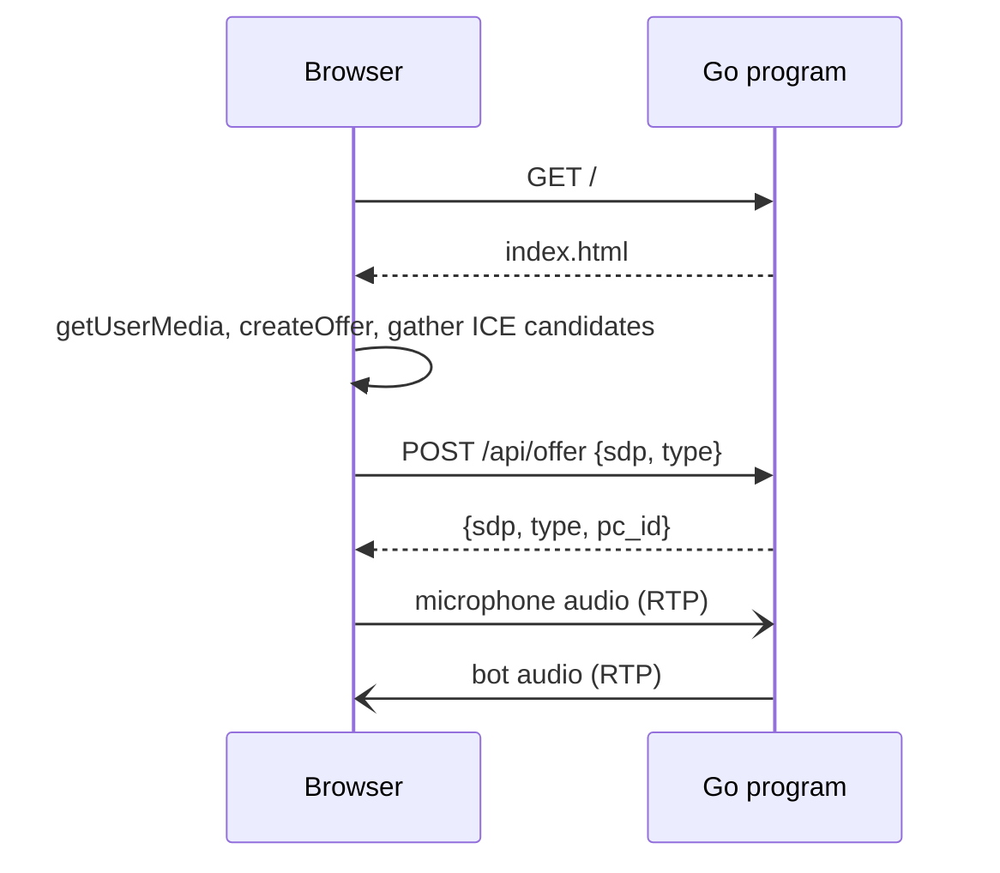
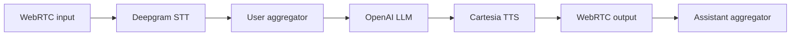

# Browser voice widget

This recipe puts a "talk to us" button on a web page that opens a live voice conversation with a Strawgo bot over WebRTC. You get one Go program that serves both the page and the bot, the HTML and JavaScript for the page, and an explanation of the signalling.

## What you build

The browser asks for the microphone, sends a WebRTC offer to `/api/offer`, and plays the bot's audio. The Go program answers the offer with `src/transports/webrtc`, runs the usual STT, LLM and TTS pipeline for that connection, and serves `index.html` at `/`.





Terms used on this page: **WebRTC** is the browser standard for real-time audio between peers; **SDP** is the text that describes each side's media; **ICE** finds a network path between them; **STT** is speech-to-text and **TTS** is text-to-speech.

## Before you begin

- Go 1.26 or newer and the module set up as in [Installation](../getting-started/installation.md).
- A desktop browser with a microphone. Browsers allow microphone access on `http://localhost`; any other host needs HTTPS.
- API keys: `DEEPGRAM_API_KEY`, `OPENAI_API_KEY`, `CARTESIA_API_KEY`, `CARTESIA_VOICE_ID`.

> [!NOTE]
> The WebRTC transport negotiates G.711 (PCMU or PCMA, 8 kHz) by default. Opus is only compiled in with the `opus` build tag, and that path is unverified. There is no video support and no Daily or LiveKit transport.

## The code

Create two files in a new module. `main.go`:

```go
package main

import (
	"context"
	"errors"
	"log"
	"net/http"
	"os"
	"os/signal"
	"syscall"
	"time"

	"github.com/square-key-labs/strawgo-ai/src/frames"
	"github.com/square-key-labs/strawgo-ai/src/llm"
	"github.com/square-key-labs/strawgo-ai/src/logger"
	"github.com/square-key-labs/strawgo-ai/src/pipeline"
	"github.com/square-key-labs/strawgo-ai/src/processors"
	"github.com/square-key-labs/strawgo-ai/src/processors/aggregators"
	"github.com/square-key-labs/strawgo-ai/src/services/cartesia"
	"github.com/square-key-labs/strawgo-ai/src/services/deepgram"
	"github.com/square-key-labs/strawgo-ai/src/services/openai"
	"github.com/square-key-labs/strawgo-ai/src/transports/webrtc"
)

func main() {
	logger.Init()
	for _, k := range []string{"DEEPGRAM_API_KEY", "OPENAI_API_KEY", "CARTESIA_API_KEY", "CARTESIA_VOICE_ID"} {
		if os.Getenv(k) == "" {
			log.Fatalf("%s is required", k)
		}
	}
	rtc, err := webrtc.NewHandler(webrtc.Config{
		Handler: runSession,
		Params: webrtc.Params{
			AudioInSampleRate: 16000,
			SessionTimeout:    15 * time.Minute,
		},
	})
	if err != nil {
		log.Fatal(err)
	}

	mux := http.NewServeMux()
	mux.Handle("/api/offer", rtc)
	mux.HandleFunc("/", func(w http.ResponseWriter, r *http.Request) {
		if r.URL.Path != "/" {
			http.NotFound(w, r)
			return
		}
		http.ServeFile(w, r, "index.html")
	})
	srv := &http.Server{Addr: ":8080", Handler: mux, ReadHeaderTimeout: 10 * time.Second}

	ctx, stop := signal.NotifyContext(context.Background(), os.Interrupt, syscall.SIGTERM)
	defer stop()
	go func() {
		<-ctx.Done()
		shutdownCtx, cancel := context.WithTimeout(context.Background(), 10*time.Second)
		defer cancel()
		_ = rtc.Shutdown(shutdownCtx)
		_ = srv.Shutdown(shutdownCtx)
	}()
	log.Println("open http://localhost:8080")
	if err := srv.ListenAndServe(); err != nil && !errors.Is(err, http.ErrServerClosed) {
		log.Fatal(err)
	}
}

func runSession(ctx context.Context, s *webrtc.Session) error {
	stt := deepgram.NewSTTService(deepgram.STTConfig{APIKey: os.Getenv("DEEPGRAM_API_KEY"), Model: "nova-3", Language: "en"})
	llmSvc := openai.NewLLMService(openai.LLMConfig{
		APIKey:       os.Getenv("OPENAI_API_KEY"),
		Model:        "gpt-4.1-mini",
		SystemPrompt: "You are the voice assistant on a company website. Answer in one or two short sentences without lists or markdown.",
	})
	tts := cartesia.NewTTSService(cartesia.TTSConfig{APIKey: os.Getenv("CARTESIA_API_KEY"), VoiceID: os.Getenv("CARTESIA_VOICE_ID")})

	conversation := llm.NewContext()
	pair := aggregators.NewContextAggregatorPair(conversation, aggregators.ContextAggregatorPairParams{})
	task := pipeline.NewPipelineTask(pipeline.NewPipeline([]processors.FrameProcessor{
		s.Input(), stt, pair.User(), llmSvc, tts, s.Output(), pair.Assistant(),
	}))
	if err := task.QueueFrame(frames.NewTTSSpeakFrame("Hi! What can I help you with?")); err != nil {
		return err
	}
	log.Printf("session %s started", s.ID())
	err := task.Run(ctx)
	log.Printf("session %s ended after %d messages", s.ID(), conversation.Len())
	return err
}
```

`index.html`, in the directory you run the program from:

```html
<!doctype html>
<html lang="en">
<head>
  <meta charset="utf-8">
  <title>Talk to us</title>
  <style>
    body { font-family: system-ui, sans-serif; display: grid; place-items: center; height: 100vh; margin: 0; }
    button { font-size: 1.2rem; padding: 0.8rem 1.6rem; border-radius: 2rem; border: none; background: #1f6feb; color: white; cursor: pointer; }
    button.live { background: #d1242f; }
    p { color: #57606a; text-align: center; }
  </style>
</head>
<body>
  <main>
    <button id="talk">Talk to us</button>
    <p id="status">Click to start a voice chat.</p>
    <audio id="bot" autoplay></audio>
  </main>
  <script>
    const button = document.getElementById("talk");
    const statusText = document.getElementById("status");
    const botAudio = document.getElementById("bot");
    let pc = null;
    let mic = null;

    function waitForIce(peer) {
      if (peer.iceGatheringState === "complete") {
        return Promise.resolve();
      }
      return new Promise((resolve) => {
        peer.addEventListener("icegatheringstatechange", () => {
          if (peer.iceGatheringState === "complete") {
            resolve();
          }
        });
      });
    }

    async function start() {
      mic = await navigator.mediaDevices.getUserMedia({ audio: { echoCancellation: true, noiseSuppression: true } });
      pc = new RTCPeerConnection();
      mic.getTracks().forEach((track) => pc.addTrack(track, mic));
      pc.ontrack = (event) => {
        botAudio.srcObject = event.streams[0] || new MediaStream([event.track]);
      };
      pc.onconnectionstatechange = () => {
        statusText.textContent = "Connection: " + pc.connectionState;
        if (pc.connectionState === "failed" || pc.connectionState === "closed") {
          stop();
        }
      };
      await pc.setLocalDescription(await pc.createOffer());
      await waitForIce(pc);
      const response = await fetch("/api/offer", {
        method: "POST",
        headers: { "Content-Type": "application/json" },
        body: JSON.stringify({ sdp: pc.localDescription.sdp, type: pc.localDescription.type }),
      });
      if (!response.ok) {
        throw new Error(await response.text());
      }
      const answer = await response.json();
      await pc.setRemoteDescription({ type: answer.type, sdp: answer.sdp });
      button.textContent = "Hang up";
      button.classList.add("live");
    }

    function stop() {
      if (pc) {
        pc.close();
        pc = null;
      }
      if (mic) {
        mic.getTracks().forEach((track) => track.stop());
        mic = null;
      }
      button.textContent = "Talk to us";
      button.classList.remove("live");
    }

    button.addEventListener("click", async () => {
      if (pc) {
        stop();
        statusText.textContent = "Call ended.";
        return;
      }
      statusText.textContent = "Connecting...";
      try {
        await start();
      } catch (err) {
        statusText.textContent = "Could not connect: " + err.message;
        stop();
      }
    });
  </script>
</body>
</html>
```

## Run it

```sh
export DEEPGRAM_API_KEY=YOUR_DEEPGRAM_API_KEY
export OPENAI_API_KEY=YOUR_OPENAI_API_KEY
export CARTESIA_API_KEY=YOUR_CARTESIA_API_KEY
export CARTESIA_VOICE_ID=YOUR_CARTESIA_VOICE_ID
go run .
```

Open `http://localhost:8080`, click **Talk to us**, allow the microphone, and speak. Click **Hang up** to end the session.

## How it works

**One handler, one session per browser.** `webrtc.NewHandler` returns an `http.Handler`. A `POST` with `{sdp, type}` creates a peer connection, answers the offer and returns `{sdp, type, pc_id}`. It then calls your `runSession` in its own goroutine with a `*webrtc.Session`, just as the WebSocket server calls a handler per phone call.

**The browser sends a complete offer.** The page waits until ICE gathering is complete before posting the offer, so all its network candidates are in the SDP. The handler also waits for its own gathering (up to `GatherTimeout`, 10 seconds by default) before answering. That avoids the trickle-ICE `PATCH` requests the handler also supports.

**Audio is resampled at the edges.** The browser sends G.711 at 8 kHz. `AudioInSampleRate: 16000` makes the input processor resample to 16 kHz for STT; the output processor encodes the TTS audio back to G.711.

**The session ends with the peer connection.** When the user clicks **Hang up**, the browser closes the peer connection. The session pushes a `ClientDisconnectedFrame` and, because no `OnClientDisconnected` callback is set, a `CancelTaskFrame`, so `task.Run` returns. `SessionTimeout` ends a forgotten tab after 15 minutes with an `EndTaskFrame`. On Ctrl-C, `rtc.Shutdown` cancels the handler's context and closes every session before the HTTP server stops.

## Variations

Add a STUN server so browsers behind NAT can reach a remote deployment:

```go
func newHandlerWithSTUN(run webrtc.SessionHandler) (*webrtc.Handler, error) {
	return webrtc.NewHandler(webrtc.Config{
		Handler:    run,
		ICEServers: []pionwebrtc.ICEServer{{URLs: []string{"stun:stun.l.google.com:19302"}}},
		Params:     webrtc.Params{AudioInSampleRate: 16000},
	})
}
```

Import `pionwebrtc "github.com/pion/webrtc/v4"` for the ICE server type.

Pass data from the page to the bot with `request_data`, for example the visitor's page, and read it in the session:

```go
func visitorPage(s *webrtc.Session) string {
	var data struct {
		Page string `json:"page"`
	}
	if err := json.Unmarshal(s.RequestData(), &data); err != nil {
		return ""
	}
	return data.Page
}
```

On the page, add `request_data: { page: location.pathname }` to the JSON body of the offer.

Send a message to the page over the data channel, if the page opened one with `pc.createDataChannel(...)` before creating the offer:

```go
func notifyPage(ctx context.Context, s *webrtc.Session, text string) error {
	return s.SendMessage(ctx, map[string]string{"type": "bot-status", "text": text})
}
```

## Next steps

- [WebRTC guide](../guides/webrtc.md): every `webrtc.Params` field, trickle ICE and renegotiation.
- [RTVI](../guides/rtvi.md): a standard message protocol between the page and the bot.
- [Background ambience](background-ambience.md): mix sound under the bot's voice.
- [Deployment](../guides/deployment.md): HTTPS, TURN and running many sessions.
