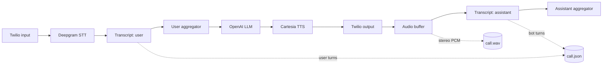

# Call recording and transcript

This recipe records every phone call to a stereo WAV file and writes a timestamped transcript next to it when the call ends. You get a complete program, the commands to run it, and an explanation of where the two recording processors sit and why.

## What you build

A Twilio voice bot that saves `recordings/<call id>.wav` (caller on the left channel, bot on the right) and `recordings/<call id>.json` (one entry per turn, with role, text and time) for every call.



Terms used on this page: **STT** is speech-to-text, **TTS** is text-to-speech, a **frame** is a message flowing through the **pipeline**, and **PCM** is raw, uncompressed 16-bit audio samples.

## Before you begin

- Go 1.25 or newer and the module set up as in [Installation](../getting-started/installation.md).
- A Twilio number and a tunnel, as in [Your first phone bot](../getting-started/first-phone-bot.md).
- API keys: `DEEPGRAM_API_KEY`, `OPENAI_API_KEY`, `CARTESIA_API_KEY`, `CARTESIA_VOICE_ID`.
- Check the recording and consent rules where you and your callers are. The bot below announces the recording in its greeting.

## The code

```go
package main

import (
	"context"
	"encoding/json"
	"log"
	"net/http"
	"os"
	"os/signal"
	"path/filepath"
	"sync"
	"syscall"
	"time"

	"github.com/square-key-labs/strawgo-ai/src/frames"
	"github.com/square-key-labs/strawgo-ai/src/llm"
	"github.com/square-key-labs/strawgo-ai/src/logger"
	"github.com/square-key-labs/strawgo-ai/src/pipeline"
	"github.com/square-key-labs/strawgo-ai/src/processors"
	"github.com/square-key-labs/strawgo-ai/src/processors/aggregators"
	"github.com/square-key-labs/strawgo-ai/src/processors/audiobuffer"
	"github.com/square-key-labs/strawgo-ai/src/processors/transcript"
	"github.com/square-key-labs/strawgo-ai/src/serializers"
	"github.com/square-key-labs/strawgo-ai/src/services/cartesia"
	"github.com/square-key-labs/strawgo-ai/src/services/deepgram"
	"github.com/square-key-labs/strawgo-ai/src/services/openai"
	"github.com/square-key-labs/strawgo-ai/src/transports"
)

const outDir = "recordings"

type recording struct {
	mu         sync.Mutex
	audio      []byte
	sampleRate int
	channels   int
	turns      []turn
}

type turn struct {
	Role string    `json:"role"`
	Text string    `json:"text"`
	At   time.Time `json:"at"`
}

func (r *recording) addAudio(pcm []byte, sampleRate, channels int) {
	r.mu.Lock()
	defer r.mu.Unlock()
	r.audio = append(r.audio, pcm...)
	r.sampleRate, r.channels = sampleRate, channels
}

func (r *recording) addTurn(m transcript.Message) {
	r.mu.Lock()
	defer r.mu.Unlock()
	r.turns = append(r.turns, turn{Role: string(m.Role), Text: m.Content, At: m.Timestamp})
}

func (r *recording) save(callID string) error {
	r.mu.Lock()
	defer r.mu.Unlock()
	if err := os.MkdirAll(outDir, 0o755); err != nil {
		return err
	}
	base := filepath.Join(outDir, callID)
	if len(r.audio) > 0 {
		if err := audiobuffer.WriteWAVFile(base+".wav", r.audio, r.sampleRate, r.channels); err != nil {
			return err
		}
	}
	data, err := json.MarshalIndent(r.turns, "", "  ")
	if err != nil {
		return err
	}
	return os.WriteFile(base+".json", data, 0o644)
}

func main() {
	logger.Init()
	srv, err := transports.NewServer(transports.ServerConfig{
		Addr: ":8080",
		Path: "/media",
		NewSerializer: func(*http.Request) serializers.FrameSerializer {
			return serializers.NewTwilioFrameSerializer(serializers.TwilioConfig{
				AccountSID: os.Getenv("TWILIO_ACCOUNT_SID"),
				AuthToken:  os.Getenv("TWILIO_AUTH_TOKEN"),
			})
		},
		Handler: runCall,
	})
	if err != nil {
		log.Fatal(err)
	}
	ctx, stop := signal.NotifyContext(context.Background(), os.Interrupt, syscall.SIGTERM)
	defer stop()
	if err := srv.ListenAndServe(ctx); err != nil {
		log.Fatal(err)
	}
}

func runCall(ctx context.Context, s *transports.Session) error {
	callID := s.CallInfo().CallID
	if callID == "" {
		callID = s.ID()
	}
	rec := &recording{}

	stt := deepgram.NewSTTService(deepgram.STTConfig{APIKey: os.Getenv("DEEPGRAM_API_KEY"), Model: "nova-3", Language: "en"})
	llmSvc := openai.NewLLMService(openai.LLMConfig{
		APIKey:       os.Getenv("OPENAI_API_KEY"),
		Model:        "gpt-4.1-mini",
		SystemPrompt: "You are a friendly phone assistant. Answer in one or two short sentences.",
	})
	tts := cartesia.NewTTSService(cartesia.TTSConfig{APIKey: os.Getenv("CARTESIA_API_KEY"), VoiceID: os.Getenv("CARTESIA_VOICE_ID")})

	recorder := audiobuffer.New(audiobuffer.Config{NumChannels: 2, AutoStartRecording: true}, audiobuffer.Handlers{
		OnAudioData: rec.addAudio,
	})
	transcripts := transcript.NewProcessor()
	transcripts.OnTranscriptUpdate(rec.addTurn)

	conversation := llm.NewContext()
	pair := aggregators.NewContextAggregatorPair(conversation, aggregators.ContextAggregatorPairParams{})
	task := pipeline.NewPipelineTask(pipeline.NewPipeline([]processors.FrameProcessor{
		s.Input(), stt, transcripts.User(), pair.User(), llmSvc, tts, s.Output(), recorder, transcripts.Assistant(), pair.Assistant(),
	}))
	if err := task.QueueFrame(frames.NewTTSSpeakFrame("Hi! This call is recorded. How can I help?")); err != nil {
		return err
	}

	runErr := task.Run(ctx)
	if err := rec.save(callID); err != nil {
		log.Printf("call %s: save recording: %v", callID, err)
	} else {
		log.Printf("call %s: saved %s/%s.wav and .json", callID, outDir, callID)
	}
	return runErr
}
```

## Run it

```sh
export DEEPGRAM_API_KEY=YOUR_DEEPGRAM_API_KEY
export OPENAI_API_KEY=YOUR_OPENAI_API_KEY
export CARTESIA_API_KEY=YOUR_CARTESIA_API_KEY
export CARTESIA_VOICE_ID=YOUR_CARTESIA_VOICE_ID
go run .
```

Point your Twilio number at `wss://YOUR_TUNNEL_HOST/media`, make a call, hang up, and look in `recordings/`. Play the WAV with any audio player; the caller is on the left, the bot on the right.

## How it works

**The audio buffer sits after the transport output.** `audiobuffer.Processor` records two tracks: user audio from `AudioFrame`s and bot audio from `TTSAudioFrame`s. Placed after `s.Output()`, it sees the caller's audio (which every processor passes along) and the bot's audio after the output has played it, so the bot track reflects what was actually sent. It resamples both tracks to one rate (the pipeline's output rate unless you set `Config.SampleRate`) and fills gaps with silence so the tracks stay aligned.

**Audio arrives in chunks.** `OnAudioData` fires whenever the internal buffer fills and once more when the call ends (`EndFrame` or `CancelFrame`). With `NumChannels: 2` each chunk is interleaved stereo; with 1 it is a mono mix. The program appends the chunks in memory and writes one WAV file after `task.Run` returns, when no more chunks can arrive. For long calls, write chunks to disk as they come instead, for example with `wav.NewWriter` from `src/audio/wav`.

**The transcript has two halves.** `transcript.NewProcessor()` returns a pair that shares one handler list. `User()` goes after STT and emits a message for each final `TranscriptionFrame`. `Assistant()` goes after the transport output and collects `TTSTextFrame`s, emitting one message when the bot stops speaking or is interrupted, so an interrupted reply is recorded only up to where it was cut off.

**`AutoStartRecording` starts when the pipeline starts.** Without it, recording waits for an `AudioBufferStartRecordingFrame` or a call to `recorder.StartRecording()`.

## Variations

Record only after the caller consents, by starting the recorder from a function call:

```go
func registerConsent(llmSvc *llmservice.Service, recorder *audiobuffer.Processor) {
	llmSvc.RegisterFunction("caller_consented_to_recording", func(ctx context.Context, p llm.FunctionCallParams) (llm.FunctionResult, error) {
		recorder.StartRecording()
		return llm.FunctionResult{Value: "recording started"}, nil
	})
}
```

Save each turn's audio separately, for example to review what the STT heard:

```go
func perTurnRecorder(dir string) *audiobuffer.Processor {
	return audiobuffer.New(audiobuffer.Config{EnableTurnAudio: true, AutoStartRecording: true}, audiobuffer.Handlers{
		OnUserTurnAudio: func(t audiobuffer.TurnAudio) {
			path := filepath.Join(dir, fmt.Sprintf("user-%03d.wav", t.TurnNumber))
			if err := audiobuffer.WriteWAVFile(path, t.Audio, t.SampleRate, t.NumChannels); err != nil {
				log.Printf("save turn: %v", err)
			}
		},
	})
}
```

Record the LLM's text instead of the spoken words, for example when TTS is replaced by a text channel:

```go
func llmTextTranscript() *transcript.Processor {
	return transcript.NewProcessor(transcript.WithLLMText())
}
```

## Next steps

- [Recording guide](../guides/recording.md): the audio buffer's options in full.
- [Metrics dashboard](metrics-dashboard.md): store per-call metrics next to the recording.
- [Audio guide](../guides/audio.md): sample rates and WAV helpers.
- [Customer support bot](customer-support-bot.md): a bot worth recording.
