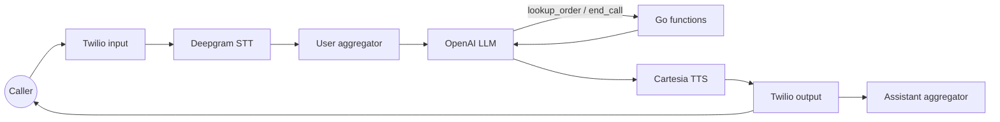

# Customer support bot

This recipe builds a phone agent for an online shop that looks up orders and hangs up politely when the caller is done. You get a complete program, the commands to run it, and a walk-through of the function-calling parts.

## What you build

A caller dials your Twilio number and asks "where is my order 1042?". The bot calls a `lookup_order` function, reads the status back, and when the caller says goodbye it calls `end_call`, says goodbye and hangs up.



Terms used on this page: **STT** (speech-to-text) turns the caller's audio into text; **TTS** (text-to-speech) turns the reply into audio; a **frame** is a message that flows through the **pipeline** of processors; **function calling** lets the LLM ask your Go code to run a named function and use the result.

## Before you begin

- Go 1.25 or newer and the module set up as in [Installation](../getting-started/installation.md).
- A Twilio phone number and a public HTTPS tunnel to your machine, as in [Your first phone bot](../getting-started/first-phone-bot.md).
- API keys: `DEEPGRAM_API_KEY`, `OPENAI_API_KEY`, `CARTESIA_API_KEY`, and a Cartesia voice ID in `CARTESIA_VOICE_ID`.
- `TWILIO_ACCOUNT_SID` and `TWILIO_AUTH_TOKEN`, so the bot can hang up the call through Twilio's REST API.

## The code

Save this as `main.go` in a new module.

```go
package main

import (
	"context"
	"log"
	"net/http"
	"os"
	"os/signal"
	"strings"
	"syscall"

	"github.com/square-key-labs/strawgo-ai/src/frames"
	"github.com/square-key-labs/strawgo-ai/src/llm"
	"github.com/square-key-labs/strawgo-ai/src/logger"
	"github.com/square-key-labs/strawgo-ai/src/pipeline"
	"github.com/square-key-labs/strawgo-ai/src/processors"
	"github.com/square-key-labs/strawgo-ai/src/processors/aggregators"
	"github.com/square-key-labs/strawgo-ai/src/serializers"
	"github.com/square-key-labs/strawgo-ai/src/services/cartesia"
	"github.com/square-key-labs/strawgo-ai/src/services/deepgram"
	"github.com/square-key-labs/strawgo-ai/src/services/openai"
	"github.com/square-key-labs/strawgo-ai/src/transports"
)

const systemPrompt = `You are the phone support agent of Northwind Shop.
You can look up orders with lookup_order. Ask for the order number if the caller has not given it.
When the caller says goodbye or has nothing else to ask, call end_call.
Speak in short, plain sentences. Never use lists, markdown or emojis.`

type order struct {
	Status   string
	Carrier  string
	Delivery string
}

var orders = map[string]order{
	"1042": {Status: "shipped", Carrier: "UPS", Delivery: "Thursday"},
	"1043": {Status: "being packed", Delivery: "next Monday"},
	"1044": {Status: "delivered", Carrier: "DHL", Delivery: "yesterday"},
}

var tools = llm.Tools{Functions: []llm.FunctionSchema{
	{
		Name:        "lookup_order",
		Description: "Look up the status of an order by its order number.",
		Properties: map[string]any{
			"order_id": map[string]any{"type": "string", "description": "The order number, digits only, e.g. 1042"},
		},
		Required: []string{"order_id"},
	},
	{
		Name:        "end_call",
		Description: "Say goodbye and hang up once the caller is finished.",
		Properties:  map[string]any{},
	},
}}

type keys struct {
	deepgram, openai, cartesia, voiceID string
}

func main() {
	logger.Init()
	k := keys{
		deepgram: mustEnv("DEEPGRAM_API_KEY"),
		openai:   mustEnv("OPENAI_API_KEY"),
		cartesia: mustEnv("CARTESIA_API_KEY"),
		voiceID:  mustEnv("CARTESIA_VOICE_ID"),
	}
	srv, err := transports.NewServer(transports.ServerConfig{
		Addr: ":8080",
		Path: "/media",
		NewSerializer: func(*http.Request) serializers.FrameSerializer {
			return serializers.NewTwilioFrameSerializer(serializers.TwilioConfig{
				AccountSID: mustEnv("TWILIO_ACCOUNT_SID"),
				AuthToken:  mustEnv("TWILIO_AUTH_TOKEN"),
			})
		},
		Handler: func(ctx context.Context, s *transports.Session) error { return runCall(ctx, s, k) },
	})
	if err != nil {
		log.Fatal(err)
	}
	ctx, stop := signal.NotifyContext(context.Background(), os.Interrupt, syscall.SIGTERM)
	defer stop()
	log.Println("listening on :8080/media")
	if err := srv.ListenAndServe(ctx); err != nil {
		log.Fatal(err)
	}
}

func runCall(ctx context.Context, s *transports.Session, k keys) error {
	stt := deepgram.NewSTTService(deepgram.STTConfig{APIKey: k.deepgram, Model: "nova-3", Language: "en", SmartFormat: true})
	llmSvc := openai.NewLLMService(openai.LLMConfig{APIKey: k.openai, Model: "gpt-4.1-mini", SystemPrompt: systemPrompt})
	tts := cartesia.NewTTSService(cartesia.TTSConfig{APIKey: k.cartesia, VoiceID: k.voiceID})

	conversation := llm.NewContext()
	conversation.SetTools(tools)
	pair := aggregators.NewContextAggregatorPair(conversation, aggregators.ContextAggregatorPairParams{})

	task := pipeline.NewPipelineTask(pipeline.NewPipeline([]processors.FrameProcessor{
		s.Input(), stt, pair.User(), llmSvc, tts, s.Output(), pair.Assistant(),
	}))

	llmSvc.RegisterFunction("lookup_order", lookupOrder)
	llmSvc.RegisterFunction("end_call", func(ctx context.Context, p llm.FunctionCallParams) (llm.FunctionResult, error) {
		if err := task.QueueFrames([]frames.Frame{
			frames.NewTTSSpeakFrame("Thanks for calling Northwind. Goodbye!"),
			frames.NewEndFrame(),
		}); err != nil {
			return llm.FunctionResult{}, err
		}
		runLLM := false
		return llm.FunctionResult{Value: "call ended", RunLLM: &runLLM}, nil
	}, llm.FunctionOptions{CancelOnInterruption: false})

	if err := task.QueueFrame(frames.NewTTSSpeakFrame("Northwind support, how can I help?")); err != nil {
		return err
	}
	err := task.Run(ctx)
	log.Printf("call %s ended after %d messages", s.CallInfo().CallID, conversation.Len())
	return err
}

func lookupOrder(ctx context.Context, p llm.FunctionCallParams) (llm.FunctionResult, error) {
	id, _ := p.Arguments["order_id"].(string)
	id = strings.TrimSpace(strings.TrimPrefix(id, "#"))
	o, ok := orders[id]
	if !ok {
		return llm.FunctionResult{Value: map[string]any{"found": false, "order_id": id}}, nil
	}
	result := map[string]any{"found": true, "order_id": id, "status": o.Status, "delivery": o.Delivery}
	if o.Carrier != "" {
		result["carrier"] = o.Carrier
	}
	return llm.FunctionResult{Value: result}, nil
}

func mustEnv(key string) string {
	v := os.Getenv(key)
	if v == "" {
		log.Fatalf("%s is required", key)
	}
	return v
}
```

## Run it

1. Export the keys:

   ```sh
   export DEEPGRAM_API_KEY=YOUR_DEEPGRAM_API_KEY
   export OPENAI_API_KEY=YOUR_OPENAI_API_KEY
   export CARTESIA_API_KEY=YOUR_CARTESIA_API_KEY
   export CARTESIA_VOICE_ID=YOUR_CARTESIA_VOICE_ID
   export TWILIO_ACCOUNT_SID=YOUR_TWILIO_ACCOUNT_SID
   export TWILIO_AUTH_TOKEN=YOUR_TWILIO_AUTH_TOKEN
   ```

2. Start the server: `go run .`
3. Start a tunnel to port 8080 and set your Twilio number's voice webhook to return this TwiML, with your tunnel host:

   ```xml
   <Response>
     <Connect>
       <Stream url="wss://YOUR_TUNNEL_HOST/media"/>
     </Connect>
   </Response>
   ```

4. Call the number and ask about order 1042, then say goodbye.

## How it works

**The tool list goes into the context.** `conversation.SetTools(tools)` stores the function schemas in the conversation. The LLM service sends them with every request, so the model knows `lookup_order` and `end_call` exist.

**Handlers are registered on the LLM service.** `RegisterFunction` maps a function name to Go code. When the model returns a tool call, the service decodes the JSON arguments into `p.Arguments` and runs the handler. It then broadcasts `FunctionCallInProgressFrame` and `FunctionCallResultFrame`; the context aggregators record the call and its result in the conversation and ask the model again. The second answer is what the caller hears.

**`lookup_order` returns data, not prose.** The handler returns a map; the service serialises it to JSON for the model. Returning `found: false` for an unknown number lets the model ask the caller to repeat it instead of failing the call.

**`end_call` stops the conversation.** The handler queues a goodbye `TTSSpeakFrame` and then an `EndFrame` on the task. Because the frames are processed in order, the goodbye is spoken before the pipeline shuts down. On `EndFrame` the Twilio output drains its audio and then hangs up the call through Twilio's REST API, using `AccountSID` and `AuthToken`. `RunLLM: false` tells the service not to ask the model for another reply after this function.

**`CancelOnInterruption: false` protects the hang-up.** If the caller talks over the goodbye, an **interruption** (barge-in) cancels in-flight work. Functions registered with `CancelOnInterruption: true` would be cancelled too; the hang-up should not be.

## Variations

Run slow lookups one after another instead of in parallel, and give each a time limit:

```go
func newSupportLLM(apiKey string) *llmservice.Service {
	return openai.NewLLMService(openai.LLMConfig{
		APIKey: apiKey,
		Model:  "gpt-4.1-mini",
		ServiceOptions: []llmservice.Option{
			llmservice.WithSequentialFunctionCalls(),
			llmservice.WithFunctionCallTimeout(5 * time.Second),
		},
	})
}
```

Say something while a slow lookup runs, without involving the LLM:

```go
func lookupWithFiller(task *pipeline.PipelineTask) llm.FunctionHandler {
	return func(ctx context.Context, p llm.FunctionCallParams) (llm.FunctionResult, error) {
		if err := task.QueueFrame(frames.NewTTSSpeakFrame("One moment while I check that.")); err != nil {
			return llm.FunctionResult{}, err
		}
		select {
		case <-ctx.Done():
			return llm.FunctionResult{}, ctx.Err()
		case <-time.After(2 * time.Second):
		}
		return llm.FunctionResult{Value: map[string]any{"status": "shipped"}}, nil
	}
}
```

Use Groq instead of OpenAI by changing one constructor; the tools and handlers stay the same:

```go
func newGroqSupportLLM(apiKey string) *llmservice.Service {
	return groq.NewLLMService(groq.LLMConfig{APIKey: apiKey, SystemPrompt: "You are the phone support agent of Northwind Shop."})
}
```

## Next steps

- [Function calling guide](../guides/function-calling.md): every option of `RegisterFunction` and `FunctionResult`.
- [Appointment booking flow](appointment-booking-flow.md): structure a longer conversation into steps.
- [Call recording and transcript](call-recording-and-transcript.md): keep a record of each support call.
- [Telephony with Twilio](../guides/telephony-twilio.md): TwiML, signatures and hang-up details.
