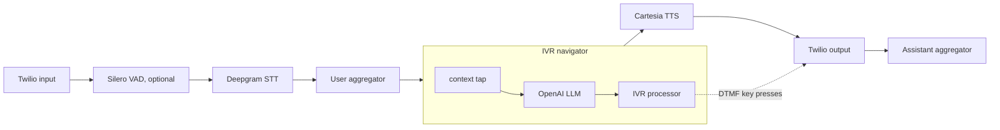

# IVR navigator

This recipe places an outbound call to a business, works through its phone menu by pressing keys, and talks to the person at the end. You get a complete program built on `src/extensions/ivr`, the commands to run it, and a walk-through of how the navigator decides what to do.

## What you build

An **IVR** (interactive voice response) is the automated "press 1 for billing" menu of a phone line. The program dials a pharmacy, tells the navigator its goal ("find out whether prescription 48213 is ready"), and lets the LLM pick menu options. When a human answers, the bot switches to a normal conversation and asks its question.



Terms used on this page: **STT** is speech-to-text, **TTS** is text-to-speech, **VAD** (voice activity detection) decides when the other side starts and stops talking, and **DTMF** tones are the sounds a phone keypad makes.

## Before you begin

- Everything from the [outbound call recipe](outbound-call-with-voicemail.md#before-you-begin): a Twilio number, a tunnel, `PUBLIC_HOST`, `TWILIO_ACCOUNT_SID`, `TWILIO_AUTH_TOKEN`, `TWILIO_FROM_NUMBER`, `DEEPGRAM_API_KEY`, `OPENAI_API_KEY`, `CARTESIA_API_KEY`, `CARTESIA_VOICE_ID`.
- Optional: the ONNX worker running and `ONNX_WORKER_SOCK` set, so the navigator can lengthen the VAD pause while it listens to menus. See [Turn-taking](../guides/turn-taking.md) and [Deployment](../guides/deployment.md).
- A phone line you are allowed to call for testing.

> [!NOTE]
> `src/extensions/ivr` has no tests in the repository, and Twilio media streams have no native DTMF message, so key presses are sent as in-band audio tones. Check that the target IVR accepts them.

## The code

```go
package main

import (
	"context"
	"encoding/json"
	"flag"
	"fmt"
	"io"
	"log"
	"net"
	"net/http"
	"net/url"
	"os"
	"os/signal"
	"strings"
	"sync"
	"syscall"

	"github.com/square-key-labs/strawgo-ai/src/audio/vad"
	"github.com/square-key-labs/strawgo-ai/src/extensions/ivr"
	"github.com/square-key-labs/strawgo-ai/src/frames"
	"github.com/square-key-labs/strawgo-ai/src/llm"
	"github.com/square-key-labs/strawgo-ai/src/logger"
	"github.com/square-key-labs/strawgo-ai/src/pipeline"
	"github.com/square-key-labs/strawgo-ai/src/processors"
	"github.com/square-key-labs/strawgo-ai/src/processors/aggregators"
	"github.com/square-key-labs/strawgo-ai/src/serializers"
	"github.com/square-key-labs/strawgo-ai/src/services/cartesia"
	"github.com/square-key-labs/strawgo-ai/src/services/deepgram"
	"github.com/square-key-labs/strawgo-ai/src/services/openai"
	"github.com/square-key-labs/strawgo-ai/src/transports"
)

const goal = "Reach the pharmacy department to ask whether prescription number 48213 for Alex Kim is ready for pickup."

const humanPrompt = `You are calling a pharmacy on behalf of Alex Kim.
Ask whether prescription number 48213 is ready for pickup and when the pharmacy closes today.
Thank the person and say goodbye once you have the answer. Keep every reply to one short sentence.`

type config struct {
	accountSID, authToken, from string
	publicHost                  string
	deepgram, openai, cartesia  string
	voiceID, vadSocket          string
}

func main() {
	to := flag.String("to", "", "number to call, E.164")
	flag.Parse()
	if *to == "" {
		log.Fatal("-to is required")
	}
	logger.Init()
	cfg := config{
		accountSID: mustEnv("TWILIO_ACCOUNT_SID"),
		authToken:  mustEnv("TWILIO_AUTH_TOKEN"),
		from:       mustEnv("TWILIO_FROM_NUMBER"),
		publicHost: mustEnv("PUBLIC_HOST"),
		deepgram:   mustEnv("DEEPGRAM_API_KEY"),
		openai:     mustEnv("OPENAI_API_KEY"),
		cartesia:   mustEnv("CARTESIA_API_KEY"),
		voiceID:    mustEnv("CARTESIA_VOICE_ID"),
		vadSocket:  os.Getenv("ONNX_WORKER_SOCK"),
	}

	ctx, stop := signal.NotifyContext(context.Background(), os.Interrupt, syscall.SIGTERM)
	defer stop()
	ctx, finish := context.WithCancel(ctx)
	defer finish()
	var once sync.Once

	srv, err := transports.NewServer(transports.ServerConfig{
		Path: "/media",
		NewSerializer: func(*http.Request) serializers.FrameSerializer {
			return serializers.NewTwilioFrameSerializer(serializers.TwilioConfig{AccountSID: cfg.accountSID, AuthToken: cfg.authToken})
		},
		Handler: func(callCtx context.Context, s *transports.Session) error {
			defer once.Do(finish)
			return runCall(callCtx, s, cfg)
		},
	})
	if err != nil {
		log.Fatal(err)
	}
	ln, err := net.Listen("tcp", ":8080")
	if err != nil {
		log.Fatal(err)
	}
	serveErr := make(chan error, 1)
	go func() { serveErr <- srv.Serve(ctx, ln) }()

	twiml := fmt.Sprintf(`<Response><Connect><Stream url="wss://%s/media"/></Connect></Response>`, cfg.publicHost)
	sid, err := placeCall(ctx, cfg, *to, twiml)
	if err != nil {
		log.Fatal(err)
	}
	log.Printf("calling %s (call %s)", *to, sid)
	if err := <-serveErr; err != nil {
		log.Fatal(err)
	}
}

func placeCall(ctx context.Context, cfg config, to, twiml string) (string, error) {
	form := url.Values{"To": {to}, "From": {cfg.from}, "Twiml": {twiml}}
	endpoint := "https://api.twilio.com/2010-04-01/Accounts/" + cfg.accountSID + "/Calls.json"
	req, err := http.NewRequestWithContext(ctx, http.MethodPost, endpoint, strings.NewReader(form.Encode()))
	if err != nil {
		return "", err
	}
	req.SetBasicAuth(cfg.accountSID, cfg.authToken)
	req.Header.Set("Content-Type", "application/x-www-form-urlencoded")
	resp, err := http.DefaultClient.Do(req)
	if err != nil {
		return "", err
	}
	defer resp.Body.Close()
	if resp.StatusCode != http.StatusCreated {
		body, _ := io.ReadAll(io.LimitReader(resp.Body, 4096))
		return "", fmt.Errorf("twilio: HTTP %d: %s", resp.StatusCode, body)
	}
	var out struct {
		SID string `json:"sid"`
	}
	if err := json.NewDecoder(resp.Body).Decode(&out); err != nil {
		return "", err
	}
	return out.SID, nil
}

func runCall(ctx context.Context, s *transports.Session, cfg config) error {
	procs := []processors.FrameProcessor{s.Input()}
	if cfg.vadSocket != "" {
		analyzer, err := vad.NewSileroVADAnalyzer(16000, vad.DefaultVADParams(), cfg.vadSocket)
		if err != nil {
			return err
		}
		defer analyzer.Cleanup()
		procs = append(procs, vad.NewVADInputProcessor(analyzer))
	}

	stt := deepgram.NewSTTService(deepgram.STTConfig{APIKey: cfg.deepgram, Model: "nova-3", Language: "en"})
	llmSvc := openai.NewLLMService(openai.LLMConfig{APIKey: cfg.openai, Model: "gpt-4.1-mini"})
	tts := cartesia.NewTTSService(cartesia.TTSConfig{APIKey: cfg.cartesia, VoiceID: cfg.voiceID})

	var task *pipeline.PipelineTask
	toHuman := func(history []llm.Message, runLLM bool) {
		messages := append([]llm.Message{llm.Developer(humanPrompt)}, history...)
		if err := task.QueueFrame(frames.NewLLMMessagesUpdateFrame(messages, runLLM)); err != nil {
			log.Printf("switch to conversation: %v", err)
		}
	}
	nav := ivr.New(llmSvc, goal,
		ivr.OnConversationDetected(func(_ *ivr.Processor, history []llm.Message) {
			log.Printf("a person answered directly")
			toHuman(history, true)
		}),
		ivr.OnIVRStatusChanged(func(_ *ivr.Processor, status ivr.Status) {
			log.Printf("IVR status: %s", status)
			switch status {
			case ivr.StatusCompleted:
				toHuman(nil, false)
			case ivr.StatusStuck:
				_ = task.QueueFrame(frames.NewEndFrame())
			}
		}),
	)

	conversation := llm.NewContext()
	pair := aggregators.NewContextAggregatorPair(conversation, aggregators.ContextAggregatorPairParams{})
	procs = append(procs, stt, pair.User(), nav, tts, s.Output(), pair.Assistant())
	task = pipeline.NewPipelineTask(pipeline.NewPipeline(procs))

	err := task.Run(ctx)
	for _, m := range conversation.Messages() {
		log.Printf("%s: %s", m.Role, m.Text())
	}
	return err
}

func mustEnv(key string) string {
	v := os.Getenv(key)
	if v == "" {
		log.Fatalf("%s is required", key)
	}
	return v
}
```

## Run it

```sh
export TWILIO_ACCOUNT_SID=YOUR_TWILIO_ACCOUNT_SID
export TWILIO_AUTH_TOKEN=YOUR_TWILIO_AUTH_TOKEN
export TWILIO_FROM_NUMBER=+15550001111
export PUBLIC_HOST=YOUR_TUNNEL_HOST
export DEEPGRAM_API_KEY=YOUR_DEEPGRAM_API_KEY
export OPENAI_API_KEY=YOUR_OPENAI_API_KEY
export CARTESIA_API_KEY=YOUR_CARTESIA_API_KEY
export CARTESIA_VOICE_ID=YOUR_CARTESIA_VOICE_ID
go run . -to +15557654321
```

The program logs each IVR status change, prints the conversation when the call ends, and exits.

## How it works

**The navigator is a small pipeline.** `ivr.New(llmSvc, goal, …)` returns a `*ivr.Navigator`, which embeds a `*pipeline.Pipeline` of three processors: a tap that remembers the latest context, your LLM service, and the IVR processor. You place the navigator where the LLM would normally go.

**It starts by classifying.** When the pipeline starts, the IVR processor replaces the context with a classifier prompt. The LLM answers `<mode>ivr</mode>` or `<mode>conversation</mode>` after the first words it hears.

**In IVR mode it navigates.** The processor swaps in a navigation prompt built from your goal (`ivr.NavigationPrompt(goal)`), and asks the VAD for a 2-second stop time so long menu prompts are not cut into pieces. From then on the LLM answers with tags:

| LLM output | What the processor does |
| --- | --- |
| `<dtmf>1</dtmf>` | pushes an urgent DTMF frame to the transport output |
| `<ivr>wait</ivr>` | nothing; waits for more of the menu |
| `<ivr>completed</ivr>` | calls your status handler with `StatusCompleted` |
| `<ivr>stuck</ivr>` | calls your status handler with `StatusStuck` |
| plain text | spoken through TTS, for menus that ask for a spoken answer |

Tags are stripped before TTS, so the caller never hears them, and a copy is kept in the context so the LLM remembers what it pressed.

**Your handlers switch to a conversation.** When a person answers straight away, `OnConversationDetected` receives the history and the code replaces the context with the human prompt plus that history, and asks the LLM to reply. When the IVR reports `completed`, the code installs the human prompt without running the LLM, so the bot waits for the agent to speak first. `stuck` ends the call.

## Variations

Keep the conversation VAD settings separate from the IVR ones:

```go
func newNavigator(llmSvc *llmservice.Service) *ivr.Navigator {
	return ivr.New(llmSvc, "Reach billing support.",
		ivr.WithIVRVADParams(frames.VADParams{StopSecs: 2.5}),
		ivr.WithConversationVADParams(frames.VADParams{StopSecs: 0.8}),
	)
}
```

Combine with voicemail detection by putting the voicemail detector before the user aggregator and its gate after TTS, exactly as in the [outbound call recipe](outbound-call-with-voicemail.md):

```go
func outboundProcessors(s *transports.Session, stt, tts processors.FrameProcessor, vm *voicemail.VoicemailDetector, pair *aggregators.ContextAggregatorPair, nav *ivr.Navigator) []processors.FrameProcessor {
	return []processors.FrameProcessor{
		s.Input(), stt, vm.Detector(), pair.User(), nav, tts, vm.Gate(), s.Output(), pair.Assistant(),
	}
}
```

## Next steps

- [IVR navigation guide](../guides/ivr-navigation.md): prompts, status values and VAD tuning.
- [Telephony providers](../guides/telephony-providers.md): which transports send DTMF natively.
- [Outbound call with voicemail](outbound-call-with-voicemail.md): the call-placing code explained.
- [Turn-taking](../guides/turn-taking.md): VAD parameters in depth.
