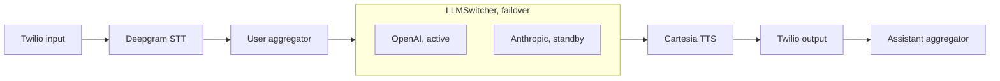

# LLM failover

This recipe keeps a phone bot answering when its main LLM provider returns errors, by switching to a second provider automatically. You get a complete program with OpenAI as the primary and Anthropic as the backup, the commands to run it, and an explanation of how the switcher routes frames.

## What you build

A Twilio voice bot whose LLM slot holds two services behind a `pipeline.LLMSwitcher`. Only the active one receives requests. When it reports a non-fatal error, the failover strategy makes the next one active and the switcher sends it the request that failed.



Terms used on this page: **STT** is speech-to-text, **TTS** is text-to-speech, a **frame** is a message flowing through the **pipeline**, and an **error frame** is how a processor reports a failure; it is **fatal** when the pipeline cannot continue.

## Before you begin

- Go 1.25 or newer and the module set up as in [Installation](../getting-started/installation.md).
- A Twilio number and a tunnel, as in [Your first phone bot](../getting-started/first-phone-bot.md).
- API keys: `DEEPGRAM_API_KEY`, `OPENAI_API_KEY`, `ANTHROPIC_API_KEY`, `CARTESIA_API_KEY`, `CARTESIA_VOICE_ID`.

## The code

```go
package main

import (
	"context"
	"log"
	"net/http"
	"os"
	"os/signal"
	"syscall"
	"time"

	"github.com/square-key-labs/strawgo-ai/src/frames"
	"github.com/square-key-labs/strawgo-ai/src/llm"
	"github.com/square-key-labs/strawgo-ai/src/logger"
	"github.com/square-key-labs/strawgo-ai/src/pipeline"
	"github.com/square-key-labs/strawgo-ai/src/processors"
	"github.com/square-key-labs/strawgo-ai/src/processors/aggregators"
	"github.com/square-key-labs/strawgo-ai/src/serializers"
	"github.com/square-key-labs/strawgo-ai/src/services/anthropic"
	"github.com/square-key-labs/strawgo-ai/src/services/cartesia"
	"github.com/square-key-labs/strawgo-ai/src/services/deepgram"
	"github.com/square-key-labs/strawgo-ai/src/services/llmservice"
	"github.com/square-key-labs/strawgo-ai/src/services/openai"
	"github.com/square-key-labs/strawgo-ai/src/services/openaicompat"
	"github.com/square-key-labs/strawgo-ai/src/transports"
)

const systemPrompt = "You are a friendly phone assistant for a bike shop. Answer in one or two short sentences without lists or markdown."

var tools = llm.Tools{Functions: []llm.FunctionSchema{{
	Name:        "opening_hours",
	Description: "Opening hours of the shop.",
	Properties:  map[string]any{},
}}}

func main() {
	logger.Init()
	srv, err := transports.NewServer(transports.ServerConfig{
		Addr: ":8080",
		Path: "/media",
		NewSerializer: func(*http.Request) serializers.FrameSerializer {
			return serializers.NewTwilioFrameSerializer(serializers.TwilioConfig{
				AccountSID: os.Getenv("TWILIO_ACCOUNT_SID"),
				AuthToken:  os.Getenv("TWILIO_AUTH_TOKEN"),
			})
		},
		Handler: runCall,
	})
	if err != nil {
		log.Fatal(err)
	}
	ctx, stop := signal.NotifyContext(context.Background(), os.Interrupt, syscall.SIGTERM)
	defer stop()
	if err := srv.ListenAndServe(ctx); err != nil {
		log.Fatal(err)
	}
}

func runCall(ctx context.Context, s *transports.Session) error {
	stt := deepgram.NewSTTService(deepgram.STTConfig{APIKey: os.Getenv("DEEPGRAM_API_KEY"), Model: "nova-3", Language: "en"})
	primary := openai.NewLLMService(openai.LLMConfig{
		APIKey:       os.Getenv("OPENAI_API_KEY"),
		Model:        "gpt-4.1-mini",
		SystemPrompt: systemPrompt,
		Retry:        openaicompat.RetryPolicy{MaxAttempts: 2, FirstByteTimeout: 4 * time.Second},
	})
	backup := anthropic.NewLLMService(anthropic.LLMConfig{
		APIKey:       os.Getenv("ANTHROPIC_API_KEY"),
		SystemPrompt: systemPrompt,
		MaxTokens:    512,
	})
	switcher := pipeline.NewLLMSwitcher([]*llmservice.Service{primary, backup}, pipeline.FailoverSwitchStrategy{ReplayFailedTurn: true})
	switcher.RegisterFunction("opening_hours", func(context.Context, llm.FunctionCallParams) (llm.FunctionResult, error) {
		return llm.FunctionResult{Value: "Monday to Saturday, 9am to 6pm"}, nil
	})
	tts := cartesia.NewTTSService(cartesia.TTSConfig{APIKey: os.Getenv("CARTESIA_API_KEY"), VoiceID: os.Getenv("CARTESIA_VOICE_ID")})

	conversation := llm.NewContext()
	conversation.SetTools(tools)
	pair := aggregators.NewContextAggregatorPair(conversation, aggregators.ContextAggregatorPairParams{})
	task := pipeline.NewPipelineTask(pipeline.NewPipeline([]processors.FrameProcessor{
		s.Input(), stt, pair.User(), switcher, tts, s.Output(), pair.Assistant(),
	}))

	switcher.OnServiceSwitched(func(active processors.FrameProcessor) {
		log.Printf("call %s: LLM is now %s", s.CallInfo().CallID, active.Name())
	})

	if err := task.QueueFrame(frames.NewTTSSpeakFrame("Spoke and Chain, how can I help?")); err != nil {
		return err
	}
	return task.Run(ctx)
}
```

## Run it

```sh
export DEEPGRAM_API_KEY=YOUR_DEEPGRAM_API_KEY
export OPENAI_API_KEY=YOUR_OPENAI_API_KEY
export ANTHROPIC_API_KEY=YOUR_ANTHROPIC_API_KEY
export CARTESIA_API_KEY=YOUR_CARTESIA_API_KEY
export CARTESIA_VOICE_ID=YOUR_CARTESIA_VOICE_ID
go run .
```

To see a failover without waiting for an outage, start the program with an invalid OpenAI key (`export OPENAI_API_KEY=invalid`). The first reply fails with an authentication error, the log shows `LLM is now Anthropic`, and the backup answers.

## How it works

**Both services share one slot.** `pipeline.NewLLMSwitcher` wraps the services in a `ServiceSwitcher`. Lifecycle frames such as start and end go to every service, so both connect and shut down with the call. Every other frame goes only to the active service, which is the first one in the list at the start.

**Errors trigger the switch.** When the active service pushes a non-fatal `ErrorFrame`, the switcher asks the strategy what to do. `FailoverSwitchStrategy` returns the next service in the list, wrapping around, so a failing backup hands back to the primary. The switcher swallows the error, so the task does not see it. Fatal errors are passed on unchanged. Errors from an inactive service are dropped.

**The failed turn is answered again.** With `ReplayFailedTurn`, the switcher remembers every context it sends to each service, in order. When a service fails, the switcher sends the context of the request that failed, which already holds the caller's message, to the active service. If a later request for the same conversation is still queued, the switcher leaves the turn to that request instead, so the turn is answered once. Each failed request is replayed once, and a request is never replayed after every service in the list has tried it, so a list where every provider is down stops instead of looping. An interruption clears the remembered context. `OnServiceSwitched` only logs the switch here. If the primary had started streaming before it failed, the request is not replayed, so the caller hears only the part the primary produced.

**Retries happen before failover.** `Retry` on the OpenAI config retries a request once when the connection fails or no byte arrives within 4 seconds. Only when that also fails does the service push an error and trigger the switch.

**Functions are registered on both.** `switcher.RegisterFunction` registers the handler on every service, so a tool call works whichever LLM is active.

## Variations

Switch manually, for example from an admin endpoint, with a `ManuallySwitchServiceFrame`:

```go
func useBackup(task *pipeline.PipelineTask, backup *llmservice.Service) error {
	return task.QueueFrame(frames.NewManuallySwitchServiceFrame(backup))
}
```

Change a setting on every LLM in the switcher, not only the active one:

```go
func setTemperatureEverywhere(task *pipeline.PipelineTask, t float64) error {
	f := frames.NewLLMUpdateSettingsFrame(llm.Settings{Temperature: &t})
	f.ReachInactiveServices = true
	return task.QueueFrame(f)
}
```

Use Groq as a third fallback; the strategy moves through the list in order:

```go
func threeWay(primary, backup *llmservice.Service, groqKey string) *pipeline.LLMSwitcher {
	third := groq.NewLLMService(groq.LLMConfig{APIKey: groqKey})
	return pipeline.NewLLMSwitcher([]*llmservice.Service{primary, backup, third}, pipeline.FailoverSwitchStrategy{ReplayFailedTurn: true})
}
```

## Next steps

- [Switching services guide](../guides/switching-services.md): `ServiceSwitcher` for STT and TTS too.
- [LLM providers](../providers/llm.md): retry policy fields and every LLM constructor.
- [Errors reference](../reference/errors.md): fatal and non-fatal errors.
- [Metrics dashboard](metrics-dashboard.md): track how often each LLM answers.
