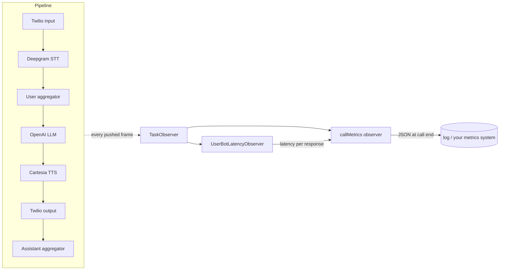

# Metrics dashboard

This recipe collects per-call metrics from a phone bot (response latency, time to first byte per service, token and character usage) and logs one JSON summary when each call ends. You get a complete observer you can point at your own metrics system, and notes on where Prometheus or OpenTelemetry would plug in.

## What you build

An **observer** is an object the pipeline task calls for every frame that moves between processors, without being part of the pipeline itself. This recipe's observer picks out `MetricsFrame`s, aggregates them per call, combines them with the user-to-bot latency from `observers.UserBotLatencyObserver`, and prints a summary like this when the call ends:

```json
{
  "call_id": "CA0123456789abcdef0123456789abcdef",
  "duration_ms": 48211,
  "responses": 6,
  "response_latency_ms": {"count": 6, "avg_ms": 912, "max_ms": 1430},
  "ttfb_ms": {
    "CartesiaTTS": {"count": 7, "avg_ms": 201, "max_ms": 260},
    "DeepgramSTT": {"count": 6, "avg_ms": 288, "max_ms": 341},
    "OpenAI": {"count": 6, "avg_ms": 402, "max_ms": 655}
  },
  "processing_ms": {
    "CartesiaTTS": {"count": 7, "avg_ms": 640, "max_ms": 910},
    "OpenAI": {"count": 6, "avg_ms": 1180, "max_ms": 1902}
  },
  "llm_tokens": {"prompt": 3120, "completion": 214, "total": 3334},
  "tts_characters": 611,
  "stt_audio_seconds": 21.4
}
```

The numbers above only show the shape of the output; your values depend on your providers and network.



Terms used on this page: **STT** is speech-to-text, **TTS** is text-to-speech, a **frame** is a message flowing through the **pipeline**, and **TTFB** (time to first byte) is how long a service took to return the first piece of its answer.

## Before you begin

- Go 1.25 or newer and the module set up as in [Installation](../getting-started/installation.md).
- A Twilio number and a tunnel, as in [Your first phone bot](../getting-started/first-phone-bot.md).
- API keys: `DEEPGRAM_API_KEY`, `OPENAI_API_KEY`, `CARTESIA_API_KEY`, `CARTESIA_VOICE_ID`.

## The code

```go
package main

import (
	"context"
	"encoding/json"
	"log"
	"net/http"
	"os"
	"os/signal"
	"sync"
	"syscall"
	"time"

	"github.com/square-key-labs/strawgo-ai/src/frames"
	"github.com/square-key-labs/strawgo-ai/src/llm"
	"github.com/square-key-labs/strawgo-ai/src/logger"
	"github.com/square-key-labs/strawgo-ai/src/pipeline"
	"github.com/square-key-labs/strawgo-ai/src/pipeline/observers"
	"github.com/square-key-labs/strawgo-ai/src/processors"
	"github.com/square-key-labs/strawgo-ai/src/processors/aggregators"
	"github.com/square-key-labs/strawgo-ai/src/serializers"
	"github.com/square-key-labs/strawgo-ai/src/services/cartesia"
	"github.com/square-key-labs/strawgo-ai/src/services/deepgram"
	"github.com/square-key-labs/strawgo-ai/src/services/openai"
	"github.com/square-key-labs/strawgo-ai/src/transports"
)

type stat struct {
	count int
	total time.Duration
	max   time.Duration
}

func (s *stat) add(d time.Duration) {
	s.count++
	s.total += d
	if d > s.max {
		s.max = d
	}
}

type statJSON struct {
	Count int   `json:"count"`
	AvgMs int64 `json:"avg_ms"`
	MaxMs int64 `json:"max_ms"`
}

func (s *stat) json() statJSON {
	if s.count == 0 {
		return statJSON{}
	}
	return statJSON{Count: s.count, AvgMs: (s.total / time.Duration(s.count)).Milliseconds(), MaxMs: s.max.Milliseconds()}
}

type summary struct {
	CallID          string              `json:"call_id"`
	DurationMs      int64               `json:"duration_ms"`
	Responses       int                 `json:"responses"`
	ResponseLatency statJSON            `json:"response_latency_ms"`
	TTFB            map[string]statJSON `json:"ttfb_ms"`
	Processing      map[string]statJSON `json:"processing_ms"`
	LLMTokens       tokens              `json:"llm_tokens"`
	TTSCharacters   int                 `json:"tts_characters"`
	STTAudioSeconds float64             `json:"stt_audio_seconds"`
}

type tokens struct {
	Prompt     int `json:"prompt"`
	Completion int `json:"completion"`
	Total      int `json:"total"`
}

type callMetrics struct {
	callID string
	report func(summary)

	mu         sync.Mutex
	started    time.Time
	seen       map[uint64]struct{}
	latency    stat
	ttfb       map[string]*stat
	processing map[string]*stat
	usage      llm.Usage
	ttsChars   int
	sttSeconds float64
}

func newCallMetrics(callID string, report func(summary)) *callMetrics {
	return &callMetrics{
		callID:     callID,
		report:     report,
		seen:       map[uint64]struct{}{},
		ttfb:       map[string]*stat{},
		processing: map[string]*stat{},
	}
}

func (m *callMetrics) Interested(frame frames.Frame, _ frames.FrameDirection, kind pipeline.EventKind) bool {
	_, ok := frame.(*frames.MetricsFrame)
	return ok && kind == pipeline.PushEvent
}

func (m *callMetrics) OnProcessFrame(pipeline.ProcessFrameEvent) {}

func (m *callMetrics) OnPipelineStarted() {
	m.mu.Lock()
	m.started = time.Now()
	m.mu.Unlock()
}

func (m *callMetrics) OnPushFrame(event pipeline.PushFrameEvent) {
	f, ok := event.Frame.(*frames.MetricsFrame)
	if !ok {
		return
	}
	m.mu.Lock()
	defer m.mu.Unlock()
	if _, dup := m.seen[f.ID()]; dup {
		return
	}
	m.seen[f.ID()] = struct{}{}
	for _, d := range f.Data {
		switch v := d.(type) {
		case frames.TTFBMetricsData:
			statFor(m.ttfb, v.Processor).add(v.Value)
		case frames.ProcessingMetricsData:
			statFor(m.processing, v.Processor).add(v.Value)
		case frames.LLMUsageMetricsData:
			m.usage.PromptTokens += v.Value.PromptTokens
			m.usage.CompletionTokens += v.Value.CompletionTokens
			m.usage.TotalTokens += v.Value.TotalTokens
		case frames.TTSUsageMetricsData:
			m.ttsChars += v.Value
		case frames.STTUsageMetricsData:
			m.sttSeconds += v.Value.AudioSeconds
		}
	}
}

func (m *callMetrics) addLatency(d time.Duration) {
	m.mu.Lock()
	m.latency.add(d)
	m.mu.Unlock()
}

func (m *callMetrics) OnPipelineStopped() {
	m.mu.Lock()
	s := summary{
		CallID:          m.callID,
		DurationMs:      time.Since(m.started).Milliseconds(),
		Responses:       m.latency.count,
		ResponseLatency: m.latency.json(),
		TTFB:            map[string]statJSON{},
		Processing:      map[string]statJSON{},
		LLMTokens:       tokens{Prompt: m.usage.PromptTokens, Completion: m.usage.CompletionTokens, Total: m.usage.TotalTokens},
		TTSCharacters:   m.ttsChars,
		STTAudioSeconds: m.sttSeconds,
	}
	for name, st := range m.ttfb {
		s.TTFB[name] = st.json()
	}
	for name, st := range m.processing {
		s.Processing[name] = st.json()
	}
	m.mu.Unlock()
	m.report(s)
}

func statFor(stats map[string]*stat, name string) *stat {
	st, ok := stats[name]
	if !ok {
		st = &stat{}
		stats[name] = st
	}
	return st
}

func logSummary(s summary) {
	data, err := json.Marshal(s)
	if err != nil {
		log.Printf("metrics: %v", err)
		return
	}
	log.Printf("call metrics %s", data)
}

func main() {
	logger.Init()
	srv, err := transports.NewServer(transports.ServerConfig{
		Addr: ":8080",
		Path: "/media",
		NewSerializer: func(*http.Request) serializers.FrameSerializer {
			return serializers.NewTwilioFrameSerializer(serializers.TwilioConfig{
				AccountSID: os.Getenv("TWILIO_ACCOUNT_SID"),
				AuthToken:  os.Getenv("TWILIO_AUTH_TOKEN"),
			})
		},
		Handler: runCall,
	})
	if err != nil {
		log.Fatal(err)
	}
	ctx, stop := signal.NotifyContext(context.Background(), os.Interrupt, syscall.SIGTERM)
	defer stop()
	if err := srv.ListenAndServe(ctx); err != nil {
		log.Fatal(err)
	}
}

func runCall(ctx context.Context, s *transports.Session) error {
	stt := deepgram.NewSTTService(deepgram.STTConfig{APIKey: os.Getenv("DEEPGRAM_API_KEY"), Model: "nova-3", Language: "en"})
	llmSvc := openai.NewLLMService(openai.LLMConfig{
		APIKey:       os.Getenv("OPENAI_API_KEY"),
		Model:        "gpt-4.1-mini",
		SystemPrompt: "You are a friendly phone assistant. Answer in one or two short sentences.",
	})
	tts := cartesia.NewTTSService(cartesia.TTSConfig{APIKey: os.Getenv("CARTESIA_API_KEY"), VoiceID: os.Getenv("CARTESIA_VOICE_ID")})

	conversation := llm.NewContext()
	pair := aggregators.NewContextAggregatorPair(conversation, aggregators.ContextAggregatorPairParams{})
	cfg := pipeline.DefaultPipelineTaskConfig()
	cfg.EnableMetrics = true
	cfg.EnableUsageMetrics = true
	task := pipeline.NewPipelineTaskWithConfig(pipeline.NewPipeline([]processors.FrameProcessor{
		s.Input(), stt, pair.User(), llmSvc, tts, s.Output(), pair.Assistant(),
	}), cfg)

	callID := s.CallInfo().CallID
	if callID == "" {
		callID = s.ID()
	}
	metrics := newCallMetrics(callID, logSummary)
	latency := observers.NewUserBotLatencyObserver()
	latency.OnLatencyMeasured(metrics.addLatency)
	obs := pipeline.NewTaskObserver()
	obs.AddObserver(metrics)
	obs.AddObserver(latency)
	task.SetObserver(obs)

	if err := task.QueueFrame(frames.NewTTSSpeakFrame("Hello! How can I help?")); err != nil {
		return err
	}
	return task.Run(ctx)
}
```

## Run it

```sh
export DEEPGRAM_API_KEY=YOUR_DEEPGRAM_API_KEY
export OPENAI_API_KEY=YOUR_OPENAI_API_KEY
export CARTESIA_API_KEY=YOUR_CARTESIA_API_KEY
export CARTESIA_VOICE_ID=YOUR_CARTESIA_VOICE_ID
go run .
```

Point your Twilio number at `wss://YOUR_TUNNEL_HOST/media`, have a short conversation, hang up, and look for the `call metrics` line in the log. Pipe the log through `grep 'call metrics' | sed 's/.*call metrics //' | jq .` to read it.

## How it works

**Metrics are frames.** With `EnableMetrics` on, services push a `MetricsFrame` carrying `TTFBMetricsData` and `ProcessingMetricsData`. With `EnableUsageMetrics` on, they add `LLMUsageMetricsData` (tokens), `TTSUsageMetricsData` (characters) and `STTUsageMetricsData` (seconds of audio). Each entry names the processor that measured it in `Processor`.

**One frame is seen many times.** A metrics frame is pushed from processor to processor down the pipeline, and the observer hears every push. The observer remembers frame IDs and counts each frame once.

**`Interested` keeps the observer cheap.** Implementing `pipeline.SelectiveObserver` means the task only queues the events you want, here push events of metrics frames, instead of every audio chunk.

**Latency comes from a built-in observer.** `UserBotLatencyObserver` measures from the moment the caller stops speaking to the first bot audio, once per response. Its callback feeds the same aggregator. `OnLatencyBreakdown` gives a per-service breakdown if you need more detail.

**The summary is written at the end.** The task calls `OnPipelineStopped` on each observer after the pipeline finishes, and delivers events to each observer in order, so every metric of the call has been counted by then.

**Where Prometheus or OpenTelemetry plug in.** The `report` function is the only place that knows where the numbers go. To export to Prometheus, replace `logSummary` with a function that observes `ResponseLatency` and `TTFB` into histograms labelled by processor, and serve them from the same process. For traces, Strawgo already ships an OpenTelemetry observer, `tracing.NewObserver` in `src/tracing`, which creates conversation, turn and service spans from a `trace.Tracer` you configure; see the [observability guide](../guides/observability.md). Neither needs changes to the pipeline.

## Variations

Log every metric as it arrives instead of a summary, using the built-in logger (it logs at debug level):

```go
func addMetricsLog(obs *pipeline.TaskObserver) {
	logger.SetLevel(logger.DEBUG)
	obs.AddObserver(observers.NewMetricsLogObserver())
}
```

Report only the first TTFB of each service per call:

```go
func firstTTFBOnly() *pipeline.PipelineTaskConfig {
	cfg := pipeline.DefaultPipelineTaskConfig()
	cfg.EnableMetrics = true
	cfg.ReportOnlyInitialTTFB = true
	return cfg
}
```

Log a per-service breakdown of each response's latency:

```go
func logBreakdowns(latency *observers.UserBotLatencyObserver) {
	latency.OnLatencyBreakdown(func(bd observers.LatencyBreakdown) {
		log.Printf("response latency %v:\n  %s", bd.Total.Round(time.Millisecond), strings.Join(bd.Lines(true), "\n  "))
	})
}
```

## Next steps

- [Observability guide](../guides/observability.md): metrics frames, observers and OpenTelemetry tracing.
- [Observers reference](../reference/observers.md): every built-in observer.
- [Call recording and transcript](call-recording-and-transcript.md): save the call next to its metrics.
- [LLM failover](llm-failover.md): see which LLM answered in the TTFB keys.
