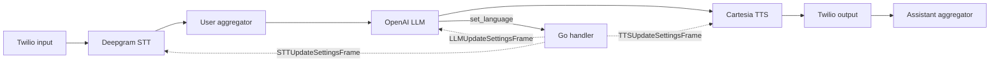

# Multilingual bot

This recipe builds a phone bot that switches its listening language, speaking language and voice in the middle of a call when the caller asks for another language. You get a complete program, the commands to run it, and an explanation of the three settings-update frames that make the switch.

## What you build

The caller says "¿Puedo hablar en español?". The LLM calls a `set_language` function; the function tells Deepgram to transcribe Spanish, tells Cartesia to speak Spanish with a Spanish voice, and tells the LLM to answer in Spanish. The conversation continues in the new language.



Terms used on this page: **STT** is speech-to-text, **TTS** is text-to-speech, a **frame** is a message flowing through the **pipeline**, and **function calling** lets the LLM run a Go function by name.

## Before you begin

- Go 1.26 or newer and the module set up as in [Installation](../getting-started/installation.md).
- A Twilio number and a tunnel, as in [Your first phone bot](../getting-started/first-phone-bot.md).
- API keys: `DEEPGRAM_API_KEY`, `OPENAI_API_KEY`, `CARTESIA_API_KEY`.
- One Cartesia voice ID per language you support: `CARTESIA_VOICE_EN`, `CARTESIA_VOICE_ES`, `CARTESIA_VOICE_FR`, `CARTESIA_VOICE_DE`. Pick voices meant for each language in the Cartesia dashboard.

> [!NOTE]
> Strawgo does not detect the caller's language for you in this pipeline. The switch happens when the LLM decides to call `set_language`. Deepgram reconnects its websocket to change language, and Cartesia uses the new language and voice from the next sentence it synthesises. Whether a vendor honours a given language code is up to the vendor; neither integration has been verified against the live API.

## The code

```go
package main

import (
	"context"
	"fmt"
	"log"
	"net/http"
	"os"
	"os/signal"
	"syscall"

	"github.com/square-key-labs/strawgo-ai/src/frames"
	"github.com/square-key-labs/strawgo-ai/src/llm"
	"github.com/square-key-labs/strawgo-ai/src/logger"
	"github.com/square-key-labs/strawgo-ai/src/pipeline"
	"github.com/square-key-labs/strawgo-ai/src/processors"
	"github.com/square-key-labs/strawgo-ai/src/processors/aggregators"
	"github.com/square-key-labs/strawgo-ai/src/serializers"
	"github.com/square-key-labs/strawgo-ai/src/services/cartesia"
	"github.com/square-key-labs/strawgo-ai/src/services/deepgram"
	"github.com/square-key-labs/strawgo-ai/src/services/openai"
	"github.com/square-key-labs/strawgo-ai/src/transports"
)

type language struct {
	Name  string
	Voice string
}

var languages = map[string]language{
	"en": {Name: "English", Voice: os.Getenv("CARTESIA_VOICE_EN")},
	"es": {Name: "Spanish", Voice: os.Getenv("CARTESIA_VOICE_ES")},
	"fr": {Name: "French", Voice: os.Getenv("CARTESIA_VOICE_FR")},
	"de": {Name: "German", Voice: os.Getenv("CARTESIA_VOICE_DE")},
}

const basePrompt = `You are the front desk of Hotel Lumen on a phone call. Keep every reply to one or two short sentences, without lists or markdown.
If the caller speaks or asks for Spanish, French, German or English and it is not the current language, call set_language first.`

func promptFor(code string) string {
	return basePrompt + fmt.Sprintf("\nThe current language is %s. Always reply in %s.", languages[code].Name, languages[code].Name)
}

var tools = llm.Tools{Functions: []llm.FunctionSchema{{
	Name:        "set_language",
	Description: "Switch the conversation to another language.",
	Properties: map[string]any{
		"language": map[string]any{"type": "string", "enum": []string{"en", "es", "fr", "de"}},
	},
	Required: []string{"language"},
}}}

func main() {
	logger.Init()
	for code, l := range languages {
		if l.Voice == "" {
			log.Fatalf("set a Cartesia voice for %s (%s)", l.Name, code)
		}
	}
	srv, err := transports.NewServer(transports.ServerConfig{
		Addr: ":8080",
		Path: "/media",
		NewSerializer: func(*http.Request) serializers.FrameSerializer {
			return serializers.NewTwilioFrameSerializer(serializers.TwilioConfig{
				AccountSID: os.Getenv("TWILIO_ACCOUNT_SID"),
				AuthToken:  os.Getenv("TWILIO_AUTH_TOKEN"),
			})
		},
		Handler: runCall,
	})
	if err != nil {
		log.Fatal(err)
	}
	ctx, stop := signal.NotifyContext(context.Background(), os.Interrupt, syscall.SIGTERM)
	defer stop()
	if err := srv.ListenAndServe(ctx); err != nil {
		log.Fatal(err)
	}
}

func runCall(ctx context.Context, s *transports.Session) error {
	stt := deepgram.NewSTTService(deepgram.STTConfig{APIKey: os.Getenv("DEEPGRAM_API_KEY"), Model: "nova-3", Language: "en"})
	llmSvc := openai.NewLLMService(openai.LLMConfig{APIKey: os.Getenv("OPENAI_API_KEY"), Model: "gpt-4.1-mini", SystemPrompt: promptFor("en")})
	tts := cartesia.NewTTSService(cartesia.TTSConfig{
		APIKey:   os.Getenv("CARTESIA_API_KEY"),
		VoiceID:  languages["en"].Voice,
		Language: "en",
	})

	conversation := llm.NewContext()
	conversation.SetTools(tools)
	pair := aggregators.NewContextAggregatorPair(conversation, aggregators.ContextAggregatorPairParams{})
	task := pipeline.NewPipelineTask(pipeline.NewPipeline([]processors.FrameProcessor{
		s.Input(), stt, pair.User(), llmSvc, tts, s.Output(), pair.Assistant(),
	}))

	llmSvc.RegisterFunction("set_language", func(ctx context.Context, p llm.FunctionCallParams) (llm.FunctionResult, error) {
		code, _ := p.Arguments["language"].(string)
		l, ok := languages[code]
		if !ok {
			return llm.FunctionResult{Value: map[string]any{"ok": false, "error": "unsupported language"}}, nil
		}
		err := task.QueueFrames([]frames.Frame{
			frames.NewSTTUpdateSettingsFrame(frames.STTSettings{Language: code}),
			frames.NewLLMUpdateSettingsFrame(llm.Settings{SystemInstruction: promptFor(code)}),
			frames.NewTTSUpdateSettingsFrame(frames.TTSSettings{Language: code, Voice: l.Voice}),
		})
		if err != nil {
			return llm.FunctionResult{}, err
		}
		log.Printf("call %s: switched to %s", s.CallInfo().CallID, l.Name)
		return llm.FunctionResult{Value: map[string]any{"ok": true, "language": l.Name}}, nil
	}, llm.FunctionOptions{CancelOnInterruption: false})

	if err := task.QueueFrame(frames.NewTTSSpeakFrame("Hotel Lumen, good evening. How can I help?")); err != nil {
		return err
	}
	return task.Run(ctx)
}
```

## Run it

```sh
export DEEPGRAM_API_KEY=YOUR_DEEPGRAM_API_KEY
export OPENAI_API_KEY=YOUR_OPENAI_API_KEY
export CARTESIA_API_KEY=YOUR_CARTESIA_API_KEY
export CARTESIA_VOICE_EN=YOUR_ENGLISH_VOICE_ID
export CARTESIA_VOICE_ES=YOUR_SPANISH_VOICE_ID
export CARTESIA_VOICE_FR=YOUR_FRENCH_VOICE_ID
export CARTESIA_VOICE_DE=YOUR_GERMAN_VOICE_ID
go run .
```

Point your Twilio number at `wss://YOUR_TUNNEL_HOST/media`, call it, and ask "Can we speak Spanish?".

## How it works

**Three frames, three services.** Each service type has its own settings frame, and each frame carries a delta: only the fields you set change.

| Frame | Consumed by | What changes here |
| --- | --- | --- |
| `STTUpdateSettingsFrame{Delta: STTSettings{Language}}` | the first STT service it reaches | Deepgram's `language` query parameter; the service reconnects its websocket |
| `LLMUpdateSettingsFrame{Delta: llm.Settings{SystemInstruction}}` | the first LLM service it reaches | the system prompt for the next request |
| `TTSUpdateSettingsFrame{Delta: TTSSettings{Language, Voice}}` | the first TTS service it reaches | Cartesia's `language` and voice ID for the next sentence |

**The frames are queued at the start of the pipeline.** `task.QueueFrames` puts them in order at the source, so the STT frame stops at Deepgram, the LLM frame at OpenAI and the TTS frame at Cartesia. They are uninterruptible control frames, so a barge-in does not drop them.

**The reply comes after the switch.** The function returns `ok: true`, and the LLM is asked again with the result. That second request needs a round trip through the context aggregators and the LLM, while the settings frames only need to travel down the pipeline, so they reach the TTS service ahead of the reply text.

**The handler is not cancelled by interruptions.** `CancelOnInterruption: false` makes sure the switch completes even if the caller keeps talking.

## Variations

Target one service explicitly when the pipeline has more than one STT or TTS, for example behind a service switcher:

```go
func switchOnly(task *pipeline.PipelineTask, target *cartesia.TTSService, voice string) error {
	f := frames.NewTTSUpdateSettingsFrame(frames.TTSSettings{Voice: voice})
	f.Service = target
	return task.QueueFrame(f)
}
```

Change speaking speed for callers who ask the bot to slow down:

```go
func slowDown(task *pipeline.PipelineTask) error {
	speed := 0.8
	return task.QueueFrame(frames.NewTTSUpdateSettingsFrame(frames.TTSSettings{Speed: &speed}))
}
```

Set the language directly on the services instead of with frames, for example from an HTTP admin endpoint that holds references to them:

```go
func setLanguageDirect(stt *deepgram.STTService, tts *cartesia.TTSService, code string) {
	stt.SetLanguage(code)
	tts.SetLanguage(code)
}
```

## Next steps

- [STT providers](../providers/stt.md#change-model-or-language-during-a-call): what each STT does on a settings change.
- [TTS providers](../providers/tts.md#change-voice-model-or-language-during-a-call): what each TTS does on a settings change.
- [Function calling guide](../guides/function-calling.md): handler options and results.
- [LLM failover](llm-failover.md): settings frames and inactive services.
