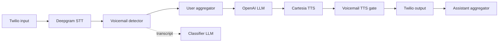

# Outbound call with voicemail detection

This recipe places an outbound reminder call with Twilio and decides whether a person or a voicemail system answered. If a person answers, the bot talks to them; if voicemail answers, the bot leaves a short message and hangs up.

## What you build

A command-line program that dials one number, streams the call into a Strawgo pipeline, and lets `src/extensions/voicemail` classify the first words it hears. The bot's speech is held back until the classifier has decided, so a voicemail greeting never hears half a conversation.



Terms used on this page: **STT** is speech-to-text, **TTS** is text-to-speech, a **frame** is a message flowing through the **pipeline**, and an **interruption** stops whatever the bot is saying.

## Before you begin

- Go 1.26 or newer and the module set up as in [Installation](../getting-started/installation.md).
- A Twilio account with a voice-capable number to call from, and a public tunnel to port 8080 (for example `ngrok http 8080`). Note its host name.
- API keys: `DEEPGRAM_API_KEY`, `OPENAI_API_KEY`, `CARTESIA_API_KEY`, `CARTESIA_VOICE_ID`.
- `TWILIO_ACCOUNT_SID`, `TWILIO_AUTH_TOKEN` and `TWILIO_FROM_NUMBER` (your Twilio number in E.164 form, for example `+15550001111`).
- Read the [voicemail detection guide](../guides/voicemail-detection.md) for the detector's options in full.

> [!NOTE]
> `src/extensions/voicemail` has no tests in the repository. Try it against your own voicemail before you rely on it.

## The code

```go
package main

import (
	"context"
	"encoding/json"
	"flag"
	"fmt"
	"html"
	"io"
	"log"
	"net"
	"net/http"
	"net/url"
	"os"
	"os/signal"
	"strings"
	"sync"
	"syscall"

	"github.com/square-key-labs/strawgo-ai/src/extensions/voicemail"
	"github.com/square-key-labs/strawgo-ai/src/frames"
	"github.com/square-key-labs/strawgo-ai/src/llm"
	"github.com/square-key-labs/strawgo-ai/src/logger"
	"github.com/square-key-labs/strawgo-ai/src/pipeline"
	"github.com/square-key-labs/strawgo-ai/src/processors"
	"github.com/square-key-labs/strawgo-ai/src/processors/aggregators"
	"github.com/square-key-labs/strawgo-ai/src/serializers"
	"github.com/square-key-labs/strawgo-ai/src/services/cartesia"
	"github.com/square-key-labs/strawgo-ai/src/services/deepgram"
	"github.com/square-key-labs/strawgo-ai/src/services/openai"
	"github.com/square-key-labs/strawgo-ai/src/transports"
)

type config struct {
	accountSID, authToken, from string
	publicHost                  string
	deepgram, openai, cartesia  string
	voiceID                     string
}

func main() {
	to := flag.String("to", "", "number to call, E.164, e.g. +15551234567")
	name := flag.String("name", "there", "name of the person you are calling")
	flag.Parse()
	if *to == "" {
		log.Fatal("-to is required")
	}
	logger.Init()
	cfg := config{
		accountSID: mustEnv("TWILIO_ACCOUNT_SID"),
		authToken:  mustEnv("TWILIO_AUTH_TOKEN"),
		from:       mustEnv("TWILIO_FROM_NUMBER"),
		publicHost: mustEnv("PUBLIC_HOST"),
		deepgram:   mustEnv("DEEPGRAM_API_KEY"),
		openai:     mustEnv("OPENAI_API_KEY"),
		cartesia:   mustEnv("CARTESIA_API_KEY"),
		voiceID:    mustEnv("CARTESIA_VOICE_ID"),
	}

	ctx, stop := signal.NotifyContext(context.Background(), os.Interrupt, syscall.SIGTERM)
	defer stop()
	ctx, finish := context.WithCancel(ctx)
	defer finish()
	var once sync.Once

	srv, err := transports.NewServer(transports.ServerConfig{
		Path: "/media",
		NewSerializer: func(*http.Request) serializers.FrameSerializer {
			return serializers.NewTwilioFrameSerializer(serializers.TwilioConfig{AccountSID: cfg.accountSID, AuthToken: cfg.authToken})
		},
		Handler: func(callCtx context.Context, s *transports.Session) error {
			defer once.Do(finish)
			return runCall(callCtx, s, cfg)
		},
	})
	if err != nil {
		log.Fatal(err)
	}
	ln, err := net.Listen("tcp", ":8080")
	if err != nil {
		log.Fatal(err)
	}
	serveErr := make(chan error, 1)
	go func() { serveErr <- srv.Serve(ctx, ln) }()

	twiml := fmt.Sprintf(`<Response><Connect><Stream url="wss://%s/media"><Parameter name="name" value="%s"/></Stream></Connect></Response>`,
		cfg.publicHost, html.EscapeString(*name))
	callSID, err := placeCall(ctx, cfg, *to, twiml)
	if err != nil {
		log.Fatal(err)
	}
	log.Printf("calling %s (call %s)", *to, callSID)
	if err := <-serveErr; err != nil {
		log.Fatal(err)
	}
}

func placeCall(ctx context.Context, cfg config, to, twiml string) (string, error) {
	form := url.Values{"To": {to}, "From": {cfg.from}, "Twiml": {twiml}}
	endpoint := "https://api.twilio.com/2010-04-01/Accounts/" + cfg.accountSID + "/Calls.json"
	req, err := http.NewRequestWithContext(ctx, http.MethodPost, endpoint, strings.NewReader(form.Encode()))
	if err != nil {
		return "", err
	}
	req.SetBasicAuth(cfg.accountSID, cfg.authToken)
	req.Header.Set("Content-Type", "application/x-www-form-urlencoded")
	resp, err := http.DefaultClient.Do(req)
	if err != nil {
		return "", err
	}
	defer resp.Body.Close()
	if resp.StatusCode != http.StatusCreated {
		body, _ := io.ReadAll(io.LimitReader(resp.Body, 4096))
		return "", fmt.Errorf("twilio: HTTP %d: %s", resp.StatusCode, body)
	}
	var out struct {
		SID string `json:"sid"`
	}
	if err := json.NewDecoder(resp.Body).Decode(&out); err != nil {
		return "", err
	}
	return out.SID, nil
}

func runCall(ctx context.Context, s *transports.Session, cfg config) error {
	name := s.CallInfo().CustomParameters["name"]
	stt := deepgram.NewSTTService(deepgram.STTConfig{APIKey: cfg.deepgram, Model: "nova-3", Language: "en"})
	llmSvc := openai.NewLLMService(openai.LLMConfig{
		APIKey: cfg.openai,
		Model:  "gpt-4.1-mini",
		SystemPrompt: "You are calling " + name + " from Bright Smile Dental to remind them of their check-up on Monday at 9am. " +
			"Confirm the time, answer briefly, and say goodbye. Keep every reply to one or two short sentences.",
	})
	tts := cartesia.NewTTSService(cartesia.TTSConfig{APIKey: cfg.cartesia, VoiceID: cfg.voiceID})
	classifier := openai.NewLLMService(openai.LLMConfig{APIKey: cfg.openai, Model: "gpt-4.1-mini"})

	var task *pipeline.PipelineTask
	message := "Hi " + name + ", this is Bright Smile Dental reminding you of your check-up on Monday at 9am. " +
		"Call us back if you need to change it. Goodbye!"
	vm, err := voicemail.New(classifier,
		voicemail.OnConversationDetected(func(*voicemail.Detector) {
			log.Printf("call %s: a person answered", s.CallInfo().CallID)
		}),
		voicemail.OnVoicemailDetected(func(d *voicemail.Detector) {
			log.Printf("call %s: voicemail, leaving a message", s.CallInfo().CallID)
			_ = d.PushFrame(frames.NewTTSSpeakFrame(message), frames.Downstream)
			_ = task.QueueFrame(frames.NewEndFrame())
		}),
	)
	if err != nil {
		return err
	}

	conversation := llm.NewContext()
	pair := aggregators.NewContextAggregatorPair(conversation, aggregators.ContextAggregatorPairParams{})
	task = pipeline.NewPipelineTask(pipeline.NewPipeline([]processors.FrameProcessor{
		s.Input(), stt, vm.Detector(), pair.User(), llmSvc, tts, vm.Gate(), s.Output(), pair.Assistant(),
	}))
	err = task.Run(ctx)
	log.Printf("call %s finished: %s", s.CallInfo().CallID, vm.Decision())
	return err
}

func mustEnv(key string) string {
	v := os.Getenv(key)
	if v == "" {
		log.Fatalf("%s is required", key)
	}
	return v
}
```

## Run it

```sh
export TWILIO_ACCOUNT_SID=YOUR_TWILIO_ACCOUNT_SID
export TWILIO_AUTH_TOKEN=YOUR_TWILIO_AUTH_TOKEN
export TWILIO_FROM_NUMBER=+15550001111
export PUBLIC_HOST=YOUR_TUNNEL_HOST
export DEEPGRAM_API_KEY=YOUR_DEEPGRAM_API_KEY
export OPENAI_API_KEY=YOUR_OPENAI_API_KEY
export CARTESIA_API_KEY=YOUR_CARTESIA_API_KEY
export CARTESIA_VOICE_ID=YOUR_CARTESIA_VOICE_ID
go run . -to +15551234567 -name Sam
```

Answer the phone and say "Hello?" to test the conversation path. Let it ring through to voicemail to test the message path. The program exits when the call ends.

## How it works

**The call is placed with Twilio's REST API.** `placeCall` posts to `Calls.json` with inline TwiML. The TwiML connects the answered call to `wss://PUBLIC_HOST/media` and passes the person's name as a stream `<Parameter>`. Strawgo exposes stream parameters in `s.CallInfo().CustomParameters`.

**The detector listens first.** `vm.Detector()` sits right after STT. While undecided it forwards every frame, and it also sends the transcript so far to the classifier LLM with a prompt that must answer `CONVERSATION` or `VOICEMAIL`. Any value with a `RunInference` method works as the classifier; here it is a second OpenAI service that is not in the pipeline.

**The gate holds the bot's audio.** `vm.Gate()` sits after TTS. Until there is a verdict it holds TTS output, so if the callee says "Hello?" the LLM can already prepare a reply. The detector decides after one second of silence following a transcript (`WithDecisionTimeout`); with no classifier answer by then it assumes a conversation.

**A person answers.** The gate releases the held audio and stays open, and `OnConversationDetected` runs. The call continues as a normal conversation.

**Voicemail answers.** The gate discards held audio, the detector broadcasts an interruption and from then on drops every non-system frame, so the greeting does not reach the LLM. After two seconds without speech (`WithVoicemailResponseDelay`) it calls `OnVoicemailDetected`. The handler pushes the message straight out of the detector with `d.PushFrame`, because a frame queued at the start of the pipeline would be dropped by the detector. It then queues an `EndFrame`, which the detector lets through; the Twilio output plays the message and hangs up.

## Variations

Use a cheaper classifier setting and give it more time:

```go
func newDetector(classifier voicemail.Classifier) (*voicemail.VoicemailDetector, error) {
	temperature := 0.0
	return voicemail.New(classifier,
		voicemail.WithClassifierSettings(llm.Settings{Model: "gpt-4.1-nano", Temperature: &temperature}),
		voicemail.WithClassifyTimeout(5*time.Second),
		voicemail.WithDecisionTimeout(1500*time.Millisecond),
	)
}
```

Wait longer for the beep before leaving the message:

```go
func patientDetector(classifier voicemail.Classifier, onVoicemail voicemail.Handler) (*voicemail.VoicemailDetector, error) {
	return voicemail.New(classifier,
		voicemail.WithVoicemailResponseDelay(4*time.Second),
		voicemail.OnVoicemailDetected(onVoicemail),
	)
}
```

Hang up without a message instead:

```go
func hangUpOnVoicemail(task *pipeline.PipelineTask) voicemail.Handler {
	return func(*voicemail.Detector) {
		_ = task.QueueFrame(frames.NewEndFrame())
	}
}
```

## Next steps

- [Voicemail detection guide](../guides/voicemail-detection.md): every option and the classifier prompt.
- [IVR navigator](ivr-navigator.md): when the call reaches a phone menu instead of a person.
- [Telephony with Twilio](../guides/telephony-twilio.md): TwiML, stream parameters and hang-up.
- [Metrics dashboard](metrics-dashboard.md): measure how long each call takes to decide.
