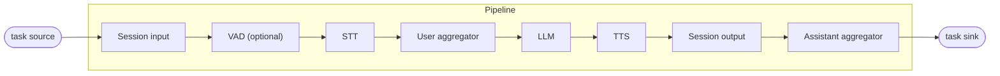
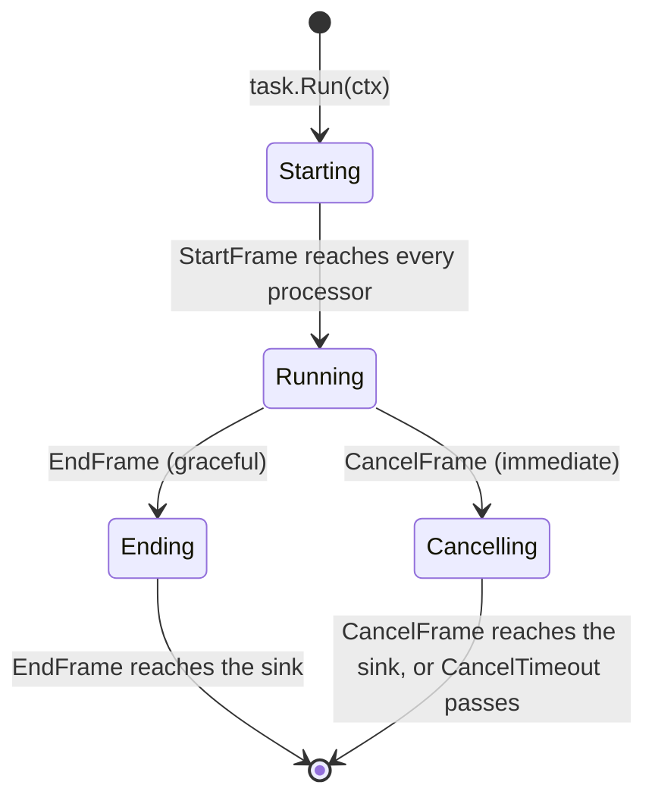
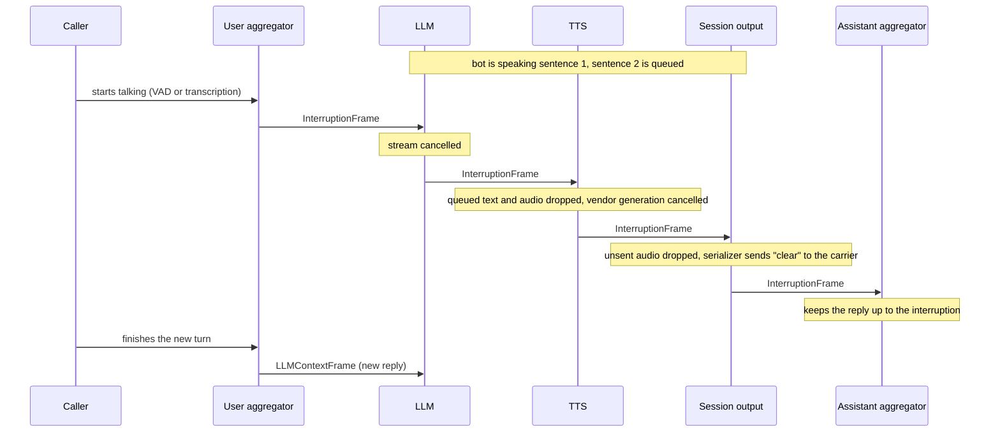

# Core concepts

This page explains the handful of ideas every Strawgo program is built from: frames, processors, pipelines, tasks, the conversation context, interruptions, function calls and metrics. Each idea comes with a small piece of code that compiles. When you finish, you can read any example in the repository and know what each line is for.

You do not need to read this before the [quickstart](quickstart.md), but it helps before you write your own processors. For the full engine internals, see [Architecture](../architecture.md).

## Frames

A frame is one unit of data moving through your bot. A chunk of caller audio is a frame (`AudioFrame`). So is a transcription (`TranscriptionFrame`), a piece of LLM output (`LLMTextFrame`), a chunk of synthesized speech (`TTSAudioFrame`), and a signal such as "the user started speaking" (`UserStartedSpeakingFrame`). All frame types live in the `frames` package and implement `frames.Frame`.

Every frame has one of three categories:

| Category | What it is for | How it is queued | Examples |
| --- | --- | --- | --- |
| System | Urgent signals | On a separate system queue, handled ahead of anything waiting | `StartFrame`, `CancelFrame`, `InterruptionFrame`, `ErrorFrame`, `UserStartedSpeakingFrame`, `MetricsFrame` |
| Control | Lifecycle steps and instructions that must stay in order with the data | On the data queue, in order | `EndFrame`, `LLMContextFrame`, `LLMFullResponseEndFrame`, `TTSStartedFrame`, `FunctionCallResultFrame` |
| Data | Payload: audio and text | On the data queue, in order | `AudioFrame`, `TTSAudioFrame`, `TextFrame`, `LLMTextFrame`, `TranscriptionFrame` |

`frames.IsSystem(f)` tells you whether a frame is a system frame.

Frames travel in one of two directions:

- Downstream (`frames.Downstream`): from the input toward the output. Audio, transcriptions, LLM text and TTS audio go this way.
- Upstream (`frames.Upstream`): back toward the input. Errors, requests to end the task (`EndTaskFrame`) and some notifications go this way.

The [frames reference](../reference/frames.md) lists every frame type.

## Processors

A processor receives frames, acts on the ones it cares about, and pushes frames on. The STT, LLM and TTS services, the context aggregators and the transport input and output are all processors. You write your own by embedding `*processors.BaseProcessor` and implementing `HandleFrame`.

This processor logs what the caller said and passes every frame on unchanged:

```go
type transcriptLogger struct {
	*processors.BaseProcessor
}

func newTranscriptLogger() *transcriptLogger {
	t := &transcriptLogger{}
	t.BaseProcessor = processors.NewBaseProcessor("TranscriptLogger", t)
	return t
}

func (t *transcriptLogger) HandleFrame(ctx context.Context, frame frames.Frame, direction frames.FrameDirection) error {
	if f, ok := frame.(*frames.TranscriptionFrame); ok {
		log.Printf("user said: %s", f.Text)
	}
	return t.PushFrame(frame, direction)
}
```

`processors.NewBaseProcessor` takes a name, used in logs, and the handler: the struct itself, so the base calls your `HandleFrame`. STT services send a `TranscriptionFrame` only for a final result; while the caller is still speaking they send partial results as separate `InterimTranscriptionFrame`s, which this processor ignores. `PushFrame(frame, direction)` sends the frame to the next processor in that direction.

Two rules matter:

1. Forward every frame you do not consume, including frames you do not recognise. A processor that swallows `EndFrame` stops the pipeline from ever finishing.
2. Never block forever in `HandleFrame`. Long work must honour `ctx`, as the [interruptions](#interruptions) section shows.

### The two queues

Each processor has two queues, each drained by its own goroutine:

- the system queue, for system frames;
- the data queue, for control and data frames, in order.

Because of this split, an `InterruptionFrame` is handled right away even if hundreds of audio frames are waiting. Queueing never blocks: the queues grow as needed, so a slow processor builds a backlog rather than slowing the one before it.

By default a processor handles one frame at a time, so your `HandleFrame` needs no locking for its own fields. The [processors reference](../reference/processors.md) describes the options that change this.

## Pipelines

A pipeline is an ordered chain of processors. `pipeline.NewPipeline` links them so that each one's downstream neighbour is the next in the list. A pipeline is itself a processor, so pipelines nest, and `ParallelPipeline` runs branches side by side.

The pipeline of a typical phone bot:



The assistant aggregator sits after the session output, so it records the reply as it is played rather than as the LLM wrote it. Upstream frames travel the same chain right to left.

## Tasks and their lifecycle

A task (`*pipeline.PipelineTask`) runs one pipeline: one conversation, usually one call. It adds a source before the first processor and a sink after the last, sends the start frame, lets your code inject frames, and decides when the run is over.



1. `task.Run(ctx)` starts every processor and queues a `StartFrame`. It carries the run's settings (sample rates, whether interruptions are allowed, whether metrics are on), and every processor reads them before it handles any data.
2. Frames you queued before `Run` follow right after the start frame.
3. The conversation runs.
4. The task finishes when an `EndFrame`, `StopFrame` or `CancelFrame` reaches the sink. `Run` then stops the processors and returns.

There are two ways to finish:

- **End gracefully.** An `EndFrame` is a control frame, so it waits behind everything already queued. The TTS finishes speaking, the output flushes its audio, and telephony serializers hang up. From outside the pipeline, call `task.StopWhenDone()` or queue `frames.NewEndFrame()`. From inside a processor, push `frames.NewEndTaskFrame(reason)` upstream; the task turns it into an `EndFrame`.
- **Cancel.** A `CancelFrame` is a system frame, so it overtakes everything. Cancelling the `ctx` you passed to `Run`, calling `task.Cancel()`, a fatal error, an idle timeout or a client disconnect all cancel the task.

Your code talks to a running task by queueing frames on it. This function makes the bot say goodbye and then end the call once the goodbye has been spoken:

```go
func sayAndHangUp(task *pipeline.PipelineTask) error {
	if err := task.QueueFrame(frames.NewTTSSpeakFrame("Thanks for calling. Goodbye!")); err != nil {
		return err
	}
	return task.QueueFrame(frames.NewEndFrame())
}
```

`task.QueueFrame` sends a frame downstream from the source by default; pass `frames.Upstream` as a second argument to send it the other way. `NewTTSSpeakFrame` asks the TTS to speak a fixed sentence without going through the LLM. Because the `EndFrame` is queued after it, the call ends only after the sentence has played.

`task.Done()` returns a channel closed when the task finishes. The [pipeline reference](../reference/pipeline.md) lists the task settings (`PipelineTaskConfig`) and callbacks.

## The conversation context

The conversation context (`*llm.Context`) holds everything the LLM needs: the messages so far, the tools it may call, and the tool choice. You create one with `llm.NewContext()` and hand it to `aggregators.NewContextAggregatorPair`, which returns two processors:

- the user aggregator, placed before the LLM, collects what the caller says in one turn, appends it as a user message, and pushes an `LLMContextFrame` that makes the LLM answer;
- the assistant aggregator, placed after the output, appends what the bot said, plus tool calls and their results.

**The single-writer rule.** While a pipeline runs, only these two aggregators change the context. The LLM service reads an immutable snapshot (`Snapshot()`) and never writes. Your code changes the context by queueing frames that the aggregators apply, not by calling methods on the context:

| To... | Queue |
| --- | --- |
| Add messages, and optionally run the LLM | `frames.NewLLMMessagesAppendFrame(messages, runLLM)` |
| Replace all messages, or rewrite them with a function | `frames.NewLLMMessagesUpdateFrame(messages, runLLM)`, `frames.NewLLMMessagesTransformFrame(transform, runLLM)` |
| Change the available tools | `frames.NewLLMSetToolsFrame(tools)` |
| Change the tool choice | `frames.NewLLMSetToolChoiceFrame(choice)` |
| Run the LLM on the current context | `frames.NewLLMRunFrame()` |

Before `task.Run` you may set up the context directly, for example with `conversation.SetTools(...)`, because nothing reads it yet. The [conversation context guide](../guides/conversation-context.md) covers system prompts, editing history and summarization.

## Interruptions

An interruption (also called barge-in) happens when the caller starts talking while the bot is speaking or about to speak. The bot must stop at once and drop what it was going to say.

The user aggregator decides when a user turn starts, using the turn strategies (by default, VAD or the first transcription). If interruptions are allowed and nothing mutes the user, it broadcasts an `InterruptionFrame` both ways through the pipeline.



How it works inside each processor: every processor keeps a counter called its epoch. When an `InterruptionFrame` arrives, the processor increments the epoch, drops queued control and data frames from the old epoch, and cancels the `ctx` it passed to the `HandleFrame` call in progress. That `ctx` is the epoch context.

**What gets dropped:** queued LLM text, TTS text and audio, unsent output audio, and any other control or data frame from before the interruption.

**What survives:** system frames, and frames marked uninterruptible (`SurvivesInterruption()` returns true). These include `EndFrame`, `StopFrame`, `EndTaskFrame`, `FunctionCallInProgressFrame`, `FunctionCallResultFrame`, the settings-update frames, and caller `AudioFrame`s. So an interruption never loses a hang-up request, a function result or the caller's own audio.

**What the context keeps:** the part of the reply that was played, to the nearest sentence (or word, when the TTS reports word timestamps). [Turn-taking](../guides/turn-taking.md#interruptions) has the details.

If your processor does slow work, honour `ctx` so that an interruption releases it. This processor waits a second before shouting a text frame back, and gives up at once when interrupted:

```go
type slowShout struct {
	*processors.BaseProcessor
}

func newSlowShout() *slowShout {
	s := &slowShout{}
	s.BaseProcessor = processors.NewBaseProcessor("SlowShout", s)
	return s
}

func (s *slowShout) HandleFrame(ctx context.Context, frame frames.Frame, direction frames.FrameDirection) error {
	f, ok := frame.(*frames.TextFrame)
	if !ok {
		return s.PushFrame(frame, direction)
	}
	select {
	case <-ctx.Done():
		return nil
	case <-time.After(time.Second):
	}
	return s.PushFrame(frames.NewTextFrame(strings.ToUpper(f.Text)), direction)
}
```

The `select` waits for whichever comes first: the epoch context being cancelled, or one second passing. On cancellation the handler returns without pushing anything, because its result is stale. Work that must outlive an interruption, such as a vendor connection, uses `s.Context()`, the processor-lifetime context, instead. The [turn-taking guide](../guides/turn-taking.md) shows how to control when interruptions happen.

## Function calls

A function call (or tool call) is the LLM asking your program to run a function. You declare tools in the context and register a Go handler for each name on the LLM service:

1. The LLM streams a response that contains one or more tool calls.
2. The LLM service runs each registered handler in its own goroutine. Calls from one response run in parallel by default.
3. The assistant aggregator records each call and its result in the context.
4. Unless the handler's result says otherwise (`RunLLM`), the LLM runs again so it can answer using the results.

Handlers keep running when the caller interrupts, unless you register them with `llm.FunctionOptions{CancelOnInterruption: true}`. That default protects calls with side effects, like a payment, from being cut off halfway. The [quickstart](quickstart.md#step-2-add-a-tool) has a working example, and the [function calling guide](../guides/function-calling.md) covers timeouts, ending a call from a function and more.

## Metrics

Set `EnableMetrics` (and optionally `EnableUsageMetrics`) on the task config, and services emit `MetricsFrame`s: time to first byte (TTFB, the delay before a service produces its first output), processing time, LLM token usage, TTS characters and STT audio seconds. They are system frames that flow downstream to the sink.

The quickest way to see them is to subscribe on the task:

```go
cfg := pipeline.DefaultPipelineTaskConfig()
cfg.EnableMetrics = true
cfg.EnableUsageMetrics = true
task := pipeline.NewPipelineTaskWithConfig(pipe, cfg)

task.OnFrameReachedDownstream(func(f frames.Frame) {
	for _, d := range f.(*frames.MetricsFrame).Data {
		switch m := d.(type) {
		case frames.TTFBMetricsData:
			log.Printf("%s time to first byte: %v", m.Processor, m.Value)
		case frames.ProcessingMetricsData:
			log.Printf("%s processing time: %v", m.Processor, m.Value)
		}
	}
}, (*frames.MetricsFrame)(nil))
```

`OnFrameReachedDownstream` calls your function for every frame that reaches the sink and matches the type of one of the example frames you pass. Pass typed nil pointers as examples, here `(*frames.MetricsFrame)(nil)`; only the type matters. Each metrics frame carries a list of typed values; `m.Processor` names the service that measured it. For production, use observers instead: they see every frame at every processor without slowing the pipeline, and ready-made ones measure user-to-bot latency and turn timing. See the [observability guide](../guides/observability.md).

## Next steps

- [Look up any term in the glossary](glossary.md)
- [Build a phone bot](first-phone-bot.md)
- [Write a custom processor with the full API](../reference/processors.md)
- [Read the architecture page for engine details](../architecture.md)
