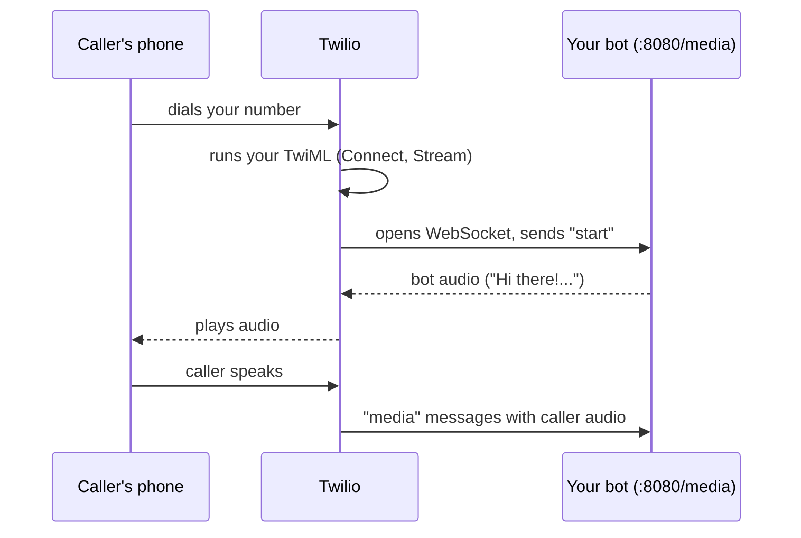

# Your first phone bot

In this tutorial you build a bot that answers a real phone number. You call it, it greets you, and you hold a spoken conversation with it. It uses Twilio for the phone line, Deepgram for STT (speech-to-text), OpenAI for the LLM, and Cartesia for TTS (text-to-speech).

> [!NOTE]
> This program has not been verified on a live Twilio call. The Twilio serializer is unit-tested and its REST hang-up is tested against a mock server, but nothing in Strawgo has been run against Twilio itself (see the [status table](../providers/README.md#framework-components)). Report what you find when you run it.

## Before you begin

- Go 1.25.9 or newer, and a Go module for the bot (`go mod init`). You add Strawgo to it after you write the program. See [Installation](installation.md).
- A Twilio account with a phone number that can receive voice calls.
- API keys for Deepgram, OpenAI and Cartesia.
- A tunnel that gives your laptop a public HTTPS address, because Twilio must reach your server from the internet. This page uses [ngrok](https://ngrok.com); any tunnel that forwards WebSockets works.
- Optional: the `onnx-worker` sidecar for Silero VAD. See [Installation](installation.md#optional-install-the-onnx-worker-sidecar).

If you have not done the [quickstart](quickstart.md), skim it first. It explains the pipeline, task and context in a simpler setting.

## How the call works

When someone calls your Twilio number, Twilio asks for TwiML, a small XML document that tells Twilio what to do with the call. Your TwiML says "connect this call to a media stream at this WebSocket address". Twilio then opens a WebSocket to your server and sends the caller's audio as 8 kHz µ-law (the standard phone audio encoding) in JSON messages. Your server sends the bot's audio back on the same socket.



Strawgo's WebSocket server accepts one connection per call. For each one, it creates a session and calls your handler, which builds and runs a pipeline for that call alone.

## The complete program

Create a folder with a module, then create `main.go` in it:

```sh
mkdir phonebot && cd phonebot
go mod init example.com/phonebot
```

Paste this program into `main.go`:

```go
package main

import (
	"context"
	"log"
	"net/http"
	"os"
	"os/signal"
	"syscall"
	"time"

	"github.com/square-key-labs/strawgo-ai/src/audio/vad"
	"github.com/square-key-labs/strawgo-ai/src/frames"
	"github.com/square-key-labs/strawgo-ai/src/llm"
	"github.com/square-key-labs/strawgo-ai/src/logger"
	"github.com/square-key-labs/strawgo-ai/src/pipeline"
	"github.com/square-key-labs/strawgo-ai/src/processors"
	"github.com/square-key-labs/strawgo-ai/src/processors/aggregators"
	"github.com/square-key-labs/strawgo-ai/src/serializers"
	"github.com/square-key-labs/strawgo-ai/src/services/cartesia"
	"github.com/square-key-labs/strawgo-ai/src/services/deepgram"
	"github.com/square-key-labs/strawgo-ai/src/services/openai"
	"github.com/square-key-labs/strawgo-ai/src/transports"
)

const systemPrompt = `You are a friendly voice assistant on a phone call.
Answer in one or two short sentences. Never use lists, markdown or emojis.`

func main() {
	logger.Init()
	for _, key := range []string{"DEEPGRAM_API_KEY", "OPENAI_API_KEY", "CARTESIA_API_KEY"} {
		if os.Getenv(key) == "" {
			log.Fatalf("%s is required", key)
		}
	}
	srv, err := transports.NewServer(transports.ServerConfig{
		Addr: ":8080",
		Path: "/media",
		NewSerializer: func(*http.Request) serializers.FrameSerializer {
			return serializers.NewTwilioFrameSerializer(serializers.TwilioConfig{
				AccountSID: os.Getenv("TWILIO_ACCOUNT_SID"),
				AuthToken:  os.Getenv("TWILIO_AUTH_TOKEN"),
			})
		},
		Handler: runCall,
		Params:  transports.TransportParams{SessionTimeout: 10 * time.Minute},
	})
	if err != nil {
		log.Fatal(err)
	}
	ctx, stop := signal.NotifyContext(context.Background(), os.Interrupt, syscall.SIGTERM)
	defer stop()
	if err := srv.ListenAndServe(ctx); err != nil {
		log.Fatal(err)
	}
}

func runCall(ctx context.Context, s *transports.Session) error {
	info := s.CallInfo()
	log.Printf("call %s started", info.CallID)

	procs := []processors.FrameProcessor{s.Input()}
	if sock := os.Getenv("ONNX_WORKER_SOCK"); sock != "" {
		analyzer, err := vad.NewSileroVADAnalyzer(16000, vad.DefaultVADParams(), sock)
		if err != nil {
			return err
		}
		defer analyzer.Cleanup()
		procs = append(procs, vad.NewVADInputProcessor(analyzer))
	}

	stt := deepgram.NewSTTService(deepgram.STTConfig{
		APIKey:      os.Getenv("DEEPGRAM_API_KEY"),
		Model:       "nova-3",
		Language:    "en",
		SmartFormat: true,
	})
	llmSvc := openai.NewLLMService(openai.LLMConfig{
		APIKey:       os.Getenv("OPENAI_API_KEY"),
		Model:        "gpt-4.1-mini",
		SystemPrompt: systemPrompt,
	})
	tts := cartesia.NewTTSService(cartesia.TTSConfig{
		APIKey:   os.Getenv("CARTESIA_API_KEY"),
		VoiceID:  envOr("CARTESIA_VOICE_ID", "71a7ad14-091c-4e8e-a314-022ece01c121"),
		Model:    "sonic-2",
		Language: "en",
	})

	conversation := llm.NewContext()
	pair := aggregators.NewContextAggregatorPair(conversation, aggregators.ContextAggregatorPairParams{})

	procs = append(procs, stt, pair.User(), llmSvc, tts, s.Output(), pair.Assistant())
	task := pipeline.NewPipelineTask(pipeline.NewPipeline(procs))

	if err := task.QueueFrame(frames.NewTTSSpeakFrame("Hi there! How can I help you today?")); err != nil {
		return err
	}
	err := task.Run(ctx)
	log.Printf("call %s ended after %d messages", info.CallID, conversation.Len())
	return err
}

func envOr(key, fallback string) string {
	if v := os.Getenv(key); v != "" {
		return v
	}
	return fallback
}
```

## Run the bot

1. Export your keys:

   ```sh
   export DEEPGRAM_API_KEY=YOUR_DEEPGRAM_API_KEY
   export OPENAI_API_KEY=YOUR_OPENAI_API_KEY
   export CARTESIA_API_KEY=YOUR_CARTESIA_API_KEY
   export TWILIO_ACCOUNT_SID=YOUR_TWILIO_ACCOUNT_SID
   export TWILIO_AUTH_TOKEN=YOUR_TWILIO_AUTH_TOKEN
   ```

2. Optional: turn on Silero VAD. In its own terminal, run the `onnx-worker` as a separate process, as in [Installation, option 3](installation.md#option-3-run-it-as-a-separate-process), with `--socket /tmp/onnx-worker.sock`. Get the binary from [option 2](installation.md#option-2-build-from-source) (build from source) or the GitHub release. Option 1 does not give you a socket to export, because the worker it starts stops when that program exits. Then point the bot at the socket:

   ```sh
   export ONNX_WORKER_SOCK=/tmp/onnx-worker.sock
   ```

   Leave `ONNX_WORKER_SOCK` unset to run without VAD.

3. Fetch Strawgo from `main`, add the indirect dependencies, and start the bot. Run this in the folder that holds `main.go`:

   ```sh
   go get github.com/square-key-labs/strawgo-ai@latest && go mod tidy
   go run .
   ```

   The log shows `[WebSocketServer] listening on [::]:8080/media`.

4. In a second terminal, start the tunnel:

   ```sh
   ngrok http 8080
   ```

   ngrok prints a forwarding address such as `https://abc123.ngrok-free.app`. Keep it running. Its host name (here `abc123.ngrok-free.app`) is what you put in the TwiML.

## Point your Twilio number at the bot

1. In the Twilio Console, create a TwiML Bin with this content. Replace `YOUR_TUNNEL_HOST` with the host name from ngrok, without `https://`:

   ```xml
   <?xml version="1.0" encoding="UTF-8"?>
   <Response>
     <Connect>
       <Stream url="wss://YOUR_TUNNEL_HOST/media" />
     </Connect>
   </Response>
   ```

   `<Connect><Stream>` opens a two-way media stream: Twilio sends the caller's audio and plays whatever audio your server sends back. The URL must start with `wss://` and end with the `Path` from your `ServerConfig`, here `/media`.

2. Open your phone number's configuration in the Twilio Console. In its voice configuration, set "A call comes in" to the TwiML Bin you just created, and save.

Free ngrok addresses change each time you restart ngrok. When that happens, update the URL in the TwiML Bin.

## Call it

Call your Twilio number. You should hear "Hi there! How can I help you today?" within a second or two of the call connecting. Ask a question; the bot answers in one or two sentences. Your terminal logs `call CA... started` when the call connects and `call CA... ended after N messages` when you hang up.

## How the program works

Now that the bot answers, here is what each part of `main.go` does.

**The server.** `transports.NewServer` creates a WebSocket server on port 8080 that accepts connections on `/media`. For each connection it calls `NewSerializer` to get a serializer, the part that converts Twilio's JSON messages into frames and back. The Twilio serializer reads the stream and call IDs from Twilio's `start` message. The account SID and auth token are optional; when you set them, the serializer hangs up the call through Twilio's REST API when your pipeline ends the call gracefully.

**`SessionTimeout`.** A call that lasts ten minutes is ended gracefully, as if the bot had decided to hang up.

**`ListenAndServe`.** It blocks until `ctx` is cancelled. Ctrl+C or SIGTERM cancels it, which closes the server and its open sessions.

**`runCall`.** The server runs it once per call, in its own goroutine, with a `*transports.Session`. `s.CallInfo()` holds what the serializer learned from the handshake, such as the Twilio call SID in `CallID`.

**Optional VAD.** If `ONNX_WORKER_SOCK` is set, the handler connects a Silero VAD analyzer to the `onnx-worker` socket and adds a VAD processor right after the session input. VAD (voice activity detection) detects the start and end of speech from the audio itself. `16000` is the sample rate the analyzer works at, which is the pipeline's default input rate. `defer analyzer.Cleanup()` closes the connection to the worker when the call ends.

**The three services.** `deepgram.NewSTTService` streams caller audio to Deepgram and emits transcriptions. `openai.NewLLMService` writes the replies; the system prompt tells it to keep them short and free of formatting, because everything it writes is spoken. `cartesia.NewTTSService` turns reply text into audio. The Cartesia voice defaults to the one used in the repository example; set `CARTESIA_VOICE_ID` to pick another voice from your Cartesia account.

**The pipeline.** The order matters:

1. `s.Input()` turns WebSocket messages into audio frames.
2. The optional VAD processor marks when the caller starts and stops speaking.
3. The STT service turns audio into transcriptions.
4. The user aggregator collects the caller's words for one turn, adds them to the conversation, and asks the LLM to answer.
5. The LLM service streams the reply as text.
6. The TTS service turns the text into audio.
7. `s.Output()` paces the audio out to Twilio in real time.
8. The assistant aggregator, placed after the output, records the bot's reply in the conversation.

**The greeting.** `task.QueueFrame(frames.NewTTSSpeakFrame(...))` queues a sentence for the TTS to speak as soon as the task starts. Frames queued before `Run` are sent right after the start frame.

**`task.Run(ctx)`.** It blocks for the whole call. It returns when the caller hangs up (Twilio sends a `stop` message), when the session times out, or when the server shuts down.

## Talk over the bot

Start talking while the bot is speaking. The bot stops mid-sentence and listens. This is called an interruption, or barge-in.

Here is what happens:

1. Strawgo decides that you started a new turn. Without VAD, the first transcription from Deepgram triggers it, including an interim (not yet final) one. With VAD, detecting your voice triggers it, which is faster because it does not wait for STT.
2. The user aggregator sends an `InterruptionFrame` through the whole pipeline.
3. The LLM stops generating, the TTS drops the text and audio it had queued, and the session output throws away audio it had not sent yet.
4. The Twilio serializer sends Twilio a `clear` message, so Twilio also discards the audio it had buffered for playback.
5. The assistant aggregator records the part of the reply that was played, sentence by sentence (word by word when the TTS reports word timestamps), so the model knows where it was cut off.

When you stop talking, your new turn goes to the LLM as usual. [Core concepts](core-concepts.md#interruptions) explains what survives an interruption, and [Turn-taking](../guides/turn-taking.md) shows how to tune when a turn starts and stops.

## Common first-run failures

| Symptom | Cause | Fix |
| --- | --- | --- |
| `go build` fails with `missing go.sum entry` | Indirect dependencies are not in `go.sum` | Run `go mod tidy`. |
| `undefined: transports.NewServer`, or `module ... found (v0.1.3), but does not contain package` | Your module uses a release older than `v0.2.0`, which has a different API | Run `go get github.com/square-key-labs/strawgo-ai@latest`. See [Troubleshooting](../guides/troubleshooting.md#undefined-transportsnewserver-or-a-missing-strawgo-package). |
| `go build` fails on the `go` version | Go 1.21 or newer downloads the Go 1.25.9 toolchain by itself, unless `GOTOOLCHAIN=local` is set; Go 1.20 and older cannot do this | Unset `GOTOOLCHAIN`, or install Go 1.25.9 or newer. |
| `websocket server listen: ... address already in use` | Something else uses port 8080 | Stop it, or change `Addr` in `ServerConfig` and the port you give ngrok. |
| The call ends right away with Twilio's error message, and the bot logs nothing | Twilio cannot reach your server: wrong URL, ngrok not running, or ngrok restarted with a new address | Check that ngrok is running and that the TwiML Bin uses `wss://` and the current host name with `/media`. |
| The bot logs `upgrade: websocket: the client is not using the websocket protocol` | Your number's voice webhook points straight at `/media`, so Twilio sent a plain HTTP request instead of opening a stream | Point the number at the TwiML Bin, not at the bot URL. |
| The bot logs `handshake:` and the call drops | No Twilio `start` message arrived within the handshake timeout (10 seconds by default) | Make sure the client connecting to `/media` is a Twilio media stream. |
| `[DeepgramSTT] ... bad handshake (HTTP 401)` or `[CartesiaTTS] ... bad handshake (HTTP 401)` | Wrong or expired API key | Check the key in your shell with `echo $DEEPGRAM_API_KEY`, fix it, restart the bot. |
| `OpenAI generation failed` | Wrong OpenAI key, no credit, or an unknown model name | Read the rest of the error line; it carries the API's response. |
| The handler logs `failed to connect to onnx-worker at ...` | `ONNX_WORKER_SOCK` is set but no worker is listening on that socket | Start the worker (see [Installation](installation.md#option-3-run-it-as-a-separate-process) and [Troubleshooting: worker not found](../guides/troubleshooting.md#worker-not-found)), or unset `ONNX_WORKER_SOCK`. |
| The bot speaks, but never answers you | STT is not producing transcriptions | Look for Deepgram errors in the log. Run with `LOG_LEVEL=DEBUG` for more detail. |
| The bot keeps talking when you interrupt | No transcription or VAD event has reached the user aggregator yet | Add VAD with `ONNX_WORKER_SOCK`, so interruptions start on your voice rather than on the first transcription. |
| The call stays open after the bot ends the conversation | Twilio credentials are not set, so the serializer cannot hang up through the REST API | Export `TWILIO_ACCOUNT_SID` and `TWILIO_AUTH_TOKEN`. |

The [troubleshooting guide](../guides/troubleshooting.md) covers more symptoms.

## Next steps

- [Let the bot call your functions and hang up](../guides/function-calling.md)
- [Learn how Twilio integration works in depth](../guides/telephony-twilio.md)
- [Tune turn-taking and interruptions](../guides/turn-taking.md)
- [Measure latency with observers](../guides/observability.md)
