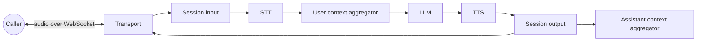
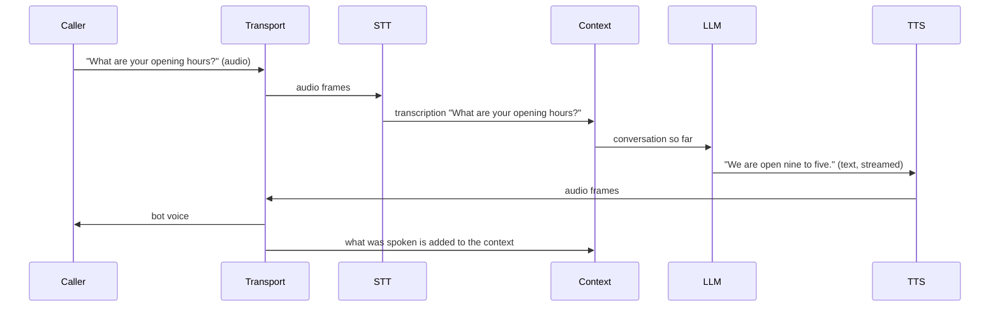

# Introduction

This page explains what a voice agent is, how a phone call travels through a Strawgo program, and what Strawgo does and does not give you. Read it first if you have never built a voice bot.

## What a voice agent is

A voice agent is a program that holds a spoken conversation. It listens to a person, works out what they said, decides what to answer, and speaks the answer back, all fast enough to feel like a normal call.

Most voice agents are built from three kinds of service:

| Service | What it does |
| --- | --- |
| STT (speech-to-text) | Turns the caller's audio into text. |
| LLM (large language model) | Reads the conversation so far and writes the bot's next reply. |
| TTS (text-to-speech) | Turns the reply text back into audio. |

Around those services sit a few jobs that make the conversation feel natural:

- VAD (voice activity detection) notices when someone is speaking and when they have gone quiet.
- Turn-taking decides when the caller has finished their turn (one stretch of speech from one side) so the bot can answer.
- Interruption, also called barge-in, stops the bot mid-sentence when the caller starts talking over it.

Strawgo connects all of these for you. You pick the vendors, write a few lines of Go to wire them together, and add your own logic.

## How a call flows through Strawgo

A Strawgo program is a pipeline: an ordered chain of processors. Data moves through it in small units called frames (a chunk of audio, a piece of text, a signal such as "the user started speaking"). Each processor handles the frames it cares about and passes the rest along.

A typical phone bot uses this pipeline:

The transport is the network layer. It accepts the call (for example a Twilio Media Streams WebSocket) and hands your code a session with an input and an output processor. The two context aggregators keep the conversation history: the user aggregator records what the caller said, and the assistant aggregator records what the bot said as it is played; if the caller interrupts, it keeps the part that was played, to the nearest sentence (or word, when the TTS reports word timestamps).

Here is one exchange in time order:

Each stage streams. The TTS starts speaking the first sentence while the LLM is still writing the second, which keeps the delay short.

## What Strawgo gives you

| Feature | What you get | Read more |
| --- | --- | --- |
| Pipeline engine | Frames, processors, nested pipelines, parallel branches, a task that runs one conversation | [Core concepts](core-concepts.md), [Pipeline reference](../reference/pipeline.md) |
| Telephony | WebSocket media-stream serializers for Twilio, Telnyx, Plivo, Exotel, Vonage, Asterisk, Genesys AudioHook and Jambonz | [First phone bot](first-phone-bot.md), [Telephony providers](../guides/telephony-providers.md) |
| Browser calls | A WebRTC handler built on Pion, plus the RTVI client protocol | [WebRTC](../guides/webrtc.md), [RTVI](../guides/rtvi.md) |
| Providers | Many LLM, STT and TTS vendors behind three shared service bases | [Provider matrix](../providers/README.md) |
| Speech-to-speech | OpenAI Realtime and Gemini Live, which take audio in and give audio out | [Speech-to-speech](../guides/speech-to-speech.md) |
| Turn-taking | Silero VAD, Smart Turn, start/stop/mute strategies, idle detection | [Turn-taking](../guides/turn-taking.md) |
| Interruptions | The bot stops talking and drops stale audio when the caller talks over it | [Core concepts](core-concepts.md#interruptions) |
| Function calling | Register Go functions the LLM can call, including MCP tools | [Function calling](../guides/function-calling.md), [MCP tools](../guides/mcp-tools.md) |
| Flows | Node-based conversation scripts with typed state | [Flows](../guides/flows.md) |
| Call extensions | Voicemail detection and IVR menu navigation | [Voicemail detection](../guides/voicemail-detection.md), [IVR navigation](../guides/ivr-navigation.md) |
| Audio tools | Resampling, G.711, mixers, filters, DTMF tones, recording | [Audio](../guides/audio.md), [Recording](../guides/recording.md) |
| Observability | Metrics frames, observers, latency tracking, OpenTelemetry tracing | [Observability](../guides/observability.md) |

## What Strawgo does not have

> [!NOTE]
> Be aware of these limits before you commit to Strawgo:
>
> - Provider integrations are tested against mock servers at best, some not at all; none against a live vendor API. The [provider matrix](../providers/README.md) gives the status of each.
> - There is no Daily or LiveKit transport, and no video on any transport.
> - WebRTC uses G.711 audio by default. Opus is available only with the `opus` build tag, which has never been compiled or verified.
> - Speechmatics STT and AWS Nova Sonic are not available.
> - The API these docs describe is on `main` and not in a tagged release yet; the tags `v0.1.0` to `v0.1.3` have the older API. See [Installation](installation.md#add-strawgo-to-your-module).

## When to pick Strawgo

Strawgo is a good fit when:

- your backend is already in Go, or you want a voice agent that ships as one Go binary (plus the optional `onnx-worker` sidecar for Silero VAD and Smart Turn);
- you need telephony over WebSocket media streams (Twilio and the other carriers above);
- you want the Pipecat programming model (frames, processors, pipelines) in Go;
- you are willing to test each provider you use against the real vendor yourself.

Pick something else when you need Daily or LiveKit rooms, video, or vendor integrations that someone has already run in production.

## Next steps

- [Install Strawgo](installation.md)
- [Build a text bot in the quickstart](quickstart.md)
- [Learn the core concepts](core-concepts.md)
