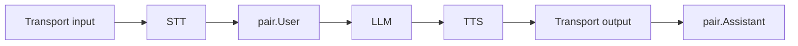

# Conversation context

The conversation context is the message history the LLM sees on every request: the system prompt, what the user said, what the bot said, and every function call. This guide shows you how to create it, change it safely while a call is running, and keep it small with automatic summarization.

## Before you begin

- You have a working pipeline, for example from the [Quickstart](../getting-started/quickstart.md).
- You know the terms **frame** (a typed message that flows through the pipeline) and **turn** (one person's uninterrupted contribution to the conversation, for example everything the user says before the bot answers). See [Core concepts](../getting-started/core-concepts.md).

## A complete example

This bot starts with a system prompt, records every turn, and summarizes older messages once the history passes roughly 4,000 estimated tokens.

```go
package main

import (
	"context"
	"log"
	"net/http"
	"os"
	"os/signal"
	"syscall"

	"github.com/square-key-labs/strawgo-ai/src/frames"
	"github.com/square-key-labs/strawgo-ai/src/llm"
	"github.com/square-key-labs/strawgo-ai/src/logger"
	"github.com/square-key-labs/strawgo-ai/src/pipeline"
	"github.com/square-key-labs/strawgo-ai/src/processors"
	"github.com/square-key-labs/strawgo-ai/src/processors/aggregators"
	"github.com/square-key-labs/strawgo-ai/src/serializers"
	"github.com/square-key-labs/strawgo-ai/src/services/cartesia"
	"github.com/square-key-labs/strawgo-ai/src/services/deepgram"
	"github.com/square-key-labs/strawgo-ai/src/services/openai"
	"github.com/square-key-labs/strawgo-ai/src/transports"
)

func main() {
	logger.Init()
	srv, err := transports.NewServer(transports.ServerConfig{
		Addr: ":8080",
		Path: "/media",
		NewSerializer: func(*http.Request) serializers.FrameSerializer {
			return serializers.NewTwilioFrameSerializer(serializers.TwilioConfig{
				AccountSID: os.Getenv("TWILIO_ACCOUNT_SID"),
				AuthToken:  os.Getenv("TWILIO_AUTH_TOKEN"),
			})
		},
		Handler: runCall,
	})
	if err != nil {
		log.Fatal(err)
	}
	ctx, stop := signal.NotifyContext(context.Background(), os.Interrupt, syscall.SIGTERM)
	defer stop()
	if err := srv.ListenAndServe(ctx); err != nil {
		log.Fatal(err)
	}
}

func runCall(ctx context.Context, s *transports.Session) error {
	stt := deepgram.NewSTTService(deepgram.STTConfig{APIKey: os.Getenv("DEEPGRAM_API_KEY"), Model: "nova-3", Language: "en"})
	llmSvc := openai.NewLLMService(openai.LLMConfig{APIKey: os.Getenv("OPENAI_API_KEY"), Model: "gpt-4.1-mini"})
	tts := cartesia.NewTTSService(cartesia.TTSConfig{APIKey: os.Getenv("CARTESIA_API_KEY"), VoiceID: os.Getenv("CARTESIA_VOICE_ID"), Model: "sonic-2", Language: "en"})

	conversation := llm.NewContext(
		llm.System("You are a friendly concierge on a phone call. Answer in one or two short sentences."),
	)
	pair := aggregators.NewContextAggregatorPair(conversation, aggregators.ContextAggregatorPairParams{
		Assistant: aggregators.AssistantAggregatorParams{
			EnableAutoContextSummarization: true,
			AutoSummarizationConfig: aggregators.LLMAutoContextSummarizationConfig{
				MaxContextTokens: 4000,
				SummaryConfig: aggregators.LLMContextSummaryConfig{
					MinMessagesAfterSummary: 4,
				},
			},
			Summarize: func(ctx context.Context, snapshot llm.Snapshot) (string, error) {
				return llmSvc.RunInference(ctx, snapshot, llm.Settings{})
			},
			OnSummaryApplied: func(before, after int) {
				log.Printf("context summarized: %d -> %d messages", before, after)
			},
		},
	})

	pipe := pipeline.NewPipeline([]processors.FrameProcessor{
		s.Input(), stt, pair.User(), llmSvc, tts, s.Output(), pair.Assistant(),
	})
	task := pipeline.NewPipelineTask(pipe)

	if err := task.QueueFrame(frames.NewLLMMessagesAppendFrame(
		[]llm.Message{llm.Developer("Greet the caller and ask how you can help.")}, true,
	)); err != nil {
		return err
	}
	err := task.Run(ctx)
	for _, m := range conversation.Messages() {
		log.Printf("%s: %s", m.Role, m.Text())
	}
	return err
}
```

## Create the context and the aggregator pair

An `*llm.Context` holds three things: a list of messages, the tools the model may call, and a tool choice. Create one with `llm.NewContext`, passing any starting messages:

```go
conversation := llm.NewContext(llm.System("You are a helpful assistant."))
```

The context is changed by two **aggregators**, created together as a pair that shares the context:

```go
pair := aggregators.NewContextAggregatorPair(conversation, aggregators.ContextAggregatorPairParams{})
```

Place them around the LLM and the output:



| Aggregator | What it does |
| --- | --- |
| `pair.User()` | Collects the user's transcriptions into one user message per turn, adds it, and sends an `LLMContextFrame` to the LLM. It also applies the context frames described below. |
| `pair.Assistant()` | Records what the bot said, its thoughts, and every function call and result. It sits after the output transport so it records the reply as it is played, to the nearest word or sentence when the caller interrupts (see [Turn-taking](turn-taking.md#interruptions)). |

`pair.Context()` returns the shared context. If you pass `nil` to `NewContextAggregatorPair`, it creates an empty one.

### Message helpers

| Helper | Role |
| --- | --- |
| `llm.System(text)` | `system` |
| `llm.Developer(text)` | `developer`, an instruction from you rather than the user. Some OpenAI-compatible providers have no developer role and send it as a user message. |
| `llm.User(text)` | `user` |
| `llm.Assistant(text)` | `assistant` |
| `llm.ToolCalls(...)`, `llm.ToolResult(id, name, content)` | function calls and results; normally written for you by the assistant aggregator |

`m.Text()` returns the text parts of a message joined together, which is handy for logging transcripts.

## System prompt or `Settings.SystemInstruction`

You can give the model its instructions in two places:

| | System message in the context | `Settings.SystemInstruction` |
| --- | --- | --- |
| How to set it | `llm.NewContext(llm.System("..."))` | `openai.LLMConfig{SystemPrompt: "..."}` or `Settings.SystemInstruction` |
| Stored in the context | yes | no, the LLM service adds it to each request |
| Replaced by `LLMMessagesUpdateFrame` | yes, if your new list leaves it out | no |
| Change it during a call | send a context frame | send `frames.NewLLMUpdateSettingsFrame(llm.Settings{SystemInstruction: "..."})` |
| Kept by summarization | yes, leading system and developer messages are never summarized | not affected |

The OpenAI-compatible providers send `SystemInstruction` as the first system message, followed by the context's messages. If you set both, the model receives both.

Use `SystemInstruction` for the bot's fixed persona. Use context messages for instructions that are part of the conversation, such as "now ask for the account number". [Flows](flows.md) use `SystemInstruction` for each node's role message for this reason.

`Settings.Merge` ignores an empty `SystemInstruction`, so an update frame cannot clear it to empty. Replace it with different text instead.

## Change messages at runtime with frames

Once the pipeline is running, change the context by queueing frames. The user aggregator applies them in order with the conversation.

| Frame | Effect | `runLLM` |
| --- | --- | --- |
| `frames.NewLLMMessagesAppendFrame(msgs, runLLM)` | adds messages at the end | `true` sends the context to the LLM right away |
| `frames.NewLLMMessagesUpdateFrame(msgs, runLLM)` | replaces every message | same |
| `frames.NewLLMMessagesTransformFrame(fn, runLLM)` | calls `fn(messages)` and stores what it returns | pointer; `nil` means do not run |
| `frames.NewLLMRunFrame()` | runs the LLM on the context as it is | not applicable |
| `frames.NewLLMSetToolsFrame(tools)` | replaces the tools | never runs |
| `frames.NewLLMSetToolChoiceFrame(choice)` | replaces the tool choice | never runs |

Queue them from outside the pipeline with `task.QueueFrame`. They enter at the start of the pipeline and reach the user aggregator in order.

Append an instruction and make the bot speak:

```go
err := task.QueueFrame(frames.NewLLMMessagesAppendFrame(
	[]llm.Message{llm.Developer("Tell the caller their order has shipped.")}, true,
))
```

Replace the whole history, for example to restart with a short summary:

```go
err := task.QueueFrame(frames.NewLLMMessagesUpdateFrame([]llm.Message{
	llm.System("You are a friendly concierge."),
	llm.Developer("The caller, Ana, wants a table for two on Friday."),
}, false))
```

Transform the history, here keeping only the system message and the last six messages:

```go
run := false
err := task.QueueFrame(frames.NewLLMMessagesTransformFrame(func(msgs []llm.Message) []llm.Message {
	if len(msgs) <= 7 {
		return msgs
	}
	return append([]llm.Message{msgs[0]}, msgs[len(msgs)-6:]...)
}, &run))
```

Your transform receives a copy of the message slice and must return the new list. It runs inside the user aggregator, so keep it fast and do not block.

A processor inside the pipeline that wants to change the context pushes the same frames upstream with `PushFrame(frame, frames.Upstream)`; they travel back to the user aggregator.

### Change tools during a call

Send the new tool list and register the handlers that go with it. Handlers can be registered from any goroutine:

```go
llmSvc.RegisterFunction("cancel_booking", cancelBooking)
llmSvc.UnregisterFunction("create_booking")
err := task.QueueFrame(frames.NewLLMSetToolsFrame(llm.Tools{Functions: []llm.FunctionSchema{
	{
		Name:        "cancel_booking",
		Description: "Cancel the caller's booking.",
		Properties:  map[string]any{"booking_id": map[string]any{"type": "string"}},
		Required:    []string{"booking_id"},
	},
}}))
```

Calls the model makes before the new tools arrive still go to whatever handler is registered under that name, so remove old handlers only when you are sure they are no longer offered.

## Images, audio and files

A message is a list of parts. Besides `llm.TextPart`, you can add:

| Part | Fields |
| --- | --- |
| `llm.ImagePart` | `URL` or `Data` + `MIME`, and an optional `Detail` |
| `llm.AudioPart` | `Data`, `MIME`, `SampleRate` (needed for raw PCM) |
| `llm.FilePart` | `URL` or `Data`, `MIME`, `Name` |

```go
photo, err := os.ReadFile("receipt.jpg")
if err != nil {
	return err
}
err = task.QueueFrame(frames.NewLLMMessagesAppendFrame([]llm.Message{{
	Role: llm.RoleUser,
	Parts: []llm.Part{
		llm.TextPart{Text: "The caller uploaded this receipt. Read out the total."},
		llm.ImagePart{Data: photo, MIME: "image/jpeg"},
	},
}}, true))
```

Support depends on the provider. Image and file parts are converted by the OpenAI-compatible providers, OpenAI Responses, Anthropic, Gemini and Bedrock. Audio parts are converted by the OpenAI-compatible providers, OpenAI Responses and Gemini. A provider returns an error for a part it cannot send, for example the OpenAI-compatible providers accept files only as inline PDFs or images. Whether a given model accepts the part is up to the vendor.

## Automatic summarization

Long calls make every request bigger and slower. The assistant aggregator can replace older messages with a summary written by an LLM.

Summarization runs when you give the assistant aggregator a `Summarize` function. That function receives a small, ready-made request (a system prompt and a transcript of the messages to summarize) and returns the summary text. The simplest choice is your own LLM service's `RunInference`:

```go
Summarize: func(ctx context.Context, snapshot llm.Snapshot) (string, error) {
	return llmSvc.RunInference(ctx, snapshot, llm.Settings{})
},
```

`RunInference` uses the service's settings, so its `SystemInstruction` is also sent with the summary request. Use a separate, cheaper LLM service if you prefer.

### When it runs

With `EnableAutoContextSummarization: true`, the aggregator checks after each assistant message and each function call. It summarizes when a threshold is exceeded:

| Setting in `LLMAutoContextSummarizationConfig` | Triggers when |
| --- | --- |
| `MaxContextTokens` | the estimated tokens of the counted messages exceed this |
| `MaxUnsummarizedMessages` | the number of counted messages exceeds this |
| `ShouldSummarize` | your function returns `true`; when a threshold above is set, it is asked only after the threshold is exceeded, as a veto |

Messages matching `SummaryConfig.Keep` are not counted. Only one summary runs at a time, in the background, so the conversation does not wait for it.

To summarize on demand, queue `frames.NewLLMSummarizeContextFrame()`. This works even when automatic summarization is off and ignores `ShouldSummarize`. It still needs `Summarize`.

### The token estimate

Strawgo does not call a tokenizer. The default estimate per message is the character count of its text, tool call names and arguments, tool results and thoughts, divided by 4, plus 10. Images, audio and files are not counted. Provide `EstimateTokens func(llm.Message) int` for a better estimate.

### What is kept

| Setting in `LLMContextSummaryConfig` | Meaning |
| --- | --- |
| `TargetContextTokens` | how many estimated tokens of recent messages to keep unsummarized; defaults to 80% of `MaxContextTokens` |
| `MinMessagesAfterSummary` | always keep at least this many recent messages |
| `Keep` | `func(llm.Message) bool`; matching messages stay in place, word for word |
| `SummarizationPrompt` | replaces the default prompt that asks for key facts, decisions, commitments, preferences and open questions |
| `SummaryMessageTemplate` | how the summary is written into the context; `%s` is replaced by the summary; the default is `Conversation summary: <summary>` |

Rules the summarizer always follows:

- Leading system and developer messages are never summarized.
- A function call and its result are never split. If you keep one of them with `Keep`, the other is kept too.
- Nothing from the first unfinished function call onward is summarized.
- The summary is written as one user message, at the position of the first summarized message.
- If the context changed in a way that touches the summarized messages while the summary was being written, the summary is discarded.

Keep messages that must survive word for word, such as a confirmed booking:

```go
Keep: func(m llm.Message) bool {
	return strings.HasPrefix(m.Text(), "BOOKING CONFIRMED")
},
```

### Callbacks and timeouts

| Field on `AssistantAggregatorParams` | Meaning |
| --- | --- |
| `OnSummaryApplied func(beforeCount, afterCount int)` | called after a summary replaced messages |
| `SummarizationTimeout` | how long one summary may take; defaults to `aggregators.DefaultSummarizationTimeout` (120 s) |

A failed or timed-out summary is logged as a warning and the context is left unchanged. `pair.Assistant().Summarizer()` returns the summarizer, whose `Summarize(ctx, conversation)` method runs one summary synchronously, for example after the call ends.

## The single-writer rule

While the pipeline runs, only the two context aggregators should change the context. Your code changes it by sending frames, never by calling `Add`, `Set`, `Transform` or `SetTools` from another goroutine.

The context is protected by a lock, so a direct call would not crash. It would still be wrong, because the aggregators make several related changes in a fixed order:

- When a function starts, the assistant aggregator adds the call and an `IN_PROGRESS` placeholder; when it finishes, it replaces the placeholder by id. A message inserted between those steps from outside can end up in the wrong place relative to the turn.
- The summarizer checks that the messages it summarized are unchanged before applying the summary. A direct write can silently throw away a summary.
- A frame is applied at a defined point in the conversation: after the frames queued before it and before those queued after it. A direct write happens at whatever moment your goroutine runs, possibly in the middle of a user turn being committed.

Direct calls are fine before `task.Run` starts and after it returns. Reading is always fine: use `conversation.Snapshot()` or `conversation.Messages()`, which return a stable view.

## Next steps

- [Function calling](function-calling.md): how tool calls and results are recorded.
- [Turn-taking](turn-taking.md): when a user turn starts and ends.
- [Flows](flows.md): context strategies that reset or summarize the history at each step.
- [Aggregators reference](../reference/aggregators.md): every parameter of the aggregators.
