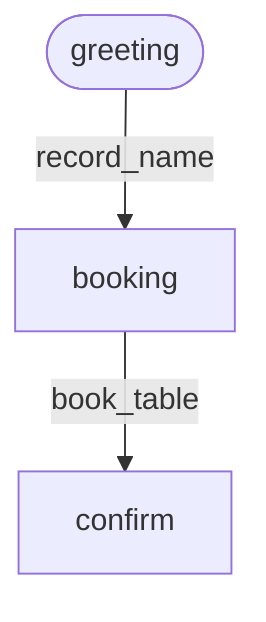
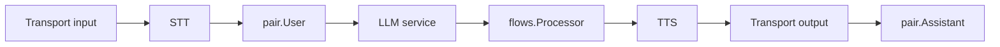

# Flows

Flows structure a conversation as a graph of steps, called nodes. Each node gives the LLM its instructions and a small set of functions; calling a function moves the conversation to the next node. This guide shows you how to build a flow in Go or JSON, wire it into a pipeline, and export it as a diagram. It is the Go counterpart of Pipecat Flows.

## Before you begin

- You know how [function calling](function-calling.md) works: flows are built on it.
- You know what the [conversation context](conversation-context.md) is.
- You have API keys for Deepgram (STT, speech-to-text), OpenAI (the LLM) and Cartesia (TTS, text-to-speech).

> [!NOTE]
> The `flows` package is tested in this repository against a fake LLM provider. It has not been run against a live LLM.

## When to use a flow

A single prompt with a few tools works well for open conversations. A flow is better when the call has fixed steps that must happen in order, for example "identify the caller, then collect the order, then confirm". Each node's prompt stays short and focused, and the model only sees the functions that make sense at that step.

## A complete example

A restaurant line with three nodes: ask for the caller's name, take the booking, then confirm and hang up. A global function answers questions about opening hours from any node.



```go
package main

import (
	"context"
	"log"
	"net/http"
	"os"
	"os/signal"
	"syscall"

	"github.com/square-key-labs/strawgo-ai/src/flows"
	"github.com/square-key-labs/strawgo-ai/src/llm"
	"github.com/square-key-labs/strawgo-ai/src/logger"
	"github.com/square-key-labs/strawgo-ai/src/pipeline"
	"github.com/square-key-labs/strawgo-ai/src/processors"
	"github.com/square-key-labs/strawgo-ai/src/processors/aggregators"
	"github.com/square-key-labs/strawgo-ai/src/serializers"
	"github.com/square-key-labs/strawgo-ai/src/services/cartesia"
	"github.com/square-key-labs/strawgo-ai/src/services/deepgram"
	"github.com/square-key-labs/strawgo-ai/src/services/openai"
	"github.com/square-key-labs/strawgo-ai/src/transports"
)

var (
	callerName = flows.Key[string]("caller_name")
	partySize  = flows.Key[int]("party_size")
	bookingDay = flows.Key[string]("day")
)

type nameArgs struct {
	Name string `json:"name" desc:"The caller's first name"`
}

type bookingArgs struct {
	PartySize int    `json:"party_size" desc:"Number of guests, 1 to 8"`
	Day       string `json:"day" enum:"friday,saturday,sunday"`
}

func buildFlow() *flows.Node {
	confirm := &flows.Node{
		Name: "confirm",
		TaskMessages: []llm.Message{llm.Developer(
			"Confirm the booking for {{ caller_name }}: a table for {{ party_size }} on {{ day }}. Then say goodbye in one sentence.",
		)},
		PostActions: []flows.Action{flows.EndConversation{}},
	}
	booking := &flows.Node{
		Name:         "booking",
		TaskMessages: []llm.Message{llm.Developer("Ask {{ caller_name }} how many guests and which day: Friday, Saturday or Sunday.")},
		Functions: []flows.Function{
			flows.Typed("book_table", "Book the table once you know the party size and the day.",
				func(ctx context.Context, args bookingArgs, m *flows.Manager) (any, *flows.Node, error) {
					partySize.Set(m.State(), args.PartySize)
					bookingDay.Set(m.State(), args.Day)
					return map[string]any{"booked": true}, confirm, nil
				}),
		},
	}
	return &flows.Node{
		Name:         "greeting",
		RoleMessage:  "You are the friendly phone host of Luigi's restaurant. Keep every answer to one or two short sentences.",
		TaskMessages: []llm.Message{llm.Developer("Greet the caller and ask for their first name.")},
		Functions: []flows.Function{
			flows.Typed("record_name", "Save the caller's first name once they have said it.",
				func(ctx context.Context, args nameArgs, m *flows.Manager) (any, *flows.Node, error) {
					callerName.Set(m.State(), args.Name)
					return map[string]any{"saved": args.Name}, booking, nil
				}),
		},
	}
}

var openingHours = flows.Function{
	Name:        "opening_hours",
	Description: "Tell the caller when the restaurant is open.",
	Handler: func(ctx context.Context, args flows.Args, m *flows.Manager) (any, *flows.Node, error) {
		return map[string]any{"hours": "Friday to Sunday, 6 pm to 11 pm"}, nil, nil
	},
}

func main() {
	logger.Init()
	srv, err := transports.NewServer(transports.ServerConfig{
		Addr: ":8080",
		Path: "/media",
		NewSerializer: func(*http.Request) serializers.FrameSerializer {
			return serializers.NewTwilioFrameSerializer(serializers.TwilioConfig{
				AccountSID: os.Getenv("TWILIO_ACCOUNT_SID"),
				AuthToken:  os.Getenv("TWILIO_AUTH_TOKEN"),
			})
		},
		Handler: runCall,
	})
	if err != nil {
		log.Fatal(err)
	}
	ctx, stop := signal.NotifyContext(context.Background(), os.Interrupt, syscall.SIGTERM)
	defer stop()
	if err := srv.ListenAndServe(ctx); err != nil {
		log.Fatal(err)
	}
}

func runCall(ctx context.Context, s *transports.Session) error {
	stt := deepgram.NewSTTService(deepgram.STTConfig{APIKey: os.Getenv("DEEPGRAM_API_KEY"), Model: "nova-3", Language: "en"})
	llmSvc := openai.NewLLMService(openai.LLMConfig{APIKey: os.Getenv("OPENAI_API_KEY"), Model: "gpt-4.1-mini"})
	tts := cartesia.NewTTSService(cartesia.TTSConfig{APIKey: os.Getenv("CARTESIA_API_KEY"), VoiceID: os.Getenv("CARTESIA_VOICE_ID"), Model: "sonic-2", Language: "en"})

	conversation := llm.NewContext()
	pair := aggregators.NewContextAggregatorPair(conversation, aggregators.ContextAggregatorPairParams{})
	flowProc := flows.NewProcessor()

	pipe := pipeline.NewPipeline([]processors.FrameProcessor{
		s.Input(), stt, pair.User(), llmSvc, flowProc, tts, s.Output(), pair.Assistant(),
	})
	task := pipeline.NewPipelineTask(pipe)

	manager, err := flows.NewManager(flows.Config{
		LLM:             llmSvc,
		Task:            task,
		Context:         conversation,
		Processor:       flowProc,
		GlobalFunctions: []flows.Function{openingHours},
	})
	if err != nil {
		return err
	}
	defer manager.Close()

	if err := manager.Initialize(ctx, buildFlow()); err != nil {
		return err
	}
	return task.Run(ctx)
}
```

`Initialize` can run before `task.Run`: the frames it queues wait in the task until the pipeline starts.

## Place the flow processor right after the LLM

The flow manager needs to see every function result before the assistant aggregator does, so it can hold back the LLM rerun and switch nodes at the right moment. Put `flows.NewProcessor()` directly after the LLM service, before TTS and before `pair.Assistant()`:



`flows.NewManager` returns an error when `Config.Processor` is missing, and a processor can belong to only one manager. If the processor is not in the pipeline, the manager logs a warning the first time a transition is requested, and transitions do not happen.

## Nodes

A `flows.Node` is one step of the conversation:

| Field | Meaning |
| --- | --- |
| `Name` | a label for logs and diagrams; one is generated if empty |
| `RoleMessage` | the system instruction for this node, sent as `Settings.SystemInstruction` |
| `RoleMessages` | extra messages added before the task messages |
| `TaskMessages` | what the bot should do now, usually `llm.Developer(...)` messages |
| `Functions` | the functions the model may call in this node |
| `PreActions`, `PostActions` | actions run before and after the node's messages are queued |
| `ContextStrategy` | how the history is handled on entry; nil uses `Config.ContextStrategy` |
| `WaitForUser` | when `true`, the bot does not speak on entry; it waits for the caller |

A `RoleMessage` stays in effect until a later node sets a different one.

### What happens when a node is entered

`manager.Initialize(ctx, node)` enters the first node; `manager.SetNode(ctx, node)` enters any node directly.

1. Placeholders such as `{{ caller_name }}` are filled in from the state. A missing key is an error and the node is not entered.
2. The pre-actions run.
3. The node's functions and the global functions are registered on the LLM service. Functions no longer offered are unregistered.
4. Three frames are queued: an `LLMUpdateSettingsFrame` with the role message, the node's messages (appended or replacing the history, depending on the context strategy), and an `LLMSetToolsFrame`. All three survive interruptions, and the context aggregators apply them in order.
5. Unless `WaitForUser` is set, an `LLMRunFrame` is queued so the bot speaks first.
6. The post-actions run. With `WaitForUser`, they are deferred until the bot next stops speaking.

## Functions and transitions

A `flows.Function` is a function-calling tool plus an optional transition:

| Field | Meaning |
| --- | --- |
| `Name`, `Description`, `Properties`, `Required` | the schema the model sees, as in [function calling](function-calling.md#step-1-describe-the-function) |
| `Handler` | `func(ctx, args flows.Args, m *flows.Manager) (result any, next *flows.Node, err error)` |
| `Next` | a fixed next node, used when the handler returns no `next` |
| `CancelOnInterruption`, `Timeout` | passed to the LLM service, with the same defaults as plain function calling |

A function needs a `Handler`, a `Next`, or both.

`flows.Typed[T](name, description, fn)` builds a function from a struct. It generates the JSON schema from the struct's fields and decodes the arguments into `T` for you:

- the `json` tag gives the property name;
- the `desc` tag becomes the property's description;
- the `enum` tag (comma separated) lists the allowed values;
- a field is required unless it is a pointer or has `omitempty`.

`flows.Decode[T](args)` does the same decoding by hand inside an untyped handler.

What the handler returns decides what happens next:

| Handler returns | Result |
| --- | --- |
| a `next` node (or `Next` is set) | the result is recorded without an LLM rerun, then the flow moves to `next` once every function call from the same LLM response has finished |
| `flows.NoResponse` as `next` | the result is recorded, the LLM stays quiet, and the node does not change |
| `nil` next and no `Next` | a normal function result; the LLM runs again in the same node |
| an error | the model receives `{"status": "error", "error": "..."}` and the LLM runs again |
| a `nil` result | the model receives `{"status": "acknowledged"}` |

Inside a handler you may also call `m.SetNode(ctx, node)`; it is treated as the handler's `next`. A call to a function that the current node does not offer gets an error result.

## Global functions

`flows.Config.GlobalFunctions` are offered in every node, in addition to the node's own functions. Use them for things the caller may ask at any point, such as opening hours or "talk to a person". A node may not declare a function with the same name as a global one.

## Actions

Actions run code around node changes.

| Action | What it does |
| --- | --- |
| `flows.TTSSay{Text: "..."}` | speaks fixed text; `SkipContext: true` keeps it out of the context; `{{ key }}` placeholders are filled in |
| `flows.EndConversation{Text: "..."}` | optionally speaks `Text`, then queues an `EndFrame` to end the call; later actions are skipped |
| `flows.FunctionAction{Fn: ...}` | runs `Fn(ctx, m)` in order with the frames around it |
| `flows.Custom{Type: "...", Params: ...}` | runs the handler registered for `Type` |

Register custom action handlers in `flows.Config.Actions` or with `manager.RegisterAction(type, handler)`. A node that uses an unregistered custom action fails to enter.

```go
manager.RegisterAction("notify_staff", func(ctx context.Context, a flows.Custom, m *flows.Manager) error {
	log.Printf("new booking for %v", a.Params["table"])
	return nil
})
```

Actions run in list order. `TTSSay`, `EndConversation` and `FunctionAction` travel through the pipeline as frames, so they keep their order on their own. A custom action that follows a `TTSSay`, and any action that follows a `FunctionAction`, waits until the earlier action has passed through the whole pipeline, so "say this, then do that" happens in that order.

## Context strategies

A context strategy decides what happens to the history when a node is entered.

| Strategy | Effect | Use it when |
| --- | --- | --- |
| `flows.ContextStrategy{Kind: flows.Append}` (default) | adds the node's messages to the history | later steps need the whole conversation |
| `flows.ContextStrategy{Kind: flows.Reset}` | replaces the history with the node's messages | earlier steps are irrelevant, and you want short, cheap requests |
| `flows.ContextStrategy{Kind: flows.ResetWithSummary, SummaryPrompt: "..."}` | asks the LLM to summarize the history, then replaces it with the summary plus the node's messages | you want short requests but must keep key facts |

Set a default in `flows.Config.ContextStrategy` and override it per node with `Node.ContextStrategy`. `ResetWithSummary` needs a `SummaryPrompt`. The summary uses the LLM's `RunInference` with a timeout of `SummaryTimeout` (default `flows.DefaultSummaryTimeout`, 5 s). If the summary fails or is empty, the node is entered with `Append` instead and a warning is logged.

```go
review := &flows.Node{
	Name:         "review",
	TaskMessages: []llm.Message{llm.Developer("Read back the order and ask the caller to confirm.")},
	ContextStrategy: &flows.ContextStrategy{
		Kind:          flows.ResetWithSummary,
		SummaryPrompt: "Summarize the order so far: items, quantities and delivery address.",
	},
}
```

## State

`manager.State()` is a thread-safe key-value store that lives for the whole flow.

```go
m.State().Set("vip", true)
vip, ok := flows.Get[bool](m.State(), "vip")
```

`flows.Key[T]` gives you a typed key, as in the example (`callerName.Set(m.State(), args.Name)` and `callerName.Get(m.State())`).

Use `{{ key }}` in `RoleMessage`, `RoleMessages`, `TaskMessages` and `TTSSay` text to insert state values. Dotted paths such as `{{ caller.name }}` read into maps and structs. Write `\{{ key }}` for literal braces.

## JSON flow definitions

You can define the graph in JSON, in the style of Pipecat Flows, and keep the handlers in Go. `flows.LoadJSON(data, registry)` parses and validates the document and returns a `*flows.Flow`.

```go
package main

import (
	"context"
	"fmt"
	"log"

	"github.com/square-key-labs/strawgo-ai/src/flows"
)

const flowJSON = `{
  "initial_node": "greeting",
  "nodes": {
    "greeting": {
      "role_message": "You are the friendly phone host of Luigi's restaurant.",
      "task_messages": [{"role": "developer", "content": "Greet the caller and ask for their first name."}],
      "functions": [{
        "name": "record_name",
        "description": "Save the caller's first name.",
        "properties": {"name": {"type": "string"}},
        "required": ["name"],
        "transition_to": "booking"
      }]
    },
    "booking": {
      "task_messages": [{"role": "developer", "content": "Ask {{ caller_name }} for the party size."}],
      "functions": [{
        "name": "book_table",
        "description": "Book the table.",
        "properties": {"party_size": {"type": "integer"}},
        "required": ["party_size"],
        "transition_to": {"field": "status", "cases": {"booked": "confirm"}, "default": "full"}
      }]
    },
    "confirm": {
      "task_messages": [{"role": "developer", "content": "Confirm the booking and say goodbye."}],
      "post_actions": [{"type": "end_conversation"}]
    },
    "full": {
      "task_messages": [{"role": "developer", "content": "Apologize that the restaurant is full and say goodbye."}],
      "post_actions": [{"type": "end_conversation"}]
    }
  }
}`

func main() {
	flow, err := flows.LoadJSON([]byte(flowJSON), flows.Registry{
		Handlers: map[string]flows.Handler{
			"record_name": func(ctx context.Context, args flows.Args, m *flows.Manager) (any, *flows.Node, error) {
				m.State().Set("caller_name", args["name"])
				return map[string]any{"saved": args["name"]}, nil, nil
			},
			"book_table": func(ctx context.Context, args flows.Args, m *flows.Manager) (any, *flows.Node, error) {
				size, _ := args["party_size"].(float64)
				if size > 8 {
					return map[string]any{"status": "full"}, nil, nil
				}
				return map[string]any{"status": "booked"}, nil, nil
			},
		},
	})
	if err != nil {
		log.Fatal(err)
	}
	fmt.Println(flow.Initial().Name)
	fmt.Println(flow.Mermaid())
}
```

Pass `flow.Initial()` to `manager.Initialize` and `flow.GlobalFunctions()` to `flows.Config.GlobalFunctions`. `flow.Node(name)` looks up any node.

### The JSON format

| Key | Meaning |
| --- | --- |
| `initial_node` | the node to start in |
| `nodes.<name>.role_message`, `task_messages` | as on `flows.Node`; message roles are `system`, `developer`, `user` or `assistant` |
| `nodes.<name>.functions[]` | `name`, `description`, `properties`, `required`, `handler`, `transition_to`, `transition_only`, `cancel_on_interruption`, `timeout_secs` |
| `nodes.<name>.pre_actions`, `post_actions` | each has a `type`; `text`, `handler` and `append_text_to_context` where relevant; other keys become `Params` |
| `nodes.<name>.context_strategy` | `append`, `reset` or `reset_with_summary` (with `summary_prompt`) |
| `nodes.<name>.respond_immediately` | `false` sets `WaitForUser` |
| `global_functions[]` | functions offered in every node |

Functions:

- `handler` names an entry in `Registry.Handlers`. If it is empty, the function's own name is used.
- `transition_to` is either a node name, or `{"field": ..., "cases": {...}, "default": ...}`, which reads `field` from the handler's result and picks the node for that value.
- `transition_only: true` makes a function that only moves to its `transition_to` node. It needs a `description` and must not name a handler.

Actions: `tts_say` needs `text`; `end_conversation` takes optional `text`; `function` runs `Registry.Actions[handler]`; any other `type` runs `Registry.Actions[handler]`, or `Registry.Actions[type]` when `handler` is empty.

### Validation

`LoadJSON` rejects unknown keys, then checks the whole flow and reports every problem at once as a `*flows.ValidationError`:

- a missing or unknown `initial_node`;
- duplicate function names, or a node function that is also global;
- handlers or action handlers missing from the registry;
- transitions to nodes that do not exist, or branches without cases;
- an unknown `context_strategy`, or `reset_with_summary` without `summary_prompt`;
- nodes that cannot be reached from `initial_node`.

```go
flow, err := flows.LoadJSON(data, registry)
var invalid *flows.ValidationError
if errors.As(err, &invalid) {
	for _, p := range invalid.Problems {
		log.Printf("flow problem: %s", p)
	}
}
```

`flows.ParseConfig(data)` returns the parsed `*flows.FlowConfig` without building it, if you want to inspect or change it before calling `cfg.Build(registry)`.

## Export a Mermaid diagram

`flow.Mermaid()` returns a Mermaid `flowchart` of a JSON flow, including global functions. For flows built in Go, `flows.Mermaid(startNode, globals...)` does the same.

The diagram shows transitions that are visible without running code: `Next` fields and `transition_to` in JSON. A Go handler that returns a node decides at run time, so its edge does not appear. Set `Next` on Go functions whose target is fixed if you want them drawn.

Paste the output into a ` ```mermaid ` block in any GitHub Markdown file to render it.

## Manager reference

| Method | Purpose |
| --- | --- |
| `flows.NewManager(cfg)` | checks the config and binds the processor |
| `Initialize(ctx, node)` | starts the flow; call once |
| `SetNode(ctx, node)` | jumps to a node from outside a handler, for example from a timer; waits until the node is entered |
| `CurrentNode()` | the name of the current node |
| `State()` | the shared state |
| `RegisterAction(type, handler)` | adds a custom action handler |
| `Close()` | stops the manager's worker; call it when the call ends |

`flows.Config.LLM` accepts anything with `RegisterFunction`, `UnregisterFunction` and `RunInference`. `*llmservice.Service` and `*pipeline.LLMSwitcher` both qualify.

## Next steps

- [Appointment booking flow](../cookbook/appointment-booking-flow.md): a complete recipe built with flows.
- [Function calling](function-calling.md): the mechanism under every flow function.
- [Conversation context](conversation-context.md): what the context strategies change.
- [Flows reference](../reference/flows.md): every type in the `flows` package.
