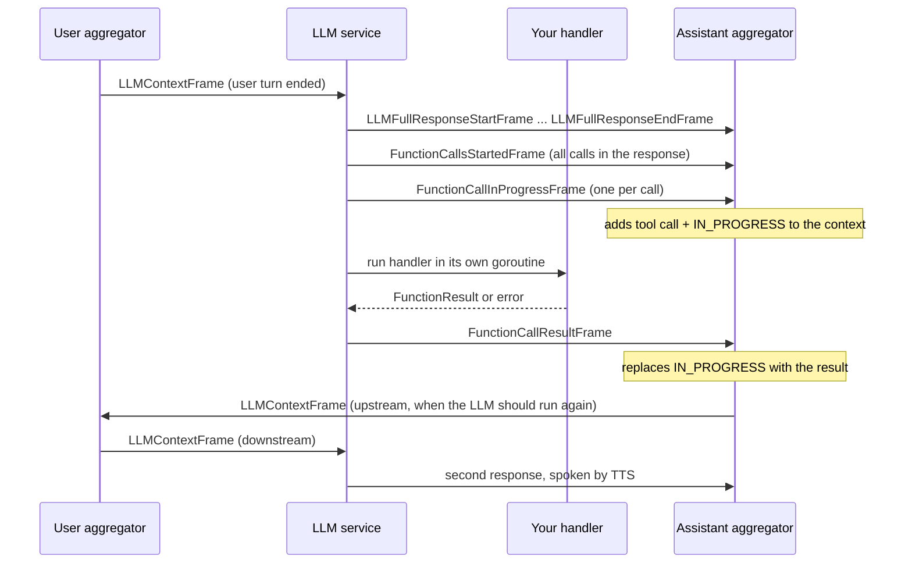

# Function calling

Function calling (also called tool use) lets the LLM ask your Go code to do something during a call: look up an order, book a slot, or hang up. This guide shows you how to describe a function to the model, run it, control what happens after it returns, and handle interruptions and slow functions.

You will build a phone bot that answers weather questions with a `get_weather` function and ends the call with an `end_call` function.

## Before you begin

- You have a working voice bot, for example from [Your first phone bot](../getting-started/first-phone-bot.md).
- You know what a frame and a pipeline are. A **frame** is a typed message that flows through the bot; a **pipeline** is the ordered list of processors that frames pass through. See [Core concepts](../getting-started/core-concepts.md).
- You have API keys for Deepgram (STT, speech-to-text), OpenAI (the LLM) and Cartesia (TTS, text-to-speech) in environment variables.

> [!NOTE]
> Provider integrations in Strawgo are tested against mock servers at best, some not at all; none against a live vendor API (see the [status table](../providers/README.md)). Run your own end-to-end test before you rely on a provider in production.

## A complete example

```go
package main

import (
	"context"
	"fmt"
	"log"
	"net/http"
	"os"
	"os/signal"
	"syscall"

	"github.com/square-key-labs/strawgo-ai/src/frames"
	"github.com/square-key-labs/strawgo-ai/src/llm"
	"github.com/square-key-labs/strawgo-ai/src/logger"
	"github.com/square-key-labs/strawgo-ai/src/pipeline"
	"github.com/square-key-labs/strawgo-ai/src/processors"
	"github.com/square-key-labs/strawgo-ai/src/processors/aggregators"
	"github.com/square-key-labs/strawgo-ai/src/serializers"
	"github.com/square-key-labs/strawgo-ai/src/services/cartesia"
	"github.com/square-key-labs/strawgo-ai/src/services/deepgram"
	"github.com/square-key-labs/strawgo-ai/src/services/openai"
	"github.com/square-key-labs/strawgo-ai/src/transports"
)

const systemPrompt = `You are the phone assistant of a weather service.
Use get_weather to answer weather questions.
Call end_call when the caller says goodbye.
Answer in one short spoken sentence.`

var tools = llm.Tools{Functions: []llm.FunctionSchema{
	{
		Name:        "get_weather",
		Description: "Current weather for a city.",
		Properties: map[string]any{
			"city": map[string]any{"type": "string", "description": "City name, for example Paris"},
			"unit": map[string]any{"type": "string", "enum": []string{"celsius", "fahrenheit"}},
		},
		Required: []string{"city"},
	},
	{
		Name:        "end_call",
		Description: "Hang up after the caller has said goodbye.",
	},
}}

func main() {
	logger.Init()
	srv, err := transports.NewServer(transports.ServerConfig{
		Addr: ":8080",
		Path: "/media",
		NewSerializer: func(*http.Request) serializers.FrameSerializer {
			return serializers.NewTwilioFrameSerializer(serializers.TwilioConfig{
				AccountSID: os.Getenv("TWILIO_ACCOUNT_SID"),
				AuthToken:  os.Getenv("TWILIO_AUTH_TOKEN"),
			})
		},
		Handler: runCall,
	})
	if err != nil {
		log.Fatal(err)
	}
	ctx, stop := signal.NotifyContext(context.Background(), os.Interrupt, syscall.SIGTERM)
	defer stop()
	if err := srv.ListenAndServe(ctx); err != nil {
		log.Fatal(err)
	}
}

func runCall(ctx context.Context, s *transports.Session) error {
	stt := deepgram.NewSTTService(deepgram.STTConfig{APIKey: os.Getenv("DEEPGRAM_API_KEY"), Model: "nova-3", Language: "en"})
	llmSvc := openai.NewLLMService(openai.LLMConfig{APIKey: os.Getenv("OPENAI_API_KEY"), Model: "gpt-4.1-mini", SystemPrompt: systemPrompt})
	tts := cartesia.NewTTSService(cartesia.TTSConfig{APIKey: os.Getenv("CARTESIA_API_KEY"), VoiceID: os.Getenv("CARTESIA_VOICE_ID"), Model: "sonic-2", Language: "en"})

	conversation := llm.NewContext()
	conversation.SetTools(tools)
	pair := aggregators.NewContextAggregatorPair(conversation, aggregators.ContextAggregatorPairParams{})

	pipe := pipeline.NewPipeline([]processors.FrameProcessor{
		s.Input(), stt, pair.User(), llmSvc, tts, s.Output(), pair.Assistant(),
	})
	task := pipeline.NewPipelineTask(pipe)

	llmSvc.RegisterFunction("get_weather", getWeather)
	llmSvc.RegisterFunction("end_call", func(ctx context.Context, p llm.FunctionCallParams) (llm.FunctionResult, error) {
		if err := task.QueueFrame(frames.NewTTSSpeakFrame("Thanks for calling, goodbye!")); err != nil {
			return llm.FunctionResult{}, err
		}
		if err := task.QueueFrame(frames.NewEndFrame()); err != nil {
			return llm.FunctionResult{}, err
		}
		runLLM := false
		return llm.FunctionResult{Value: "call ended", RunLLM: &runLLM}, nil
	})

	if err := task.QueueFrame(frames.NewTTSSpeakFrame("Weather line. Which city?")); err != nil {
		return err
	}
	return task.Run(ctx)
}

func getWeather(ctx context.Context, p llm.FunctionCallParams) (llm.FunctionResult, error) {
	city, _ := p.Arguments["city"].(string)
	if city == "" {
		return llm.FunctionResult{}, fmt.Errorf("city is required")
	}
	unit, _ := p.Arguments["unit"].(string)
	temperature := "21 C"
	if unit == "fahrenheit" {
		temperature = "70 F"
	}
	return llm.FunctionResult{Value: map[string]any{
		"city":        city,
		"temperature": temperature,
		"conditions":  "partly cloudy",
	}}, nil
}
```

Run it the same way as [Your first phone bot](../getting-started/first-phone-bot.md). Ask "What's the weather in Paris?", then say "Goodbye". A fuller version with latency logging lives in [examples/function_calling](../../examples/function_calling/main.go).

The rest of this page explains each part.

## Step 1: describe the function

The model only knows about functions you describe in the conversation context. Each `llm.FunctionSchema` has:

| Field | What it does |
| --- | --- |
| `Name` | The name the model uses to call the function. It must match the name you register. |
| `Description` | Tells the model when to call the function. Write it as an instruction. |
| `Properties` | A JSON Schema `properties` object, written as `map[string]any`. |
| `Required` | Names of the properties the model must always fill in. |
| `Strict` | Asks providers that support strict schemas to follow the schema exactly. The OpenAI-compatible providers send it as `strict`. |

Strawgo wraps your properties in an object schema (`FunctionSchema.JSONSchema()` returns `{"type": "object", "properties": ..., "required": [...]}`) and each provider converts that to its own wire format.

Put the tools in the context before the call starts:

```go
conversation := llm.NewContext()
conversation.SetTools(tools)
```

To force or forbid tool use, set a tool choice. `llm.ToolChoiceAuto`, `llm.ToolChoiceNone`, `llm.ToolChoiceRequired`, and `llm.ToolChoiceFunction` (with `Name`) are available:

```go
conversation.SetToolChoice(llm.ToolChoice{Mode: llm.ToolChoiceFunction, Name: "get_weather"})
```

Calling `SetTools` or `SetToolChoice` directly is fine before `task.Run`. Once the call is running, change tools with frames instead, as described in [Conversation context](conversation-context.md#change-tools-during-a-call).

## Step 2: register a handler

A handler is a Go function with this signature:

```go
type FunctionHandler func(ctx context.Context, params llm.FunctionCallParams) (llm.FunctionResult, error)
```

Register it on the LLM service under the same name as the schema:

```go
llmSvc.RegisterFunction("get_weather", getWeather)
```

`llm.FunctionCallParams` gives the handler:

| Field | Meaning |
| --- | --- |
| `ToolCallID` | The provider's id for this call. |
| `FunctionName` | The name the model called. |
| `Arguments` | The arguments decoded into `map[string]any`. JSON numbers arrive as `float64`. |
| `RawArguments` | The raw JSON, if you prefer `json.Unmarshal` into your own struct. |
| `Context` | The live conversation context. Read it with `Snapshot()`; do not change it (see [the single-writer rule](conversation-context.md#the-single-writer-rule)). |
| `ReportProgress` | Sends an intermediate result while the call runs. See [Report progress](#report-progress-from-a-running-function). |

Other registration helpers:

- `llmSvc.RegisterFunction("", handler)` registers a catch-all that receives every call with no handler of its own. Use `p.FunctionName` to tell calls apart.
- `llmSvc.UnregisterFunction(name)` removes a handler. `llmSvc.HasFunction(name)` reports whether a call to `name` would find one.

## What the model sees

After the handler returns, the assistant aggregator writes the call and its result into the context, so the next LLM request contains both:

1. An assistant message with an `llm.ToolCallPart` (id, name, arguments).
2. A tool message with an `llm.ToolResultPart` (id, name, content).

While the handler runs, the tool result content is the placeholder `IN_PROGRESS`. When the result arrives, the placeholder is replaced with the encoded `Value`:

| `Value` you return | Content the model sees |
| --- | --- |
| a `string` | the string as a JSON string, for example `"sunny"` |
| `json.RawMessage` or `[]byte` | the bytes as they are |
| a map, struct or slice | its JSON encoding |
| `nil` | `COMPLETED` |

Whether the LLM runs again depends only on `RunLLM`, not on `Value`. A `nil` `Value` with a nil error is recorded as `COMPLETED` and, with `RunLLM` nil or `true`, the LLM runs again like it does for any other result.

## The frame sequence

The LLM service runs function calls after the model's response stream ends. It broadcasts each frame in both directions, so processors before and after it can react.



| Frame | Kind | Survives an interruption |
| --- | --- | --- |
| `FunctionCallsStartedFrame` | system | yes (system frames are never dropped) |
| `FunctionCallInProgressFrame` | control | yes |
| `FunctionCallResultFrame` | control | yes |
| `FunctionCallCancelFrame` | system | yes |

You can watch these frames with an observer or `task.OnFrameReachedDownstream`, for example to log every tool call.

## Parallel and sequential calls

A model can ask for several functions in one response. By default each call runs in its own goroutine, all at the same time.

To run them one after another, in the order the model listed them, build the service with `llmservice.WithSequentialFunctionCalls()`. OpenAI-compatible services take service options through `ServiceOptions`:

```go
llmSvc := openai.NewLLMService(openai.LLMConfig{
	APIKey:         os.Getenv("OPENAI_API_KEY"),
	Model:          "gpt-4.1-mini",
	ServiceOptions: []llmservice.Option{llmservice.WithSequentialFunctionCalls()},
})
```

Either way, calls from one response form a group. The LLM runs again once, after the last call in the group has finished.

| Mode | Use it when |
| --- | --- |
| Parallel (default) | Calls are independent, for example two lookups. Total wait is the slowest call. |
| Sequential | A later call depends on an earlier side effect, for example "create the booking" then "send the confirmation". |

## Timeouts

Set a timeout for one function with `llm.FunctionOptions`, or a default for every function on the service:

```go
llmSvc.RegisterFunction("lookup_order", lookupOrder, llm.FunctionOptions{Timeout: 5 * time.Second})
```

```go
llmSvc := openai.NewLLMService(openai.LLMConfig{
	APIKey:         os.Getenv("OPENAI_API_KEY"),
	ServiceOptions: []llmservice.Option{llmservice.WithFunctionCallTimeout(10 * time.Second)},
})
```

A per-function `Timeout` wins over the service default. Zero means no timeout.

When the timeout expires, the handler's `ctx` is cancelled and the service stops waiting, even if the handler ignores `ctx`. The model receives an error result (`context deadline exceeded`) and the LLM runs again, so it can tell the caller what happened. Pass `ctx` to your HTTP and database calls so the work itself also stops.

## Returning errors

Return an error when the function failed:

```go
func lookupOrder(ctx context.Context, p llm.FunctionCallParams) (llm.FunctionResult, error) {
	id, _ := p.Arguments["order_id"].(string)
	if id == "" {
		return llm.FunctionResult{}, fmt.Errorf("order_id is required")
	}
	return llm.FunctionResult{Value: map[string]any{"order_id": id, "status": "shipped"}}, nil
}
```

An error never stops the pipeline. The service turns it into a normal result:

- `FunctionCallResultFrame.Error` holds the error text.
- If you returned no `Value`, the result becomes `{"error": "<message>"}`, so the model sees what went wrong.
- The tool result in the context is marked as an error (`ToolResultPart.IsError`).

The same happens, without your handler running, when the model calls a function with no registered handler, sends arguments that are not valid JSON, or when your handler panics.

Write error messages the model can act on, for example "no order with that number". The model reads them and decides what to say.

## Controlling whether the LLM runs again

`llm.FunctionResult.RunLLM` decides what happens after the result is recorded:

| `RunLLM` | Effect |
| --- | --- |
| `nil` (default) | The LLM runs again with the result, so the bot speaks. |
| pointer to `true` | Same as `nil`. |
| pointer to `false` | The result is recorded, and the LLM stays quiet. |

```go
runLLM := false
return llm.FunctionResult{Value: "saved", RunLLM: &runLLM}, nil
```

Use `false` when your handler already made the bot speak, when the call is ending, or when a later event should trigger the next response.

The rerun is never started on top of speech. If the user is speaking, it waits until they stop. If the bot is speaking, it waits for `BotStoppedSpeakingFrame`. To change this timing, see [Choose when a result is delivered](#choose-when-a-result-is-delivered).

## Cancellation on interruption

An **interruption** (also called barge-in) is when the caller starts talking while the bot is speaking or about to speak. The bot stops talking and listens.

By default, an interruption does **not** cancel a running function. The call keeps going, its result is recorded when it arrives, and the LLM runs again once the user has stopped speaking. This protects side effects such as payments or bookings from being cut off halfway.

To let user speech cancel a function, opt in when you register it:

```go
llmSvc.RegisterFunction("search_flights", searchFlights, llm.FunctionOptions{CancelOnInterruption: true})
```

When an opted-in function is interrupted:

1. Its `ctx` is cancelled. Return promptly when `ctx.Done()` closes.
2. The service broadcasts a `FunctionCallCancelFrame` instead of a result. A result your handler returns later is dropped.
3. The context records this text as the tool result, so the model knows the outcome is unknown:

   ```text
   INTERRUPTED: the call was cancelled before it returned, so its outcome is unknown. It may have completed, partly completed or not run; verify before retrying it or reporting it as done.
   ```

   The same string is available as `llm.ToolResultInterrupted`.
4. The LLM does not run again because of the cancellation. The user's new turn drives the next response.

Only opt in for functions that are safe to abandon, such as read-only searches. A `CancelFrame` (the call is being torn down) cancels every running function, opted in or not.

## Ending the call from a function

Queue a goodbye and an `EndFrame` on the task, and return `RunLLM: false` so the model does not start another reply:

```go
llmSvc.RegisterFunction("end_call", func(ctx context.Context, p llm.FunctionCallParams) (llm.FunctionResult, error) {
	if err := task.QueueFrame(frames.NewTTSSpeakFrame("Thanks for calling, goodbye!")); err != nil {
		return llm.FunctionResult{}, err
	}
	if err := task.QueueFrame(frames.NewEndFrame()); err != nil {
		return llm.FunctionResult{}, err
	}
	runLLM := false
	return llm.FunctionResult{Value: "call ended", RunLLM: &runLLM}, nil
})
```

The `EndFrame` is queued behind the goodbye, so the bot finishes speaking before the pipeline shuts down. The output transport then hangs up when the serializer supports it. See [Telephony providers](telephony-providers.md) for hang-up support per provider.

## Long-running functions

While a function runs, the caller hears silence unless you do something about it. You have three options, and you can combine them:

1. **Let the model talk first.** Tell it in the system prompt to say a short phrase such as "Let me check" before calling slow tools. Text the model produces in the same response as the tool call is spoken as usual.
2. **Speak from the handler.** Queue a `TTSSpeakFrame` at the start of the handler:

   ```go
   func checkAvailability(ctx context.Context, p llm.FunctionCallParams) (llm.FunctionResult, error) {
   	if err := task.QueueFrame(frames.NewTTSSpeakFrame("One moment while I check.")); err != nil {
   		return llm.FunctionResult{}, err
   	}
   	slots, err := fetchSlots(ctx)
   	if err != nil {
   		return llm.FunctionResult{}, err
   	}
   	return llm.FunctionResult{Value: slots}, nil
   }
   ```

   The filler's words are recorded in the context together with the next assistant reply.
3. **Mute the user while tools run**, so a cough does not start a new turn. Add `user_mute.NewFunctionCallUserMuteStrategy()` to the user turn strategies. See [Turn-taking](turn-taking.md#mute-strategies).

If the user speaks while the function is still running, their turn is answered right away. The context then shows the tool result as `IN_PROGRESS`, so the model knows the work is not finished. When the real result arrives it replaces the placeholder, and the LLM runs again after the user stops speaking.

The [user idle timer](turn-taking.md#user-idle-detection) is paused while function calls are pending, so a slow tool does not trigger an "Are you still there?" prompt.

A result never gets lost or answered twice because of an interruption. A function that survives an interruption keeps its `IN_PROGRESS` placeholder; its result replaces the placeholder once and starts at most one new LLM run. A second result for the same call is ignored.

## Report progress from a running function

`params.ReportProgress` sends an intermediate result while the handler is still running. By default it is silent: it is written to the context, the call stays in progress, and the LLM does not run, so the bot does not speak. The model sees the progress the next time it runs, for example when the user asks "how is it going?".

```go
func writeReport(ctx context.Context, p llm.FunctionCallParams) (llm.FunctionResult, error) {
	for i, section := range sections {
		if err := writeSection(ctx, section); err != nil {
			return llm.FunctionResult{}, err
		}
		p.ReportProgress(llm.FunctionResult{Value: map[string]any{"sections_done": i + 1, "of": len(sections)}})
	}
	return llm.FunctionResult{Value: "report sent"}, nil
}
```

Each progress update is added to the context as a developer message, `Intermediate result of function <name> (call <id>): <value>`. The `IN_PROGRESS` placeholder stays until the final result replaces it.

To make the bot speak about the progress, set `RunLLM` to a pointer to `true` in the progress value. That update then runs the LLM like a result does, using the [delivery mode](#choose-when-a-result-is-delivered) of the update or of the function.

`ReportProgress` returns `false` and sends nothing once the call has finished, timed out or been cancelled, so a handler that keeps a reference to it cannot reopen a settled call.

## Choose when a result is delivered

A slow function's result can arrive at any moment: while the bot is talking, while the user is talking, or during silence. `llm.FunctionOptions.Delivery` decides what happens then. It follows the non-blocking function modes of the Gemini Live API.

| Delivery | What happens when the result arrives |
| --- | --- |
| `llm.ResultDeliveryDefault` (zero value) | Today's behaviour. The LLM runs again once the user has stopped speaking and the bot has finished its current speech. |
| `llm.ResultDeliveryInterrupt` | The bot's current speech, or the reply being generated, is interrupted and the LLM answers with the result right away. If the user is speaking, it waits until they stop. If interruptions are disabled for the pipeline, or the user is muted (a mute strategy is active), it behaves like the default. If the interruption it requests never arrives, the LLM still runs when the bot stops speaking. If the bot finishes speaking on its own in the instant between the interruption request and its arrival, the answer can be cut off; the result stays in the context and the model sees it on the next turn. |
| `llm.ResultDeliveryWhenIdle` | Waits until the bot has finished speaking and no user turn is in progress, then runs the LLM. A user turn that is answered after the result arrived already carries the result, so no extra run is started. |
| `llm.ResultDeliverySilent` | The result is written to the context and the LLM does not run. The model sees it on its next turn. |

```go
llmSvc.RegisterFunction("book_table", bookTable, llm.FunctionOptions{Delivery: llm.ResultDeliveryWhenIdle})
```

A handler can override the delivery for one result with `llm.FunctionResult.Delivery`:

```go
if urgent {
	return llm.FunctionResult{Value: slots, Delivery: llm.ResultDeliveryInterrupt}, nil
}
return llm.FunctionResult{Value: slots}, nil
```

`ResultDeliverySilent` always wins over `RunLLM`: the result frame carries `RunLLM` set to `false`. When several calls from one response finish, the most urgent delivery among them decides, in the order interrupt, default, when idle.

`ResultDeliveryWhenIdle` sees the user's turn through `UserStartedSpeakingFrame`, `UserStoppedSpeakingFrame` and the start of the reply to that turn. If the user speaks but the turn produces no reply, for example because the transcript was empty, the result is delivered `AssistantAggregatorParams.WhenIdleUserTurnTimeout` after they stopped speaking (default `aggregators.DefaultUserTurnStopTimeout`, 5 seconds).

## Let the model cancel a running function

A function that survives interruptions keeps running even when the user changes their mind. Register it with `CancellableByLLM` to let the model stop it:

```go
llmSvc.RegisterFunction("write_report", writeReport, llm.FunctionOptions{CancellableByLLM: true})
```

While a `write_report` call is running, the LLM service adds a tool named `cancel_write_report` to every request. The context's own tool list is not changed, and the tool disappears again once no `write_report` call is running. Its schema comes from `llm.CancelToolSchema`; the name is `llm.CancelToolName("write_report")`.

When the model calls it:

1. With no arguments and one running call, that call is cancelled. With several running calls, the model must pass `tool_call_id`; without it, the cancel tool answers with the ids and arguments of the running calls so the model can choose.
2. The cancelled handler's `ctx` is cancelled. Return promptly when `ctx.Done()` closes. A result it returns later is dropped. If the handler had already returned when the model asked, its result stands and the cancel tool answers that the call finished before it could be cancelled.
3. The cancelled call's tool result becomes `llm.ToolResultCancelled`:

   ```text
   CANCELLED: this tool call was cancelled before it returned a result
   ```

4. The cancel tool's own result, `{"cancelled": "<id>", "function_name": "write_report"}`, runs the LLM again so the bot can confirm.

`CancellableByLLM` has no effect together with `CancelOnInterruption: true`, because the model is not running while it waits on such a call. A warning is logged. If you register a function that is itself called `cancel_write_report`, it takes precedence and no cancel tool is offered.

## Tell the model when tools change

When you change the tool set during a call with `LLMSetToolsFrame`, the model only sees the new list. It can still try to call a removed tool it used earlier. Set `AddToolChangeMessages` to add a developer message describing the change:

```go
pair := aggregators.NewContextAggregatorPair(conversation, aggregators.ContextAggregatorPairParams{
	Assistant: aggregators.AssistantAggregatorParams{AddToolChangeMessages: true},
})
```

The message names the added and removed functions, for example:

```text
The following function(s) have just been added and may now be called: `book_table`. Any previously available functions remain available. The following function(s) have just been removed and should not be called: `lookup`. Any previously available functions remain available. The removed function(s) may become available again later, in which case you will be informed.
```

It is off by default. `NewContextAggregatorPair` turns it on for both aggregators. If you build the user aggregator yourself, call `SetAddToolChangeMessages(true)` on it too, because the first aggregator to apply the frame writes the message. Only function names are compared; provider-specific tools are ignored.

## Function calling with other services

- **Speech-to-speech models** (OpenAI Realtime, Gemini Live) use the same `RegisterFunction` API and the same default of not cancelling on interruption. See [Speech-to-speech](speech-to-speech.md#tools-with-realtime-models).
- **MCP servers** can supply both the schemas and the handlers. See [MCP tools](mcp-tools.md).
- **Flows** register functions for you, per conversation node. See [Flows](flows.md).
- **Several LLMs behind a switcher**: `pipeline.LLMSwitcher.RegisterFunction` registers on every LLM at once. See [Switching services](switching-services.md).

## Next steps

- [Conversation context](conversation-context.md): change tools and messages while the call runs.
- [Flows](flows.md): structure a conversation as nodes, each with its own functions.
- [Customer support bot](../cookbook/customer-support-bot.md): a complete recipe with function calling and hang-up.
- [LLM reference](../reference/llm.md): every type in the `llm` package.
