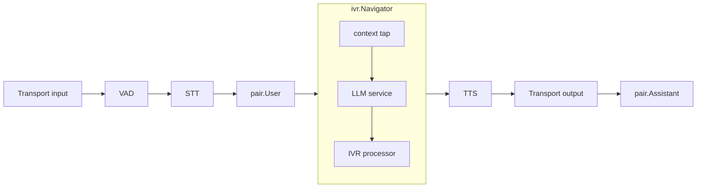

# IVR navigation

An IVR (interactive voice response) is a phone menu: "Press 1 for billing, press 2 for support". The IVR navigator lets your bot get through such menus on its own, by pressing keys and answering spoken prompts, until it reaches a person or its goal. This guide adds the navigator to an outbound bot and hands the call over to a normal conversation when a person answers.

## Before you begin

- Your bot can place outbound calls. See [Telephony providers](telephony-providers.md).
- Your telephony provider and serializer can send DTMF. **DTMF** tones are the beeps a phone keypad makes; the navigator "presses keys" by sending them. See [Telephony providers](telephony-providers.md) for which serializers support it.
- You have API keys for Deepgram (STT, speech-to-text), OpenAI (the LLM) and Cartesia (TTS, text-to-speech).

> [!NOTE]
> The `extensions/ivr` package compiles but has no tests in this repository. Try it against the phone menus you need to navigate before you rely on it.

## How it works

`ivr.New(llmService, goal)` returns a `*ivr.Navigator`, a small pipeline that wraps your LLM service. Put it where the LLM service would go:



The navigator works in three phases:

1. **Classify.** When the pipeline starts, the navigator replaces the context with a classifier prompt (`ivr.ClassifierPrompt`). After the first thing the other side says, the LLM answers `<mode>ivr</mode>` or `<mode>conversation</mode>`.
2. **Navigate.** In IVR mode, the context becomes the navigation prompt with your goal (`ivr.NavigationPrompt(goal)`), and VAD switches to a longer stop time so menus are heard in full. For every menu, the LLM answers with one of:
   - `<dtmf>2</dtmf>`: press a key; several tags press several keys in order;
   - plain text such as "Billing.": spoken to the menu;
   - `<ivr>wait</ivr>`: listen for more options;
   - `<ivr>completed</ivr>`: the goal is reached, for example "connecting you to an agent";
   - `<ivr>stuck</ivr>`: no way forward.
3. **Converse.** When a person answers (`<mode>conversation</mode>`), your `OnConversationDetected` handler receives the history and sets up the normal conversation.

The IVR processor strips these tags from the text before TTS, so they are never spoken. It sends key presses as `OutputDTMFUrgentFrame`s and records each tag in the context so the model remembers what it did.

## A complete example

The bot calls a utility company, navigates to billing, and talks to the agent who answers.

```go
package main

import (
	"context"
	"log"
	"net/http"
	"os"
	"os/signal"
	"syscall"

	"github.com/square-key-labs/strawgo-ai/src/audio/vad"
	"github.com/square-key-labs/strawgo-ai/src/extensions/ivr"
	"github.com/square-key-labs/strawgo-ai/src/frames"
	"github.com/square-key-labs/strawgo-ai/src/llm"
	"github.com/square-key-labs/strawgo-ai/src/logger"
	"github.com/square-key-labs/strawgo-ai/src/pipeline"
	"github.com/square-key-labs/strawgo-ai/src/processors"
	"github.com/square-key-labs/strawgo-ai/src/processors/aggregators"
	"github.com/square-key-labs/strawgo-ai/src/serializers"
	"github.com/square-key-labs/strawgo-ai/src/services/cartesia"
	"github.com/square-key-labs/strawgo-ai/src/services/deepgram"
	"github.com/square-key-labs/strawgo-ai/src/services/openai"
	"github.com/square-key-labs/strawgo-ai/src/transports"
)

const goal = "Reach the billing department to ask about a duplicate charge on account 4471. If asked for the account number, enter 4471."

const agentPrompt = `You are calling on behalf of Ana Lopez about a duplicate charge on account 4471.
Explain the problem briefly and ask for the duplicate charge to be refunded. Keep answers short.`

func main() {
	logger.Init()
	srv, err := transports.NewServer(transports.ServerConfig{
		Addr: ":8080",
		Path: "/media",
		NewSerializer: func(*http.Request) serializers.FrameSerializer {
			return serializers.NewTwilioFrameSerializer(serializers.TwilioConfig{
				AccountSID: os.Getenv("TWILIO_ACCOUNT_SID"),
				AuthToken:  os.Getenv("TWILIO_AUTH_TOKEN"),
			})
		},
		Handler: runCall,
	})
	if err != nil {
		log.Fatal(err)
	}
	ctx, stop := signal.NotifyContext(context.Background(), os.Interrupt, syscall.SIGTERM)
	defer stop()
	if err := srv.ListenAndServe(ctx); err != nil {
		log.Fatal(err)
	}
}

func runCall(ctx context.Context, s *transports.Session) error {
	analyzer, err := vad.NewSileroVADAnalyzer(16000, vad.DefaultVADParams(), os.Getenv("ONNX_WORKER_SOCK"))
	if err != nil {
		return err
	}
	defer analyzer.Cleanup()

	stt := deepgram.NewSTTService(deepgram.STTConfig{APIKey: os.Getenv("DEEPGRAM_API_KEY"), Model: "nova-3", Language: "en"})
	llmSvc := openai.NewLLMService(openai.LLMConfig{APIKey: os.Getenv("OPENAI_API_KEY"), Model: "gpt-4.1-mini"})
	tts := cartesia.NewTTSService(cartesia.TTSConfig{APIKey: os.Getenv("CARTESIA_API_KEY"), VoiceID: os.Getenv("CARTESIA_VOICE_ID"), Model: "sonic-2", Language: "en"})

	var task *pipeline.PipelineTask
	navigator := ivr.New(llmSvc, goal,
		ivr.WithConversationVADParams(frames.VADParams{StopSecs: 0.2}),
		ivr.OnConversationDetected(func(p *ivr.Processor, history []llm.Message) {
			messages := append([]llm.Message{llm.System(agentPrompt)}, history...)
			if err := task.QueueFrame(frames.NewLLMMessagesUpdateFrame(messages, true)); err != nil {
				log.Printf("switch to conversation: %v", err)
			}
		}),
		ivr.OnIVRStatusChanged(func(p *ivr.Processor, status ivr.Status) {
			log.Printf("ivr status: %s", status)
			if status == ivr.StatusStuck {
				if err := task.QueueFrame(frames.NewEndFrame()); err != nil {
					log.Printf("end call: %v", err)
				}
			}
		}),
	)

	pair := aggregators.NewContextAggregatorPair(llm.NewContext(), aggregators.ContextAggregatorPairParams{})
	pipe := pipeline.NewPipeline([]processors.FrameProcessor{
		s.Input(), vad.NewVADInputProcessor(analyzer), stt, pair.User(), navigator, tts, s.Output(), pair.Assistant(),
	})
	task = pipeline.NewPipelineTask(pipe)
	return task.Run(ctx)
}
```

Walkthrough:

- **No system prompt on the LLM.** The navigator puts its own prompts in the context. A `SystemPrompt` on the LLM service would be sent alongside them and could confuse the classifier.
- **The bot does not speak first.** It waits to hear the other side, then classifies.
- **Handing over to a conversation.** `OnConversationDetected` receives the history after the classifier prompt. The handler replaces the context with your agent prompt plus that history and runs the LLM, so the bot answers the person.
- **Restoring VAD.** In IVR mode the navigator sets VAD's stop time to 2 s. `WithConversationVADParams` sets it back when a person answers; without it, the long stop time stays in effect for the rest of the call.
- **Giving up.** On `ivr.StatusStuck` the example ends the call. On `ivr.StatusCompleted` the navigation prompt stays in effect and nothing else changes automatically. Decide what to do in the handler, for example queue an `LLMMessagesUpdateFrame` with your agent prompt (and `runLLM` set to `false`) so the bot is ready when the agent picks up.

## Options

| Option | Default | Meaning |
| --- | --- | --- |
| `ivr.WithIVRVADParams(p)` | `StopSecs: ivr.DefaultIVRStopSecs` (2 s) | VAD parameters sent when IVR mode starts; only non-zero fields change |
| `ivr.WithConversationVADParams(p)` | none | VAD parameters sent when a person is detected |
| `ivr.WithClassifierPrompt(p)` | `ivr.ClassifierPrompt` | your own classifier prompt; it must make the model answer `<mode>ivr</mode>` or `<mode>conversation</mode>` |
| `ivr.OnConversationDetected(h)` | none | `func(p *ivr.Processor, history []llm.Message)` |
| `ivr.OnIVRStatusChanged(h)` | none | `func(p *ivr.Processor, status ivr.Status)`; called with `StatusDetected`, `StatusCompleted` or `StatusStuck` |

You can also set the handlers after construction with `navigator.OnConversationDetected(h)` and `navigator.OnIVRStatusChanged(h)`. `navigator.Processor()` returns the IVR processor.

The VAD parameter changes are sent as `VADParamsUpdateFrame`s upstream, so they only take effect if a VAD processor sits before the navigator. See [Turn-taking](turn-taking.md#vad-parameters).

## Writing a good goal

The goal is inserted into the navigation prompt. Make it specific:

- name the department or outcome: "reach billing", "speak to a human agent";
- include data the menu may ask for, such as an account number or date of birth, written out in full;
- say what to do when unsure, for example "if there is no billing option, choose customer service".

## Next steps

- [IVR navigator recipe](../cookbook/ivr-navigator.md): the full recipe, including placing the call.
- [Voicemail detection](voicemail-detection.md): handle answering machines on the same outbound calls.
- [Telephony providers](telephony-providers.md): DTMF support per provider.
- [Conversation context](conversation-context.md): how `LLMMessagesUpdateFrame` replaces the history.
