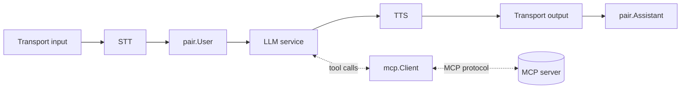

# MCP tools

The Model Context Protocol (MCP) is a standard way for a program to offer tools to an LLM. With Strawgo's MCP client, your voice bot can call the tools of any MCP server, with no handler code of your own. This guide connects a bot to an MCP server, picks which tools to expose, and shapes their results.

## Before you begin

- You understand [function calling](function-calling.md): MCP tools are registered as ordinary functions.
- You have an MCP server to talk to, reachable over streamable HTTP, SSE, or as a local command (stdio).
- You have API keys for Deepgram (STT, speech-to-text), OpenAI (the LLM) and Cartesia (TTS, text-to-speech).

> [!NOTE]
> The `services/mcp` package compiles but has no tests in this repository. Try it against your MCP server before you depend on it.

## Where MCP fits

The MCP client is not a pipeline processor. It lists the server's tools once, registers one handler per tool on the LLM service, and forwards each call to the server.



## A complete example

This bot connects to an MCP server over streamable HTTP when it starts, then offers that server's tools on every call.

```go
package main

import (
	"context"
	"log"
	"net/http"
	"os"
	"os/signal"
	"syscall"

	"github.com/square-key-labs/strawgo-ai/src/frames"
	"github.com/square-key-labs/strawgo-ai/src/llm"
	"github.com/square-key-labs/strawgo-ai/src/logger"
	"github.com/square-key-labs/strawgo-ai/src/pipeline"
	"github.com/square-key-labs/strawgo-ai/src/processors"
	"github.com/square-key-labs/strawgo-ai/src/processors/aggregators"
	"github.com/square-key-labs/strawgo-ai/src/serializers"
	"github.com/square-key-labs/strawgo-ai/src/services/cartesia"
	"github.com/square-key-labs/strawgo-ai/src/services/deepgram"
	"github.com/square-key-labs/strawgo-ai/src/services/mcp"
	"github.com/square-key-labs/strawgo-ai/src/services/openai"
	"github.com/square-key-labs/strawgo-ai/src/transports"
)

func main() {
	logger.Init()
	ctx, stop := signal.NotifyContext(context.Background(), os.Interrupt, syscall.SIGTERM)
	defer stop()

	tools, err := mcp.New(mcp.StreamableHTTPParams{
		URL:     os.Getenv("MCP_SERVER_URL"),
		Headers: map[string]string{"Authorization": "Bearer " + os.Getenv("MCP_SERVER_TOKEN")},
	})
	if err != nil {
		log.Fatal(err)
	}
	defer tools.Close()
	if err := tools.Start(ctx); err != nil {
		log.Fatal(err)
	}

	srv, err := transports.NewServer(transports.ServerConfig{
		Addr: ":8080",
		Path: "/media",
		NewSerializer: func(*http.Request) serializers.FrameSerializer {
			return serializers.NewTwilioFrameSerializer(serializers.TwilioConfig{
				AccountSID: os.Getenv("TWILIO_ACCOUNT_SID"),
				AuthToken:  os.Getenv("TWILIO_AUTH_TOKEN"),
			})
		},
		Handler: func(ctx context.Context, s *transports.Session) error { return runCall(ctx, s, tools) },
	})
	if err != nil {
		log.Fatal(err)
	}
	if err := srv.ListenAndServe(ctx); err != nil {
		log.Fatal(err)
	}
}

func runCall(ctx context.Context, s *transports.Session, tools *mcp.Client) error {
	stt := deepgram.NewSTTService(deepgram.STTConfig{APIKey: os.Getenv("DEEPGRAM_API_KEY"), Model: "nova-3", Language: "en"})
	llmSvc := openai.NewLLMService(openai.LLMConfig{
		APIKey:       os.Getenv("OPENAI_API_KEY"),
		Model:        "gpt-4.1-mini",
		SystemPrompt: "You are a helpful phone assistant. Use your tools when they help. Answer in short spoken sentences.",
	})
	tts := cartesia.NewTTSService(cartesia.TTSConfig{APIKey: os.Getenv("CARTESIA_API_KEY"), VoiceID: os.Getenv("CARTESIA_VOICE_ID"), Model: "sonic-2", Language: "en"})

	schemas, err := tools.RegisterTools(ctx, llmSvc)
	if err != nil {
		return err
	}
	conversation := llm.NewContext()
	conversation.SetTools(schemas)
	pair := aggregators.NewContextAggregatorPair(conversation, aggregators.ContextAggregatorPairParams{})

	pipe := pipeline.NewPipeline([]processors.FrameProcessor{
		s.Input(), stt, pair.User(), llmSvc, tts, s.Output(), pair.Assistant(),
	})
	task := pipeline.NewPipelineTask(pipe)
	if err := task.QueueFrame(frames.NewTTSSpeakFrame("Hi! How can I help?")); err != nil {
		return err
	}
	return task.Run(ctx)
}
```

What happens:

1. `mcp.New` checks the parameters. `Start` connects and opens the MCP session; you can skip it, because `Tools` and `RegisterTools` connect on first use.
2. On each call, `RegisterTools` lists the server's tools, converts each input schema into an `llm.FunctionSchema`, registers a handler for each on the LLM service, and returns the schemas.
3. `conversation.SetTools(schemas)` shows the tools to the model.
4. When the model calls a tool, the handler forwards the arguments to the server and returns its result to the model.

One client can serve many calls at the same time. Call `Close` when your program exits.

## Choose a transport

| Parameters | Server type | Fields |
| --- | --- | --- |
| `mcp.StreamableHTTPParams` | HTTP server using streamable HTTP | `URL`, `Headers`, `HTTPClient`, `MaxRetries` |
| `mcp.SSEParams` | HTTP server using server-sent events | `URL`, `Headers`, `HTTPClient` |
| `mcp.StdioParams` | a local program that speaks MCP on stdin and stdout | `Command`, `Args`, `Env`, `Dir`, `TerminateDuration` |

A local server started as a child process:

```go
tools, err := mcp.New(mcp.StdioParams{
	Command: "./weather-mcp-server",
	Args:    []string{"--units", "metric"},
	Env:     []string{"WEATHER_API_KEY=" + os.Getenv("WEATHER_API_KEY")},
})
```

`Env` replaces the child's environment. With a nil `Env`, the child inherits yours.

## Choose which tools to expose

A voice bot works best with a few well-described tools. Offer only the ones you need:

```go
tools, err := mcp.New(params, mcp.WithToolsFilter("get_forecast", "get_alerts"))
```

Fill in arguments yourself, so the model never sees or chooses them. The properties are removed from the schema and merged into every call:

```go
tools, err := mcp.New(params, mcp.WithToolArguments("get_forecast", map[string]any{"units": "metric"}))
```

The client logs a warning if you set fixed arguments for a tool the server does not offer.

## Shape the results

The handler returns the tool's structured content when the server sends some, otherwise the concatenated text content. Long or noisy results make the model slower and its answers worse. Trim them with an output filter:

```go
tools, err := mcp.New(params, mcp.WithOutputFilter("get_forecast", func(result any) (any, error) {
	m, ok := result.(map[string]any)
	if !ok {
		return result, nil
	}
	return map[string]any{"summary": m["summary"], "high": m["high"], "low": m["low"]}, nil
}))
```

If the filter returns an error, it is logged and the model receives the fallback text `Sorry, could not call the mcp tool`. The same fallback is used when a tool returns nothing.

## Timeouts and errors

| Option | Default | Meaning |
| --- | --- | --- |
| `mcp.WithConnectTimeout(d)` | `mcp.DefaultConnectTimeout` (30 s) | how long connecting may take |
| `mcp.WithCallTimeout(d)` | `mcp.DefaultCallTimeout` (60 s) | how long one tool call may take |
| `mcp.WithFunctionOptions(opts)` | none | the `llm.FunctionOptions` (`Timeout`, `CancelOnInterruption`) used when registering every tool |
| `mcp.WithClientInfo(name, version)` | `strawgo`, `1.0.0` | how the client introduces itself to the server |

When a tool fails, the model is told what happened instead of the call failing:

- If the server reports a tool error, the model receives the tool's own output.
- If the call itself fails, for example with a protocol error or because `WithCallTimeout` expired, the model receives `Error calling mcp tool <name>: <detail>`, with the detail cut at 200 characters.
- If the handler's own `ctx` ends (an interruption with `CancelOnInterruption`, or the function `Timeout`), or the client is not connected or closed, the handler returns a Go error, and the model gets an error result as described in [Function calling](function-calling.md#returning-errors).

If the connection to the server is lost, the client drops the session and logs a warning.

Voice callers wait in silence while a tool runs. Keep `WithCallTimeout` short enough for a phone call, and see [Long-running functions](function-calling.md#long-running-functions) for ways to fill the gap.

## Use MCP with other services

`RegisterTools` accepts anything with a `RegisterFunction` method, so it works with:

- the realtime services: `openai_realtime.LLMService` and `gemini.LiveService` (pass the returned schemas in their `Tools` config or the context);
- `pipeline.LLMSwitcher`, which registers on every LLM it holds.

`tools.Tools(ctx)` lists the schemas without registering anything, and `tools.Handler()` returns the forwarding handler if you want to register tools one by one, for example under a different name. `tools.CallTool(ctx, name, args)` calls a tool directly from your own code.

## Next steps

- [Function calling](function-calling.md): timeouts, errors and interruptions apply to MCP tools too.
- [Conversation context](conversation-context.md#change-tools-during-a-call): change the offered tools during a call.
- [Flows](flows.md): offer different tools at each step.
- [LLM providers](../providers/llm.md): which LLMs support tool calls.
