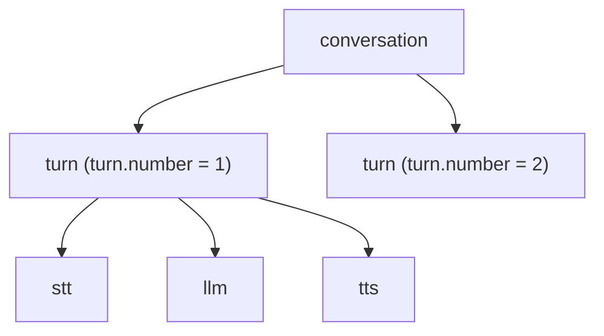

# Observability

This guide shows how to see what your bot is doing: turning on metrics, reading the metric types, using the built-in observers for turns and latency, writing your own observer, exporting OpenTelemetry traces, and measuring performance.

## Before you begin

- A working bot, for example from [Twilio](telephony-twilio.md) or the [quickstart](../getting-started/quickstart.md).
- Terms used on this page:
  - A **frame** is one unit of data in the pipeline: audio, text, or a control signal.
  - An **observer** sees every frame that processors push, without changing anything. Observers run on their own goroutines, so a slow observer does not slow the call.
  - **TTFB** (time to first byte) is how long a service took to return its first result.
  - A **turn** is one exchange: the user speaks, then the bot answers.
  - **STT**, **LLM** and **TTS** are the speech-to-text, language model and text-to-speech services.

## Turn on metrics

Services emit metrics only when the task asks for them:

```go
func metricsConfig() *pipeline.PipelineTaskConfig {
	cfg := pipeline.DefaultPipelineTaskConfig()
	cfg.EnableMetrics = true
	cfg.EnableUsageMetrics = true
	return cfg
}
```

| Field | Turns on |
| --- | --- |
| `EnableMetrics` | TTFB, processing time and LLM response ids |
| `EnableUsageMetrics` | LLM token usage, STT audio seconds and TTS characters |
| `ReportOnlyInitialTTFB` | Only the first TTFB per service per call, instead of one per request |

Pass the config to `pipeline.NewPipelineTaskWithConfig`. Metrics travel through the pipeline as `frames.MetricsFrame`s, so any observer can read them.

## A complete example

This Twilio bot logs every metric, each turn, and the user-to-bot latency with a breakdown of where the time went.

```go
package main

import (
	"context"
	"log"
	"net/http"
	"os"
	"os/signal"
	"syscall"
	"time"

	"github.com/square-key-labs/strawgo-ai/src/llm"
	"github.com/square-key-labs/strawgo-ai/src/logger"
	"github.com/square-key-labs/strawgo-ai/src/pipeline"
	"github.com/square-key-labs/strawgo-ai/src/pipeline/observers"
	"github.com/square-key-labs/strawgo-ai/src/processors"
	"github.com/square-key-labs/strawgo-ai/src/processors/aggregators"
	"github.com/square-key-labs/strawgo-ai/src/serializers"
	"github.com/square-key-labs/strawgo-ai/src/services/cartesia"
	"github.com/square-key-labs/strawgo-ai/src/services/deepgram"
	"github.com/square-key-labs/strawgo-ai/src/services/openai"
	"github.com/square-key-labs/strawgo-ai/src/transports"
)

func main() {
	logger.Init()
	srv, err := transports.NewServer(transports.ServerConfig{
		Addr: ":8080",
		Path: "/media",
		NewSerializer: func(*http.Request) serializers.FrameSerializer {
			return serializers.NewTwilioFrameSerializer(serializers.TwilioConfig{
				AccountSID: os.Getenv("TWILIO_ACCOUNT_SID"),
				AuthToken:  os.Getenv("TWILIO_AUTH_TOKEN"),
			})
		},
		Handler: runCall,
	})
	if err != nil {
		log.Fatal(err)
	}
	ctx, stop := signal.NotifyContext(context.Background(), os.Interrupt, syscall.SIGTERM)
	defer stop()
	if err := srv.ListenAndServe(ctx); err != nil {
		log.Fatal(err)
	}
}

func runCall(ctx context.Context, s *transports.Session) error {
	callID := s.CallInfo().CallID
	stt := deepgram.NewSTTService(deepgram.STTConfig{APIKey: os.Getenv("DEEPGRAM_API_KEY"), Model: "nova-3", Language: "en"})
	llmSvc := openai.NewLLMService(openai.LLMConfig{APIKey: os.Getenv("OPENAI_API_KEY"), Model: "gpt-4.1-mini", SystemPrompt: "You are a helpful phone assistant. Keep answers short."})
	tts := cartesia.NewTTSService(cartesia.TTSConfig{APIKey: os.Getenv("CARTESIA_API_KEY"), VoiceID: os.Getenv("CARTESIA_VOICE_ID"), Model: "sonic-2", Language: "en"})
	pair := aggregators.NewContextAggregatorPair(llm.NewContext(), aggregators.ContextAggregatorPairParams{})
	pipe := pipeline.NewPipeline([]processors.FrameProcessor{
		s.Input(), stt, pair.User(), llmSvc, tts, s.Output(), pair.Assistant(),
	})

	cfg := pipeline.DefaultPipelineTaskConfig()
	cfg.EnableMetrics = true
	cfg.EnableUsageMetrics = true
	task := pipeline.NewPipelineTaskWithConfig(pipe, cfg)

	latency := observers.NewUserBotLatencyObserver()
	latency.OnLatencyMeasured(func(d time.Duration) {
		log.Printf("call %s: user stopped -> bot started speaking: %v", callID, d.Round(time.Millisecond))
	})
	latency.OnLatencyBreakdown(func(b observers.LatencyBreakdown) {
		for _, line := range b.Lines(true) {
			log.Printf("call %s:   %s", callID, line)
		}
	})
	latency.OnFirstBotSpeechLatency(func(d time.Duration) {
		log.Printf("call %s: first bot speech %v after connect", callID, d.Round(time.Millisecond))
	})

	turns := observers.NewTurnTrackingObserver()
	turns.OnTurnEnded(func(turn int, d time.Duration, interrupted bool) {
		log.Printf("call %s: turn %d took %v (interrupted=%v)", callID, turn, d.Round(time.Millisecond), interrupted)
	})

	obs := pipeline.NewTaskObserver()
	obs.AddObserver(observers.NewMetricsLogObserver())
	obs.AddObserver(latency)
	obs.AddObserver(turns)
	task.SetObserver(obs)

	return task.Run(ctx)
}
```

A task has one `TaskObserver`; add as many observers to it as you like. Each observer gets its own queue and goroutine. If an observer falls far behind, events for it are dropped (media first, control events last) and the count is logged when the call ends.

## Metric types

Every metric in a `MetricsFrame.Data` slice implements `frames.MetricsData`. `Base()` returns the `Processor` name and `Model`.

| Type | Fields | Emitted by |
| --- | --- | --- |
| `TTFBMetricsData` | `Value` | STT, LLM and TTS services (needs `EnableMetrics`) |
| `ProcessingMetricsData` | `Value` | LLM (whole response), TTS, segmented STT (needs `EnableMetrics`) |
| `LLMUsageMetricsData` | `Value` (`llm.Usage`: `PromptTokens`, `CompletionTokens`, `TotalTokens`, `CacheReadTokens`, `CacheCreationTokens`, `ReasoningTokens`) | LLM services that report usage (needs `EnableUsageMetrics`) |
| `LLMResponseMetricsData` | `ResponseID`, `RequestID`, `ServedModel`, `StopReason`, `RawStopReason` | LLM services, once per response (needs `EnableMetrics`) |
| `STTUsageMetricsData` | `Value.AudioSeconds` | STT services (needs `EnableUsageMetrics`) |
| `TTSUsageMetricsData` | `Value` (characters) | TTS services (needs `EnableUsageMetrics`) |
| `TurnMetricsData` | `IsComplete`, `Probability`, `E2EProcessingTime` | The smart-turn analyzer, through the VAD processor or user aggregator |
| `TTFAMetricsData`, `TTFATMetricsData`, `TextAggregationMetricsData` | various | Defined for custom services; no built-in service emits them |

`LLMResponseMetricsData` is the one to log when you need to look a response up in your LLM provider's dashboard: `ResponseID` and `RequestID` are the provider's own ids.

`observers.FormatMetrics(d)` turns any metric into a one-line string.

## Built-in observers

All live in `pipeline/observers`.

| Observer | What it reports |
| --- | --- |
| `NewUserBotLatencyObserver(opts...)` | `OnLatencyMeasured`: time from the user stopping speaking to the bot starting to speak. `OnLatencyBreakdown`: the same time split into contributions (endpointing wait, transcription, turn detection, LLM inference, function handler, sentence aggregation, speech synthesis, output transport and so on), each with an owner such as `config: VAD stop_secs` or a service name. `OnFirstBotSpeechLatency`: time from client connected to the bot's first speech. `WithMinContribution(d)` hides contributions shorter than `d` (default 5 ms). |
| `NewTurnTrackingObserver(opts...)` | `OnTurnStarted(turn)` and `OnTurnEnded(turn, duration, interrupted)`. A turn starts when the user starts speaking and ends when the user speaks again after the bot, when the user interrupts, or 2.5 s after the bot stops speaking (`WithTurnEndTimeout`). |
| `NewStartupTimingObserver()` | `OnTransportTimingReport`: time from pipeline start to client connected. |
| `NewTurnMetricsObserver()` | `OnTurnMetrics` for `frames.TurnMetricsFrame`s. No built-in processor pushes this frame; push one yourself with `observers.TurnMetricsData.ToFrame()`. |
| `NewMetricsLogObserver(include...)` | Logs every metric, or only the types you pass (for example `frames.TTFBMetricsData{}`). |
| `NewLLMLogObserver()` | Logs LLM requests and responses. |
| `NewTranscriptionLogObserver()` | Logs transcriptions. |
| `NewDebugLogObserver(filters, excludeFields...)` and `NewDebugLogObserverFor(examples...)` | Logs frames of the given types, field by field. Audio data fields are excluded by default. |
| `NewMulti(observers...)` | Combines several observers into one. |

```go
func debugObservers() *pipeline.TaskObserver {
	obs := pipeline.NewTaskObserver()
	obs.AddObserver(observers.NewMetricsLogObserver(frames.TTFBMetricsData{}, frames.LLMUsageMetricsData{}))
	obs.AddObserver(observers.NewTranscriptionLogObserver())
	obs.AddObserver(observers.NewDebugLogObserverFor(frames.NewInterruptionFrame(), frames.NewBotStoppedSpeakingFrame()))
	return obs
}
```

## Write your own observer

An observer implements `pipeline.Observer`, which has four methods:

| Method | Called |
| --- | --- |
| `OnPushFrame(pipeline.PushFrameEvent)` | Each time a processor pushes a frame to the next one. |
| `OnProcessFrame(pipeline.ProcessFrameEvent)` | Each time a processor starts handling a frame. The built-in observers leave it empty and filter it out in `Interested`. |
| `OnPipelineStarted()` | Once, when the task starts. |
| `OnPipelineStopped()` | Once, when the task stops. |

A push event carries `ProcessorName`, `Frame`, `Direction` and `Timestamp` (taken when the frame was pushed, not when your observer runs).

Also implement `Interested` (the `pipeline.SelectiveObserver` interface) to filter cheaply before an event is queued. Without it, your observer receives every frame, including every audio chunk.

This observer keeps the TTFB per service and the total token usage for one call:

```go
type callStats struct {
	mu     sync.Mutex
	ttfb   map[string][]time.Duration
	tokens int
}

func newCallStats() *callStats {
	return &callStats{ttfb: map[string][]time.Duration{}}
}

func (c *callStats) Interested(f frames.Frame, _ frames.FrameDirection, kind pipeline.EventKind) bool {
	_, ok := f.(*frames.MetricsFrame)
	return ok && kind == pipeline.PushEvent
}

func (c *callStats) OnPushFrame(ev pipeline.PushFrameEvent) {
	mf, ok := ev.Frame.(*frames.MetricsFrame)
	if !ok {
		return
	}
	c.mu.Lock()
	defer c.mu.Unlock()
	for _, d := range mf.Data {
		switch m := d.(type) {
		case frames.TTFBMetricsData:
			c.ttfb[m.Processor] = append(c.ttfb[m.Processor], m.Value)
		case frames.LLMUsageMetricsData:
			c.tokens += m.Value.TotalTokens
		}
	}
}

func (c *callStats) OnProcessFrame(pipeline.ProcessFrameEvent) {}

func (c *callStats) OnPipelineStarted() {}

func (c *callStats) OnPipelineStopped() {
	c.mu.Lock()
	defer c.mu.Unlock()
	for processor, values := range c.ttfb {
		log.Printf("%s: %d requests, TTFB samples %v", processor, len(values), values)
	}
	log.Printf("total tokens: %d", c.tokens)
}
```

Add it with `obs.AddObserver(newCallStats())`. Notes:

- The same frame can be pushed several times as it passes through processors. To count it once, check `ev.ProcessorName` (for example only the service that produced it) or remember `ev.Frame.ID()`; `observers.RecentFrames` has a `FirstSeen(id)` helper.
- Observer methods run on the observer's own goroutine, one event at a time, but `OnPipelineStopped` may run while your handler reads the results, so guard shared state with a mutex as above.
- A panic in an observer is recovered and logged; it does not end the call.

The [metrics dashboard recipe](../cookbook/metrics-dashboard.md) sends these values to a metrics system.

## Measure latency yourself

If you want one specific measurement, observe two frames and subtract their timestamps. This measures from the end of the user's speech to the first bot audio leaving the transport:

```go
type stopToSpeech struct {
	mu        sync.Mutex
	userEnded time.Time
	onMeasure func(time.Duration)
}

func (o *stopToSpeech) Interested(f frames.Frame, dir frames.FrameDirection, kind pipeline.EventKind) bool {
	if kind != pipeline.PushEvent || dir != frames.Downstream {
		return false
	}
	switch f.(type) {
	case *frames.UserStoppedSpeakingFrame, *frames.BotStartedSpeakingFrame:
		return true
	}
	return false
}

func (o *stopToSpeech) OnPushFrame(ev pipeline.PushFrameEvent) {
	o.mu.Lock()
	defer o.mu.Unlock()
	switch ev.Frame.(type) {
	case *frames.UserStoppedSpeakingFrame:
		o.userEnded = ev.Timestamp
	case *frames.BotStartedSpeakingFrame:
		if !o.userEnded.IsZero() {
			o.onMeasure(ev.Timestamp.Sub(o.userEnded))
			o.userEnded = time.Time{}
		}
	}
}

func (o *stopToSpeech) OnProcessFrame(pipeline.ProcessFrameEvent) {}

func (o *stopToSpeech) OnPipelineStarted() {}

func (o *stopToSpeech) OnPipelineStopped() {}
```

`BotStartedSpeakingFrame` is emitted when the first audio chunk is written to the connection. What the caller hears adds the provider's and the phone network's delay, which Strawgo cannot see. The built-in `UserBotLatencyObserver` does this and more, so prefer it unless you need a custom start or end point.

## OpenTelemetry tracing

The `tracing` package turns a call into OpenTelemetry spans. It uses the global tracer provider unless you pass `Config.Tracer`, so set up the OpenTelemetry SDK once at startup. This complete program prints spans to stdout; replace the exporter with an OTLP exporter to send them to Jaeger, Tempo, Honeycomb or any OTLP collector.

```go
package main

import (
	"context"
	"log"
	"net/http"
	"os"
	"os/signal"
	"syscall"
	"time"

	"go.opentelemetry.io/otel"
	"go.opentelemetry.io/otel/attribute"
	"go.opentelemetry.io/otel/exporters/stdout/stdouttrace"
	sdktrace "go.opentelemetry.io/otel/sdk/trace"

	"github.com/square-key-labs/strawgo-ai/src/llm"
	"github.com/square-key-labs/strawgo-ai/src/logger"
	"github.com/square-key-labs/strawgo-ai/src/pipeline"
	"github.com/square-key-labs/strawgo-ai/src/processors"
	"github.com/square-key-labs/strawgo-ai/src/processors/aggregators"
	"github.com/square-key-labs/strawgo-ai/src/serializers"
	"github.com/square-key-labs/strawgo-ai/src/services/cartesia"
	"github.com/square-key-labs/strawgo-ai/src/services/deepgram"
	"github.com/square-key-labs/strawgo-ai/src/services/openai"
	"github.com/square-key-labs/strawgo-ai/src/tracing"
	"github.com/square-key-labs/strawgo-ai/src/transports"
)

func main() {
	logger.Init()
	exporter, err := stdouttrace.New(stdouttrace.WithPrettyPrint())
	if err != nil {
		log.Fatal(err)
	}
	provider := sdktrace.NewTracerProvider(sdktrace.WithBatcher(exporter))
	otel.SetTracerProvider(provider)
	defer func() {
		shutdownCtx, cancel := context.WithTimeout(context.Background(), 5*time.Second)
		defer cancel()
		_ = provider.Shutdown(shutdownCtx)
	}()

	srv, err := transports.NewServer(transports.ServerConfig{
		Addr: ":8080",
		Path: "/media",
		NewSerializer: func(*http.Request) serializers.FrameSerializer {
			return serializers.NewTwilioFrameSerializer(serializers.TwilioConfig{
				AccountSID: os.Getenv("TWILIO_ACCOUNT_SID"),
				AuthToken:  os.Getenv("TWILIO_AUTH_TOKEN"),
			})
		},
		Handler: runCall,
	})
	if err != nil {
		log.Fatal(err)
	}
	ctx, stop := signal.NotifyContext(context.Background(), os.Interrupt, syscall.SIGTERM)
	defer stop()
	if err := srv.ListenAndServe(ctx); err != nil {
		log.Print(err)
	}
}

func runCall(ctx context.Context, s *transports.Session) error {
	info := s.CallInfo()
	stt := deepgram.NewSTTService(deepgram.STTConfig{APIKey: os.Getenv("DEEPGRAM_API_KEY"), Model: "nova-3", Language: "en"})
	llmSvc := openai.NewLLMService(openai.LLMConfig{APIKey: os.Getenv("OPENAI_API_KEY"), Model: "gpt-4.1-mini", SystemPrompt: "You are a helpful phone assistant. Keep answers short."})
	tts := cartesia.NewTTSService(cartesia.TTSConfig{APIKey: os.Getenv("CARTESIA_API_KEY"), VoiceID: os.Getenv("CARTESIA_VOICE_ID"), Model: "sonic-2", Language: "en"})
	pair := aggregators.NewContextAggregatorPair(llm.NewContext(), aggregators.ContextAggregatorPairParams{})
	pipe := pipeline.NewPipeline([]processors.FrameProcessor{
		s.Input(), stt, pair.User(), llmSvc, tts, s.Output(), pair.Assistant(),
	})
	cfg := pipeline.DefaultPipelineTaskConfig()
	cfg.EnableMetrics = true
	cfg.EnableUsageMetrics = true
	task := pipeline.NewPipelineTaskWithConfig(pipe, cfg)

	obs := pipeline.NewTaskObserver()
	obs.AddObserver(tracing.NewObserver(tracing.Config{
		ConversationID: info.CallID,
		Attributes:     []attribute.KeyValue{attribute.String("call.provider", info.Provider)},
	}))
	task.SetObserver(obs)
	return task.Run(ctx)
}
```

Turn on `EnableMetrics` and `EnableUsageMetrics` as shown; without them the spans have no TTFB or token attributes.

### Span tree



| Span | Attributes |
| --- | --- |
| `conversation` (a new root span per call) | `conversation.id` (from `Config.ConversationID`, or a random UUID), `conversation.type` (`Config.ConversationType`, default `voice`), plus everything in `Config.Attributes` |
| `turn` | `turn.number`, `turn.type` (`conversation`), `conversation.id`; at the end `turn.duration_seconds`, `turn.was_interrupted`, `turn.user_bot_latency_seconds`; if the call ends mid-turn, `turn.ended_by_conversation_end` |
| `stt`, `llm`, `tts` (one per service request, under the current turn) | `gen_ai.provider.name`, `gen_ai.request.model`, `gen_ai.operation.name` (`stt`, `chat` or `tts`); `metrics.ttfb`, `metrics.processing_time` |
| `stt` only | `is_final`, `language`, `metrics.audio_seconds` |
| `llm` only | `gen_ai.output.type` (`text`), `stream`, `tool_count`, `tools`, `function_calls.count`, `function_calls.first_name`, `function_calls.names`, `gen_ai.usage.input_tokens`, `gen_ai.usage.output_tokens`, and when present `gen_ai.usage.cache_read.input_tokens`, `gen_ai.usage.cache_creation.input_tokens`, `gen_ai.usage.reasoning.output_tokens` |
| `tts` only | `gen_ai.output.type` (`speech`), `tts.interrupted`, `metrics.character_count` |

With `Config.RecordText: true`, spans also carry the text: `transcript` on `stt`, `gen_ai.system_instructions`, `input` and `output` on `llm`, and `text` on `tts`. Leave it off if transcripts are sensitive.

Other `tracing.Config` fields:

| Field | Meaning |
| --- | --- |
| `Tracer` | Use this tracer instead of the global one. |
| `TurnTracker`, `LatencyTracker` | Share existing observers instead of creating new ones (add them to the task observer yourself). |
| `TurnEndTimeout` | Passed to the internal turn tracker. |
| `ProviderName` | Maps a processor name to `gen_ai.provider.name`. The default strips suffixes such as `LLMService` and lowercases the rest. |

If the global provider is a no-op (you never set one up), the observer detects that and stops doing work. To make your own spans children of the current turn, use `ConversationContext()` or `TurnContext()` on the observer.

> [!NOTE]
> The tracing package has no tests in this repository. Check the spans in your backend before relying on them.

## Measure performance

No performance numbers are published for Strawgo; measure on your own hardware.

Frame throughput, context handling and the Twilio serializer:

```bash
go test -run '^$' -bench . -benchmem ./src/
```

Observer overhead on an audio-heavy pipeline:

```bash
go test -run '^$' -bench . -benchmem ./src/pipeline/
```

Load on the ONNX worker (VAD inference) at increasing concurrency. Start an `onnx-worker` first (see [Deployment](deployment.md#run-the-onnx-worker-sidecar)), then from the repository root:

```bash
go run ./cmd/loadtest -socket /tmp/onnx-worker.sock -levels 1,2,5,10,20 -dur 20 -pid "$(pgrep -n onnx-worker)"
```

It prints a table of p50, p95 and p99 request latency, scheduled, successful and failed requests, and the worker's memory at each concurrency level. `-pcm` points at a different 16 kHz PCM fixture; by default it uses `testdata/sine_440_500ms_16k.pcm`.

For whole-call latency, run real calls with the `UserBotLatencyObserver` shown above and collect its measurements.

## Next steps

- [Metrics dashboard recipe](../cookbook/metrics-dashboard.md)
- [Observers reference](../reference/observers.md)
- [Deployment](deployment.md)
- [Troubleshooting](troubleshooting.md)
