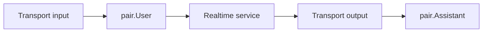

# Speech-to-speech

A speech-to-speech model (also called a realtime model) takes the caller's audio and answers with audio directly, with no separate speech-to-text or text-to-speech step. This guide helps you decide when to use one, and shows complete bots for OpenAI Realtime and Gemini Live, including tools, interruptions and transcripts.

## Before you begin

- You have run [Your first phone bot](../getting-started/first-phone-bot.md), or know how a Strawgo pipeline and transport fit together.
- You have an OpenAI API key or a Gemini API key in an environment variable.

Terms used on this page:

- **STT** (speech-to-text) turns audio into text; **TTS** (text-to-speech) turns text into audio; the **LLM** writes the reply in between.
- A **turn** is one person's uninterrupted contribution to the conversation.
- An **interruption** (barge-in) is the caller talking while the bot speaks; the bot stops and listens.

> [!NOTE]
> The OpenAI Realtime and Gemini Live services are tested against mock servers only, never against the live APIs. AWS Nova Sonic is not available in Strawgo.

## Realtime model or STT + LLM + TTS

| | Realtime model | STT + LLM + TTS |
| --- | --- | --- |
| Moving parts | one service | three services you choose separately |
| Voice choice | the vendor's built-in voices | any TTS provider and voice |
| Turn detection | the vendor's, by default; or your own VAD | your VAD and [turn strategies](turn-taking.md) |
| What you can inspect | transcripts reported by the vendor | the exact text sent to and from the LLM |
| Prompt and context control | instructions plus the vendor's session state | full control of every message ([Conversation context](conversation-context.md)) |
| Function calling | yes, same `RegisterFunction` API | yes |
| Structured output, refusal details | no | yes ([Structured output and refusals](structured-output-and-refusals.md)) |
| Switching vendor mid-call | not supported | per service ([Switching services](switching-services.md)) |
| Latency | measure it: see [Observability](observability.md) | measure it the same way |

Pick a realtime model when you want the simplest pipeline and the vendor's voice is acceptable. Pick STT + LLM + TTS when you need a specific voice, tight control of the prompt, or provider failover.

## Where the service goes

A realtime service replaces the STT, LLM and TTS services. Keep the context aggregators around it: they record the transcripts and function calls in the context.



## OpenAI Realtime

```go
package main

import (
	"context"
	"log"
	"net/http"
	"os"
	"os/signal"
	"syscall"
	"time"

	"github.com/square-key-labs/strawgo-ai/src/frames"
	"github.com/square-key-labs/strawgo-ai/src/llm"
	"github.com/square-key-labs/strawgo-ai/src/logger"
	"github.com/square-key-labs/strawgo-ai/src/pipeline"
	"github.com/square-key-labs/strawgo-ai/src/pipeline/observers"
	"github.com/square-key-labs/strawgo-ai/src/processors"
	"github.com/square-key-labs/strawgo-ai/src/processors/aggregators"
	"github.com/square-key-labs/strawgo-ai/src/serializers"
	"github.com/square-key-labs/strawgo-ai/src/services/openai_realtime"
	"github.com/square-key-labs/strawgo-ai/src/transports"
)

var tools = llm.Tools{Functions: []llm.FunctionSchema{{
	Name:        "get_time",
	Description: "The current local time.",
}}}

func main() {
	logger.Init()
	srv, err := transports.NewServer(transports.ServerConfig{
		Addr: ":8080",
		Path: "/media",
		NewSerializer: func(*http.Request) serializers.FrameSerializer {
			return serializers.NewTwilioFrameSerializer(serializers.TwilioConfig{
				AccountSID: os.Getenv("TWILIO_ACCOUNT_SID"),
				AuthToken:  os.Getenv("TWILIO_AUTH_TOKEN"),
			})
		},
		Handler: runCall,
	})
	if err != nil {
		log.Fatal(err)
	}
	ctx, stop := signal.NotifyContext(context.Background(), os.Interrupt, syscall.SIGTERM)
	defer stop()
	if err := srv.ListenAndServe(ctx); err != nil {
		log.Fatal(err)
	}
}

func runCall(ctx context.Context, s *transports.Session) error {
	rt := openai_realtime.NewLLMService(openai_realtime.LLMConfig{
		APIKey:            os.Getenv("OPENAI_API_KEY"),
		SystemInstruction: "You are a helpful voice assistant on a phone call. Keep answers brief.",
		Voice:             "alloy",
		Tools:             tools,
	})
	rt.RegisterFunction("get_time", func(context.Context, llm.FunctionCallParams) (llm.FunctionResult, error) {
		return llm.FunctionResult{Value: map[string]any{"time": time.Now().Format(time.Kitchen)}}, nil
	})

	conversation := llm.NewContext(llm.User("Greet the caller and ask how you can help."))
	pair := aggregators.NewContextAggregatorPair(conversation, aggregators.ContextAggregatorPairParams{})

	pipe := pipeline.NewPipeline([]processors.FrameProcessor{
		s.Input(), pair.User(), rt, s.Output(), pair.Assistant(),
	})
	task := pipeline.NewPipelineTask(pipe)

	obs := pipeline.NewTaskObserver()
	obs.AddObserver(observers.NewTranscriptionLogObserver())
	task.SetObserver(obs)

	if err := task.QueueFrame(frames.NewLLMRunFrame()); err != nil {
		return err
	}
	err := task.Run(ctx)
	for _, m := range conversation.Messages() {
		log.Printf("%s: %s", m.Role, m.Text())
	}
	return err
}
```

How it works:

1. When the pipeline starts, the service opens a WebSocket to `wss://api.openai.com/v1/realtime?model=...` with only an `Authorization` header (the GA Realtime API; there is no `OpenAI-Beta` header), and sends a `session.update` of type `realtime` with the instructions, tools, and the audio settings under `audio.input` (format, transcription, turn detection, noise reduction) and `audio.output` (format, voice).
2. The `LLMRunFrame` makes the user aggregator send the context. On the first context, the service sends the conversation's messages and asks for a response, so the bot greets the caller.
3. Caller audio is streamed to OpenAI, resampled to 24 kHz PCM. OpenAI's server VAD detects turns and the model answers.
4. The answer's audio goes to the output transport; its transcript is recorded by the assistant aggregator.

`openai_realtime.LLMConfig` fields:

| Field | Default | Meaning |
| --- | --- | --- |
| `APIKey` | | your OpenAI key |
| `Model` | `openai_realtime.DefaultRealtimeModel` (`gpt-realtime-2.1`) | the realtime model |
| `SystemInstruction` | | the instructions; if empty, the leading system or developer messages of the context are used |
| `Voice`, `Speed` | vendor default | the voice name and speaking speed |
| `Tools`, `ToolChoice` | | the tools; if empty, the tools of the first context are used |
| `TranscriptionModel` | `gpt-realtime-whisper` | the model that transcribes the caller |
| `TranscriptionLanguage`, `TranscriptionPrompt` | | language code and hint for the caller's transcript |
| `TurnDetection` | the server's `server_vad` | `server_vad` with threshold and timings, or `semantic_vad` with an eagerness |
| `DisableServerVAD` | `false` | use your own VAD instead of OpenAI's (see [Interruptions](#interruptions)) |
| `NoiseReduction` | off | `near_field` or `far_field` |
| `ReasoningEffort` | | reasoning effort, sent only to `gpt-realtime-2` models |
| `Truncation`, `TruncationRetentionRatio` | the server's `auto` | what happens when the conversation outgrows the context window |
| `InputAudioFormat`, `OutputAudioFormat` | `pcm16` | `pcm16`, `g711_ulaw` or `g711_alaw` (the GA names `audio/pcm`, `audio/pcmu`, `audio/pcma` also work); non-PCM output defaults to 8 kHz |
| `OutputSampleRate`, `OutputChannels` | 24000, 1 | output audio format |
| `FunctionTimeout` | none | default timeout for every function |
| `Endpoint` | `wss://api.openai.com/v1/realtime` | override for proxies or tests |
| `Backoff` | | reconnect backoff for dropped connections |

## Gemini Live

```go
package main

import (
	"context"
	"log"
	"net/http"
	"os"
	"os/signal"
	"syscall"
	"time"

	"github.com/square-key-labs/strawgo-ai/src/frames"
	"github.com/square-key-labs/strawgo-ai/src/llm"
	"github.com/square-key-labs/strawgo-ai/src/logger"
	"github.com/square-key-labs/strawgo-ai/src/pipeline"
	"github.com/square-key-labs/strawgo-ai/src/processors"
	"github.com/square-key-labs/strawgo-ai/src/processors/aggregators"
	"github.com/square-key-labs/strawgo-ai/src/serializers"
	"github.com/square-key-labs/strawgo-ai/src/services/gemini"
	"github.com/square-key-labs/strawgo-ai/src/transports"
)

var tools = llm.Tools{Functions: []llm.FunctionSchema{{
	Name:        "get_time",
	Description: "The current local time.",
}}}

func main() {
	logger.Init()
	srv, err := transports.NewServer(transports.ServerConfig{
		Addr: ":8080",
		Path: "/media",
		NewSerializer: func(*http.Request) serializers.FrameSerializer {
			return serializers.NewTwilioFrameSerializer(serializers.TwilioConfig{
				AccountSID: os.Getenv("TWILIO_ACCOUNT_SID"),
				AuthToken:  os.Getenv("TWILIO_AUTH_TOKEN"),
			})
		},
		Handler: runCall,
	})
	if err != nil {
		log.Fatal(err)
	}
	ctx, stop := signal.NotifyContext(context.Background(), os.Interrupt, syscall.SIGTERM)
	defer stop()
	if err := srv.ListenAndServe(ctx); err != nil {
		log.Fatal(err)
	}
}

func runCall(ctx context.Context, s *transports.Session) error {
	live := gemini.NewLiveService(gemini.LiveConfig{
		APIKey:            os.Getenv("GEMINI_API_KEY"),
		Model:             gemini.DefaultLiveModel,
		SystemInstruction: "You are a helpful voice assistant on a phone call. Keep answers brief.",
		Voice:             "Puck",
		Tools:             tools,
	})
	live.RegisterFunction("get_time", func(context.Context, llm.FunctionCallParams) (llm.FunctionResult, error) {
		return llm.FunctionResult{Value: map[string]any{"time": time.Now().Format(time.Kitchen)}}, nil
	})

	conversation := llm.NewContext(llm.User("Greet the caller and ask how you can help."))
	pair := aggregators.NewContextAggregatorPair(conversation, aggregators.ContextAggregatorPairParams{})

	pipe := pipeline.NewPipeline([]processors.FrameProcessor{
		s.Input(), pair.User(), live, s.Output(), pair.Assistant(),
	})
	task := pipeline.NewPipelineTask(pipe)

	if err := task.QueueFrame(frames.NewLLMRunFrame()); err != nil {
		return err
	}
	err := task.Run(ctx)
	for _, m := range conversation.Messages() {
		log.Printf("%s: %s", m.Role, m.Text())
	}
	return err
}
```

How it works:

1. The service connects to the Gemini Live WebSocket (`v1beta`, key in the `x-goog-api-key` header) and sends a `setup` message with the model, voice, instructions, tools, input and output transcription turned on, and `historyConfig` so the first context can be sent as client content.
2. On the first context, it sends the conversation's messages. If the last one is from the user, Gemini answers. Gemini 3 models also need a realtime input before they answer, so the service follows the message with a realtime text input of a single space.
3. Caller audio is streamed as PCM (or as G.711 if the audio frames say so); Gemini's own activity detection finds the turns.
4. The service keeps the session-resumption handle Gemini sends, and reconnects with it when Gemini announces it is going away.

`gemini.LiveConfig` fields:

| Field | Default | Meaning |
| --- | --- | --- |
| `APIKey` | | your Gemini key |
| `Model` | `gemini.DefaultLiveModel` (`gemini-3.8-live`) | the Live model |
| `SystemInstruction` | | instructions; if empty, the context's system messages are used |
| `Voice` | vendor default | a prebuilt voice name |
| `Tools` | | the tools; if empty, the tools of the first context are used |
| `DisableVAD` | `false` | use your own VAD instead of Gemini's |
| `InputMIMEType` | derived from the audio | override the input MIME type |
| `OutputSampleRate`, `OutputChannels` | 24000, 1 | used when Gemini's audio does not state a rate |
| `ContextWindowCompression`, `CompressionTriggerTokens` | off | sliding-window compression of long sessions, optionally starting at a token count |
| `FunctionTimeout` | none | default timeout for every function |
| `Endpoint`, `Backoff` | | connection overrides |

[examples/gemini_live](../../examples/gemini_live/main.go) is the same bot with metrics logging.

## Tools with realtime models

Register handlers exactly as with a text LLM (see [Function calling](function-calling.md)): `RegisterFunction`, `UnregisterFunction`, `HasFunction`, `llm.FunctionOptions` for `Timeout` and `CancelOnInterruption`. The service broadcasts the same `FunctionCallsStartedFrame`, `FunctionCallInProgressFrame` and `FunctionCallResultFrame`, so the assistant aggregator records calls and results in the context.

Differences between the two services:

| | OpenAI Realtime | Gemini Live |
| --- | --- | --- |
| Result sent as | `function_call_output` item | `toolResponse` message |
| After the last result | asks for a new response, unless the result has `RunLLM: false` | Gemini continues on its own; `RunLLM` has no effect |
| Change tools mid-call (`LLMSetToolsFrame`) | sends `session.update` | reconnects the session with the new tools |
| Change instructions (`LLMUpdateSettingsFrame` with `SystemInstruction`) | sends `session.update` | reconnects the session |
| Vendor cancels a call | | `toolCallCancellation` cancels the handler's `ctx` |

A handler that ignores its `ctx` keeps the realtime service waiting past the timeout, so always pass `ctx` on to your I/O.

## Interruptions

By default the vendor detects turns and interruptions:

- **OpenAI**: when OpenAI reports `input_audio_buffer.speech_started`, the service cuts the bot's audio in the context at the point the caller heard (`conversation.item.truncate`), stops local playback, and broadcasts an `InterruptionFrame` if the bot was speaking and interruptions are allowed.
- **Gemini**: when Gemini reports that its answer was interrupted, the service stops local playback and broadcasts an `InterruptionFrame` if the bot was speaking and interruptions are allowed.

An `InterruptionFrame` from elsewhere in the pipeline (for example from the user aggregator) also stops the bot: OpenAI cancels the active response; Gemini drops the rest of the current answer until the caller stops speaking.

Running functions keep running on interruption unless registered with `CancelOnInterruption: true`. A cancelled call reports `llm.ToolResultInterrupted` to OpenAI without asking for a new response; for Gemini, no result is sent.

To use your own VAD and [turn strategies](turn-taking.md) instead, set `DisableServerVAD` (OpenAI) or `DisableVAD` (Gemini) and add a VAD processor before the user aggregator. The service then:

- **OpenAI**: commits the audio buffer and asks for a response on each `UserStoppedSpeakingFrame`;
- **Gemini**: sends `activityStart` and `activityEnd` on `UserStartedSpeakingFrame` and `UserStoppedSpeakingFrame`.

`PipelineTaskConfig.AllowInterruptions = false` stops both services from broadcasting interruptions.

## Transcripts

Both services ask the vendor for transcripts of both sides:

- The caller's words arrive as `TranscriptionFrame`s (OpenAI also sends `InterimTranscriptionFrame`s while transcribing). The user aggregator records them as user messages.
- The bot's words arrive as `TTSTextFrame`s, and the assistant aggregator records them as assistant messages. If the bot is interrupted, only the words already reported are recorded.

To read the transcript:

- print `conversation.Messages()` after `task.Run` returns, as in the examples;
- add `observers.NewTranscriptionLogObserver()` to log transcriptions as they happen;
- see [Recording and transcripts](recording.md) for saving them.

Vendor transcripts are produced separately from the audio and can differ from what the model actually said.

## Next steps

- [Speech-to-speech providers](../providers/speech-to-speech.md): every option of both services.
- [Function calling](function-calling.md): handlers, timeouts and errors.
- [Turn-taking](turn-taking.md): local VAD and turn strategies, if you disable the vendor's.
- [Observability](observability.md): measure response latency.
