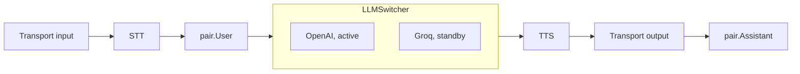

# Switching services

A service switcher holds several interchangeable services, for example two LLMs or two TTS voices, and routes frames to one of them at a time. Use it to fail over to a backup provider when one returns errors, or to switch provider, language or voice during a call. This guide shows both.

## Before you begin

- You have a working pipeline, for example from [Your first phone bot](../getting-started/first-phone-bot.md).
- You know what a **frame** (a typed message flowing through the pipeline) and a **processor** (a pipeline step that handles frames) are. See [Core concepts](../getting-started/core-concepts.md).
- You have API keys for the providers you want to switch between.

> [!NOTE]
> Provider integrations are tested against mock servers at best, some not at all; none against a live vendor API (see the [status table](../providers/README.md)). A failover setup is only as good as your test of it: force an error on the primary provider and listen to what the caller hears.

## Where the switcher goes

A switcher replaces a single service in the pipeline. All of its services receive the lifecycle frames (start, end, cancel), so each one connects when the call starts. Every other frame goes only to the active service.



## A complete example: LLM failover

The bot uses OpenAI. If OpenAI reports an error, the switcher moves to Groq and the bot answers the same turn again.

```go
package main

import (
	"context"
	"log"
	"net/http"
	"os"
	"os/signal"
	"syscall"

	"github.com/square-key-labs/strawgo-ai/src/frames"
	"github.com/square-key-labs/strawgo-ai/src/llm"
	"github.com/square-key-labs/strawgo-ai/src/logger"
	"github.com/square-key-labs/strawgo-ai/src/pipeline"
	"github.com/square-key-labs/strawgo-ai/src/processors"
	"github.com/square-key-labs/strawgo-ai/src/processors/aggregators"
	"github.com/square-key-labs/strawgo-ai/src/serializers"
	"github.com/square-key-labs/strawgo-ai/src/services/cartesia"
	"github.com/square-key-labs/strawgo-ai/src/services/deepgram"
	"github.com/square-key-labs/strawgo-ai/src/services/groq"
	"github.com/square-key-labs/strawgo-ai/src/services/llmservice"
	"github.com/square-key-labs/strawgo-ai/src/services/openai"
	"github.com/square-key-labs/strawgo-ai/src/transports"
)

const systemPrompt = "You are a friendly assistant on a phone call. Answer in one or two short sentences."

func main() {
	logger.Init()
	srv, err := transports.NewServer(transports.ServerConfig{
		Addr: ":8080",
		Path: "/media",
		NewSerializer: func(*http.Request) serializers.FrameSerializer {
			return serializers.NewTwilioFrameSerializer(serializers.TwilioConfig{
				AccountSID: os.Getenv("TWILIO_ACCOUNT_SID"),
				AuthToken:  os.Getenv("TWILIO_AUTH_TOKEN"),
			})
		},
		Handler: runCall,
	})
	if err != nil {
		log.Fatal(err)
	}
	ctx, stop := signal.NotifyContext(context.Background(), os.Interrupt, syscall.SIGTERM)
	defer stop()
	if err := srv.ListenAndServe(ctx); err != nil {
		log.Fatal(err)
	}
}

func runCall(ctx context.Context, s *transports.Session) error {
	stt := deepgram.NewSTTService(deepgram.STTConfig{APIKey: os.Getenv("DEEPGRAM_API_KEY"), Model: "nova-3", Language: "en"})
	primary := openai.NewLLMService(openai.LLMConfig{APIKey: os.Getenv("OPENAI_API_KEY"), Model: "gpt-4.1-mini", SystemPrompt: systemPrompt})
	backup := groq.NewLLMService(groq.LLMConfig{APIKey: os.Getenv("GROQ_API_KEY"), Model: "llama-3.3-70b-versatile", SystemPrompt: systemPrompt})
	tts := cartesia.NewTTSService(cartesia.TTSConfig{APIKey: os.Getenv("CARTESIA_API_KEY"), VoiceID: os.Getenv("CARTESIA_VOICE_ID"), Model: "sonic-2", Language: "en"})

	llms := pipeline.NewLLMSwitcher([]*llmservice.Service{primary, backup}, pipeline.FailoverSwitchStrategy{})

	pair := aggregators.NewContextAggregatorPair(llm.NewContext(), aggregators.ContextAggregatorPairParams{})
	pipe := pipeline.NewPipeline([]processors.FrameProcessor{
		s.Input(), stt, pair.User(), llms, tts, s.Output(), pair.Assistant(),
	})
	task := pipeline.NewPipelineTask(pipe)

	llms.OnServiceSwitched(func(service processors.FrameProcessor) {
		log.Printf("switched LLM to %s", service.Name())
		if err := task.QueueFrame(frames.NewLLMRunFrame()); err != nil {
			log.Printf("retry turn: %v", err)
		}
	})

	if err := task.QueueFrame(frames.NewTTSSpeakFrame("Hi! How can I help?")); err != nil {
		return err
	}
	return task.Run(ctx)
}
```

How it works:

1. `pipeline.NewLLMSwitcher` wraps the two LLM services. The first one is active.
2. When the active service fails, the LLM service sends a non-fatal `ErrorFrame`. `FailoverSwitchStrategy` makes the next service active, round-robin, and the switcher stops that error from travelling further.
3. The switcher does not resend the failed request. The `OnServiceSwitched` handler queues an `LLMRunFrame`, so the backup answers the turn the caller is waiting on. The user's words are already in the context, so nothing is lost.

Things to know:

- Errors from services that are not active are ignored.
- Fatal errors are not handled by the switcher. They reach the task, which by default cancels the call.
- The switcher never switches back by itself. Switch back manually when you know the primary is healthy.
- Each switch calls your `OnServiceSwitched` handlers, including manual switches. Register as many handlers as you need.

## Switch manually

`pipeline.ManualSwitchStrategy{}` (the default when you pass `nil`) only switches when you ask. There are two ways:

```go
llms.SwitchTo(backup)
```

```go
err := task.QueueFrame(frames.NewManuallySwitchServiceFrame(backup))
```

`SwitchTo` switches at once and returns `false` if the service is not in the switcher. The frame switches when it reaches the switcher, in order with the other frames, which is safer in the middle of a response. Both find the service by identity, then by `Name()`.

`FailoverSwitchStrategy` also accepts `ManuallySwitchServiceFrame`, so you can fail over automatically and still switch by hand.

## Switch any kind of service

`pipeline.NewServiceSwitcher` works with any processors, for example two TTS services, so you can change voice or language mid-call:

```go
english := cartesia.NewTTSService(cartesia.TTSConfig{APIKey: os.Getenv("CARTESIA_API_KEY"), VoiceID: os.Getenv("CARTESIA_VOICE_ID"), Model: "sonic-2", Language: "en"})
spanish := cartesia.NewTTSService(cartesia.TTSConfig{APIKey: os.Getenv("CARTESIA_API_KEY"), VoiceID: os.Getenv("CARTESIA_SPANISH_VOICE_ID"), Model: "sonic-2", Language: "es"})
voices := pipeline.NewServiceSwitcher([]processors.FrameProcessor{english, spanish}, pipeline.ManualSwitchStrategy{})
```

Put `voices` where the TTS service would go, then queue `frames.NewManuallySwitchServiceFrame(spanish)` when the caller switches language. The [multilingual bot](../cookbook/multilingual-bot.md) recipe builds on this. A switcher holds between 1 and 64 services; other counts panic.

`ServiceSwitcher` methods:

| Method | Purpose |
| --- | --- |
| `ActiveService()` | the service that currently receives frames |
| `Services()` | all services, in order |
| `SwitchTo(service)` | make a service active now |
| `OnServiceSwitched(fn)` | run `fn` after every switch |
| `Strategy()` | the strategy in use |

`LLMSwitcher` adds:

| Method | Purpose |
| --- | --- |
| `ActiveLLM()`, `LLMs()` | the active LLM service, and all of them |
| `RegisterFunction`, `UnregisterFunction` | register a function handler on every LLM at once |
| `RunInference(ctx, snapshot, settings)` | run a one-off request on the active LLM |

Because it has `RegisterFunction` and `RunInference`, an `LLMSwitcher` can be passed to [flows](flows.md) and [MCP](mcp-tools.md) in place of a single LLM service.

## Settings while switched

Settings update frames (`LLMUpdateSettingsFrame`, `TTSUpdateSettingsFrame`, `STTUpdateSettingsFrame`) go to the active service. To reach the others too:

- set the frame's `Service` field to target one specific service, active or not;
- or set `ReachInactiveServices: true` to send a copy to every service.

```go
update := frames.NewLLMUpdateSettingsFrame(llm.Settings{SystemInstruction: "Answer only in Spanish."})
update.ReachInactiveServices = true
err := task.QueueFrame(update)
```

Without this, a backup LLM keeps its old system prompt and behaves differently after a failover.

## Write your own strategy

Implement `pipeline.ServiceSwitcherStrategy`:

```go
type ServiceSwitcherStrategy interface {
	OnSwitchFrame(frame frames.Frame, services []processors.FrameProcessor, active int) int
	OnServiceError(err *frames.ErrorFrame, services []processors.FrameProcessor, active int) int
}
```

Each method returns the index of the service to activate, or `-1` to stay. `OnSwitchFrame` is called for `ManuallySwitchServiceFrame` and `ServiceSwitcherFrame`. `OnServiceError` is called for non-fatal errors from the active service; returning `-1` lets the error continue to the task. Embed `pipeline.ManualSwitchStrategy` to keep manual switching.

## Next steps

- [LLM failover recipe](../cookbook/llm-failover.md): a complete failover setup with logging.
- [Errors reference](../reference/errors.md): fatal and non-fatal errors.
- [Pipeline reference](../reference/pipeline.md): `ServiceSwitcher` and the other pipeline types.
- [Observability](observability.md): watch errors and switches in production.
