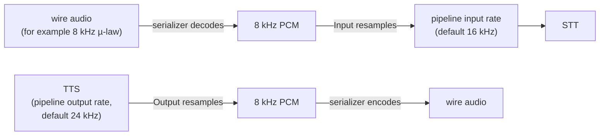

# Transports overview

A transport connects your bot to the outside world: a phone call, a browser, or another server. This page explains how Strawgo transports work, which one to pick, how audio sample rates flow through them, and shows the smallest complete server.

## Before you begin

- You have Go installed and a module that depends on `github.com/square-key-labs/strawgo-ai` (see [Installation](../getting-started/installation.md)).
- You know the basic pipeline vocabulary from [Core concepts](../getting-started/core-concepts.md). A short recap:
  - A **frame** is one unit of data moving through the bot: a chunk of audio, a piece of text, or a control signal.
  - A **pipeline** is an ordered list of processors that frames flow through.
  - **STT** (speech-to-text) turns caller audio into text. **TTS** (text-to-speech) turns the bot's text into audio.
  - An **interruption** (also called barge-in) is the caller talking over the bot, which makes the bot stop and listen.

## The mental model

Every transport follows the same three steps:

1. A **server** listens for connections. For telephony and WebSocket clients this is `transports.Server`. For browsers it is `webrtc.Handler`.
2. Each connection (one phone call, one browser tab) becomes one **session**. A session owns the connection and two processors: `Input()` and `Output()`.
3. The server calls your **handler** once per session, on its own goroutine. Your handler builds a pipeline with `Input()` first and `Output()` near the end, runs it, and returns when the call is over.

```mermaid
flowchart LR
    caller((Caller)) <-->|phone network| provider[Twilio / Telnyx / ...]
    provider <-->|WebSocket media stream| server[transports.Server]
    server -->|one per call| session[Session]
    session --> handler["your handler(ctx, session)"]
    subgraph pipeline [Pipeline built by your handler]
        direction LR
        input["session.Input()"] --> stt[STT] --> user[User aggregator] --> llm[LLM] --> tts[TTS] --> output["session.Output()"] --> assistant[Assistant aggregator]
    end
    handler --> pipeline
```



The `Input()` processor turns messages from the wire into frames: caller audio, keypad digits (DTMF), and "the call ended" signals. The `Output()` processor does the reverse: it encodes the bot's audio for the wire, sends it in real time, and tells the provider to drop queued audio when the caller interrupts.

Because each call gets its own handler goroutine and its own pipeline, one process serves many concurrent calls. Nothing is shared between calls unless you share it.

## Which transport to use

| Transport or serializer | Package and constructor | Use it when |
| --- | --- | --- |
| WebSocket server | `transports.NewServer` | A telephony provider or client connects to you over WebSocket. Pair it with one of the serializers below. |
| WebSocket client | `transports.Dial` | Your bot must connect out to someone else's WebSocket endpoint. See [WebSocket client](websocket-client.md). |
| WebRTC | `webrtc.NewHandler` (package `transports/webrtc`) | Browsers or other WebRTC peers call your bot. See [WebRTC](webrtc.md). |
| Twilio Media Streams | `serializers.NewTwilioFrameSerializer` | Calls come from Twilio. See [Twilio](telephony-twilio.md). |
| Telnyx media streaming | `serializers.NewTelnyxFrameSerializer` | Calls come from Telnyx. |
| Plivo audio streams | `serializers.NewPlivoFrameSerializer` | Calls come from Plivo. |
| Exotel voice streaming | `serializers.NewExotelFrameSerializer` | Calls come from Exotel. |
| Vonage WebSocket | `serializers.NewVonageFrameSerializer` | Calls come from Vonage. |
| Asterisk `chan_websocket` | `serializers.NewAsteriskFrameSerializer` | Calls come from your own Asterisk PBX. |
| Genesys AudioHook | `serializers.NewGenesysAudioHookSerializer` | Genesys Cloud streams a conversation to you. |
| Jambonz listen | `serializers.NewJambonzFrameSerializer` | Calls come from a Jambonz `listen` verb. |
| Protobuf (Pipecat client format) | `serializers.NewProtobufFrameSerializer` | Your own client app speaks the Pipecat protobuf frame format over WebSocket. |
| RTVI client JSON | `serializers.NewRTVIClientSerializer` | Your bot acts as an RTVI *client* of another bot, usually with `transports.Dial`. |

The provider pages walk through each serializer: [Twilio](telephony-twilio.md) and [other telephony providers](telephony-providers.md).

> [!NOTE]
> Every serializer is unit-tested against message shapes in this repository's tests (REST hang-ups against a mock server), not against the live provider. There is no Daily or LiveKit transport, and no transport carries video.

## A complete minimal server

This program answers Twilio calls. Each call gets Deepgram for STT, OpenAI for the LLM and Cartesia for TTS.

```go
package main

import (
	"context"
	"log"
	"net/http"
	"os"
	"os/signal"
	"syscall"

	"github.com/square-key-labs/strawgo-ai/src/llm"
	"github.com/square-key-labs/strawgo-ai/src/logger"
	"github.com/square-key-labs/strawgo-ai/src/pipeline"
	"github.com/square-key-labs/strawgo-ai/src/processors"
	"github.com/square-key-labs/strawgo-ai/src/processors/aggregators"
	"github.com/square-key-labs/strawgo-ai/src/serializers"
	"github.com/square-key-labs/strawgo-ai/src/services/cartesia"
	"github.com/square-key-labs/strawgo-ai/src/services/deepgram"
	"github.com/square-key-labs/strawgo-ai/src/services/openai"
	"github.com/square-key-labs/strawgo-ai/src/transports"
)

func main() {
	logger.Init()
	srv, err := transports.NewServer(transports.ServerConfig{
		Addr: ":8080",
		Path: "/media",
		NewSerializer: func(*http.Request) serializers.FrameSerializer {
			return serializers.NewTwilioFrameSerializer(serializers.TwilioConfig{
				AccountSID: os.Getenv("TWILIO_ACCOUNT_SID"),
				AuthToken:  os.Getenv("TWILIO_AUTH_TOKEN"),
			})
		},
		Handler: runCall,
	})
	if err != nil {
		log.Fatal(err)
	}
	ctx, stop := signal.NotifyContext(context.Background(), os.Interrupt, syscall.SIGTERM)
	defer stop()
	if err := srv.ListenAndServe(ctx); err != nil {
		log.Fatal(err)
	}
}

func runCall(ctx context.Context, s *transports.Session) error {
	stt := deepgram.NewSTTService(deepgram.STTConfig{
		APIKey:   mustEnv("DEEPGRAM_API_KEY"),
		Model:    "nova-3",
		Language: "en",
	})
	llmSvc := openai.NewLLMService(openai.LLMConfig{
		APIKey:       mustEnv("OPENAI_API_KEY"),
		Model:        "gpt-4.1-mini",
		SystemPrompt: "You are a friendly phone assistant. Answer in one or two short sentences.",
	})
	tts := cartesia.NewTTSService(cartesia.TTSConfig{
		APIKey:   mustEnv("CARTESIA_API_KEY"),
		VoiceID:  mustEnv("CARTESIA_VOICE_ID"),
		Model:    "sonic-2",
		Language: "en",
	})
	pair := aggregators.NewContextAggregatorPair(llm.NewContext(), aggregators.ContextAggregatorPairParams{})
	pipe := pipeline.NewPipeline([]processors.FrameProcessor{
		s.Input(), stt, pair.User(), llmSvc, tts, s.Output(), pair.Assistant(),
	})
	return pipeline.NewPipelineTask(pipe).Run(ctx)
}

func mustEnv(key string) string {
	v := os.Getenv(key)
	if v == "" {
		log.Fatalf("%s is required", key)
	}
	return v
}
```

Run it with `go run .`, expose port 8080 with a tunnel, and point Twilio at `wss://YOUR_HOST/media`. [Your first phone bot](../getting-started/first-phone-bot.md) walks through the Twilio side step by step.

### How it works

1. `transports.NewServer` takes a `ServerConfig`. `NewSerializer` and `Handler` are required; `Path` defaults to `/ws`.
2. For each WebSocket upgrade on `Path`, the server calls `NewSerializer(r)` to get a fresh serializer. A serializer translates one provider's message format into frames and back. Never share a serializer between calls. Return `nil` to reject the connection.
3. If the serializer needs an opening exchange (Twilio sends `connected` then `start`), the server reads those messages first, within `Params.HandshakeTimeout` (default 10 s). This fills in the session's call information.
4. The server calls `Handler(ctx, session)` on that connection's goroutine. When the handler returns, the server closes the connection and waits for the session's goroutines.
5. `ListenAndServe(ctx)` serves until `ctx` is cancelled, then closes every session.

`Server` also implements `http.Handler`, so you can mount it on your own `http.ServeMux` next to other routes. [Deployment](deployment.md) shows that pattern with a health endpoint and graceful shutdown.

## The session

Your handler receives a `*transports.Session`.

| Method | What it gives you |
| --- | --- |
| `Input()`, `Output()` | The two processors to place in your pipeline. |
| `CallInfo()` | A `serializers.CallInfo` filled in by the handshake: `Provider`, `StreamID`, `CallID`, `AccountID`, `From`, `To`, `Encoding`, `SampleRate`, `CustomParameters`. Which fields are set depends on the provider. |
| `Request()` | The HTTP upgrade request, so you can read query parameters and headers. |
| `Serializer()` | The serializer for this call, for provider-specific methods. |
| `ID()` | A process-unique session id such as `ws-12`. |
| `Close()`, `Done()`, `Wait()` | Close the connection, a channel closed when the session closes, and a wait for its goroutines. |

### Place `Input()` first and `Output()` near the end

Put `s.Input()` first. Put `s.Output()` after TTS. Processors that need to see audio after it was played, such as the assistant context aggregator, the [recorder](recording.md) or the assistant [transcript](recording.md#save-a-transcript) processor, go after `s.Output()`.

### What the session does for you

- **Input** waits until the pipeline has started, resamples caller audio to the pipeline's input rate, runs the optional input filter and voice activity analyzer, and forwards keypad digits and other events as frames.
- **Output** converts TTS audio to the wire format, sends it in 20 ms pieces in real time (`AudioOutChunk`), and emits `BotStartedSpeakingFrame` and `BotStoppedSpeakingFrame`.
- On **interruption**, output drops audio it has not sent yet and writes the provider's "clear" message so the provider drops audio it has buffered too.
- When the **pipeline ends** (an `EndFrame`), output finishes sending audio, writes the provider's end message, hangs up through the provider when the serializer supports it, and closes the connection.
- When the **caller hangs up**, input pushes a `ClientDisconnectedFrame` and cancels the pipeline, unless you set `Params.OnClientDisconnected`.

## Sample rates end to end

Audio has a sample rate: how many samples per second it carries. Phone networks use 8000 Hz. Most STT and TTS services prefer 16000 Hz or 24000 Hz. Strawgo converts between them for you at the edges of the pipeline.



| Direction | Rate used | How to change it |
| --- | --- | --- |
| Into the pipeline | `TransportParams.AudioInSampleRate` if set, otherwise the task's `AudioInSampleRate` (default 16000) | Set either field. |
| TTS output | The task's `AudioOutSampleRate` (default 24000), unless the TTS service config sets its own rate | Set `PipelineTaskConfig.AudioOutSampleRate` or the service's `SampleRate`. |
| Onto the wire | The serializer's fixed wire rate when it has one (8000 for Twilio, Telnyx, Plivo); otherwise `TransportParams.AudioOutSampleRate`; otherwise the task's `AudioOutSampleRate` | Usually nothing to do. |

Wire formats per serializer:

| Serializer | Wire audio |
| --- | --- |
| Twilio, Plivo | µ-law, 8000 Hz |
| Telnyx | PCMU by default; `InboundEncoding`/`OutboundEncoding` or the `start` message's `media_format` can choose another encoding such as PCMA; 8000 Hz |
| Exotel | 16-bit PCM, 8000 Hz unless `SampleRate` or the `start` message says otherwise |
| Vonage | 16-bit PCM, 16000 Hz unless `SampleRate` or the `content-type` says otherwise |
| Asterisk | µ-law 8000 Hz by default; `Codec`, `SampleRate` or the `MEDIA_START` format (for example `slin16`) can change it |
| Genesys AudioHook | PCMU, 8000 Hz unless `SampleRate` is set |
| Jambonz | 16-bit PCM at the rate in the connection preamble |
| Protobuf, RTVI client | 16-bit PCM at whatever rate the frames carry |
| WebRTC | G.711 at 8000 Hz; Opus at 48000 Hz only with the `opus` build tag |

[Audio](audio.md) covers the resampler, passing µ-law straight through without converting it ("native passthrough"), mixers and filters.

## Common `TransportParams`

`ServerConfig.Params` and `ClientConfig.Params` take a `transports.TransportParams`. Every field is optional. The full list is in the [transports reference](../reference/transports.md).

| Field | Default | What it does |
| --- | --- | --- |
| `SessionTimeout`, `OnSessionTimeout` | none | Ends the call after this long. Without a callback the session pushes an `EndTaskFrame`. |
| `InterruptionFade` | 0 (hard cut) | Fades the bot's audio out over this duration on interruption instead of cutting it. |
| `PlaybackAck`, `PlaybackAckTimeout` | off, 1 s | Waits for the provider to confirm playback finished before reporting the bot stopped speaking. |
| `BotStopTimeout` | 3 s | Reports the bot stopped speaking after this much silence when no other signal arrives. |
| `AudioOutEndSilence` | 0 | Silence padding sent before the end message when no playback acknowledgement is available. |
| `NewAudioInAnalyzer` | none | Builds a per-call voice activity analyzer, for example `transports.NewVADAnalyzerHook`. |
| `NewInputFilter`, `NewOutputMixer` | none | Build a per-call input filter (noise gate) or output mixer (background sound). |
| `AudioInNative`, `AudioOutNative` | off | Pass the provider's native encoding through without converting to PCM. |
| `OnClientConnected`, `OnClientDisconnected` | none | Callbacks with the session. Setting `OnClientDisconnected` replaces the default cancel. |
| `HandshakeTimeout`, `WriteTimeout`, `PingInterval`, `CloseTimeout`, `HangupTimeout` | 10 s, 10 s, 20 s, 2 s, 10 s | Connection timeouts. |

Prefer the `New...` factory fields over the plain `AudioInAnalyzer`, `InputFilter` and `OutputMixer` fields. The factories build a fresh instance for every call; a plain instance is shared by every call on the server.

## Next steps

- [Twilio](telephony-twilio.md): the most complete telephony walkthrough.
- [Other telephony providers](telephony-providers.md): Telnyx, Plivo, Exotel, Vonage, Asterisk, Genesys, Jambonz and protobuf.
- [WebRTC](webrtc.md): talk to the bot from a browser.
- [Deployment](deployment.md): run many calls in one process and shut down cleanly.
