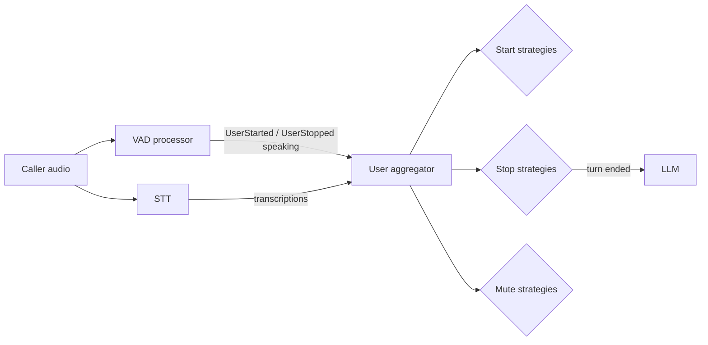

# Turn-taking

Turn-taking decides when the caller has started talking, when they have finished, and what happens if they talk over the bot. This guide explains each piece Strawgo uses for that, how to tune it, and which option to pick for your call.

## Before you begin

- You have a working voice bot, for example from [Your first phone bot](../getting-started/first-phone-bot.md).
- For voice activity detection you need the `onnx-worker` running and its Unix socket path in `ONNX_WORKER_SOCK`. See [Deployment](deployment.md) for running the worker.

Terms used on this page:

- A **turn** is one person's uninterrupted contribution to the conversation. A user turn starts when the caller begins talking and ends when Strawgo decides they are done and sends their words to the LLM.
- **VAD** (voice activity detection) classifies short chunks of audio as speech or not speech.
- **STT** (speech-to-text) turns the caller's audio into text, called a transcription.
- An **interruption** (barge-in) is the caller talking while the bot speaks. The bot stops and listens.

## A complete example

This bot uses Silero VAD, ends a turn 800 ms after the caller stops, ignores one-word backchannels such as "yeah" while the bot is talking, and mutes the caller while function calls run.

```go
package main

import (
	"context"
	"log"
	"net/http"
	"os"
	"os/signal"
	"syscall"
	"time"

	"github.com/square-key-labs/strawgo-ai/src/audio/vad"
	"github.com/square-key-labs/strawgo-ai/src/frames"
	"github.com/square-key-labs/strawgo-ai/src/llm"
	"github.com/square-key-labs/strawgo-ai/src/logger"
	"github.com/square-key-labs/strawgo-ai/src/pipeline"
	"github.com/square-key-labs/strawgo-ai/src/processors"
	"github.com/square-key-labs/strawgo-ai/src/processors/aggregators"
	"github.com/square-key-labs/strawgo-ai/src/serializers"
	"github.com/square-key-labs/strawgo-ai/src/services/cartesia"
	"github.com/square-key-labs/strawgo-ai/src/services/deepgram"
	"github.com/square-key-labs/strawgo-ai/src/services/openai"
	"github.com/square-key-labs/strawgo-ai/src/transports"
	"github.com/square-key-labs/strawgo-ai/src/turns"
	"github.com/square-key-labs/strawgo-ai/src/turns/user_mute"
	"github.com/square-key-labs/strawgo-ai/src/turns/user_start"
	"github.com/square-key-labs/strawgo-ai/src/turns/user_stop"
)

func main() {
	logger.Init()
	srv, err := transports.NewServer(transports.ServerConfig{
		Addr: ":8080",
		Path: "/media",
		NewSerializer: func(*http.Request) serializers.FrameSerializer {
			return serializers.NewTwilioFrameSerializer(serializers.TwilioConfig{
				AccountSID: os.Getenv("TWILIO_ACCOUNT_SID"),
				AuthToken:  os.Getenv("TWILIO_AUTH_TOKEN"),
			})
		},
		Handler: runCall,
	})
	if err != nil {
		log.Fatal(err)
	}
	ctx, stop := signal.NotifyContext(context.Background(), os.Interrupt, syscall.SIGTERM)
	defer stop()
	if err := srv.ListenAndServe(ctx); err != nil {
		log.Fatal(err)
	}
}

func runCall(ctx context.Context, s *transports.Session) error {
	analyzer, err := vad.NewSileroVADAnalyzer(16000, vad.DefaultVADParams(), os.Getenv("ONNX_WORKER_SOCK"))
	if err != nil {
		return err
	}
	defer analyzer.Cleanup()

	strategies := turns.UserTurnStrategies{
		StartStrategies: []user_start.UserTurnStartStrategy{
			user_start.NewMinWordsUserTurnStartStrategy(3, true),
		},
		StopStrategies: []user_stop.UserTurnStopStrategy{
			user_stop.NewSpeechTimeoutUserTurnStopStrategy(800 * time.Millisecond),
		},
		MuteStrategies: []user_mute.UserMuteStrategy{
			user_mute.NewFunctionCallUserMuteStrategy(),
		},
	}

	stt := deepgram.NewSTTService(deepgram.STTConfig{APIKey: os.Getenv("DEEPGRAM_API_KEY"), Model: "nova-3", Language: "en"})
	llmSvc := openai.NewLLMService(openai.LLMConfig{
		APIKey:       os.Getenv("OPENAI_API_KEY"),
		Model:        "gpt-4.1-mini",
		SystemPrompt: "You are a friendly assistant on a phone call. Answer in one or two short sentences.",
	})
	tts := cartesia.NewTTSService(cartesia.TTSConfig{APIKey: os.Getenv("CARTESIA_API_KEY"), VoiceID: os.Getenv("CARTESIA_VOICE_ID"), Model: "sonic-2", Language: "en"})

	pair := aggregators.NewContextAggregatorPair(llm.NewContext(), aggregators.ContextAggregatorPairParams{
		User: aggregators.UserAggregatorParams{
			Strategies:        strategies,
			OnUserTurnStopped: func(text string) { log.Printf("user said: %s", text) },
		},
	})

	pipe := pipeline.NewPipeline([]processors.FrameProcessor{
		s.Input(), vad.NewVADInputProcessor(analyzer), stt, pair.User(), llmSvc, tts, s.Output(), pair.Assistant(),
	})
	task := pipeline.NewPipelineTask(pipe)
	if err := task.QueueFrame(frames.NewTTSSpeakFrame("Hi! How can I help?")); err != nil {
		return err
	}
	return task.Run(ctx)
}
```

## How a turn is decided

Three kinds of components work together:



1. **Signals** come from the VAD processor (speech started and stopped) and the STT service (transcriptions). Some STT services, such as Deepgram Flux, also send their own turn signals.
2. **Strategies** in the user aggregator read those signals. A start strategy decides that a turn has begun. A stop strategy decides that it is over. A mute strategy decides to ignore the caller for a while.
3. When a turn ends, the user aggregator adds the collected text as a user message and sends the context to the LLM.

If you set no strategies, `turns.DefaultUserTurnStrategies()` is used:

- start: `NewVADUserTurnStartStrategy(true)` and `NewTranscriptionUserTurnStartStrategy(true)`;
- stop: `NewSpeechTimeoutUserTurnStopStrategy(user_stop.DefaultUserSpeechTimeout)` (600 ms);
- no mute strategies.

Set strategies in one of two places:

| Where | Scope |
| --- | --- |
| `aggregators.UserAggregatorParams.Strategies` | this user aggregator |
| `pipeline.PipelineTaskConfig.TurnStrategies` | sent in the `StartFrame`; when not empty it replaces the aggregator's strategies |

A safety net ends any turn that has seen no speech or transcription for `UserAggregatorParams.UserTurnStopTimeout` (default `aggregators.DefaultUserTurnStopTimeout`, 5 s), unless a stop strategy has a timer pending.

## Voice activity detection (VAD)

Strawgo's VAD is Silero, run by the separate `onnx-worker` process. `vad.NewSileroVADAnalyzer(sampleRate, params, socketPath)` connects to the worker. Silero accepts 8 kHz or 16 kHz; for other rates the VAD processor resamples to 16 kHz for you.

Put `vad.NewVADInputProcessor(analyzer)` right after the transport input. On each change it sends:

- `UserStartedSpeakingFrame` and `UserStoppedSpeakingFrame` downstream;
- `VADUserStartedSpeakingFrame` and `VADUserStoppedSpeakingFrame` in both directions;
- `UserSpeakingFrame` every 200 ms while the caller talks.

If no audio arrives for one second while the caller is speaking (a dropped stream), it forces a "stopped speaking". Change the period with `vad.WithAudioIdleTimeout`.

> [!NOTE]
> Silero VAD is tested in this repository against a fake worker socket only. Measure it on your own audio before you tune for production.

### VAD parameters

`vad.DefaultVADParams()` returns `Confidence: 0.7`, `StartSecs: 0.2`, `StopSecs: 0.2`, `MinVolume: 0.1`, and no `HoldConfidence`.

| Parameter | What it does | Raise it to | Lower it to |
| --- | --- | --- | --- |
| `Confidence` | speech probability a chunk needs to count as speech | ignore more background noise and distant voices, at the cost of missing quiet or mumbled speech | catch soft speech, at the cost of more false starts |
| `HoldConfidence` | a lower threshold used once speech has started; `0`, or a value above `Confidence`, means "use `Confidence`" | (keep it at or below `Confidence`) | avoid "stopped speaking" in the middle of a word on soft syllables, at the cost of noticing the end of speech slightly later |
| `StartSecs` | how long speech must last before "started speaking" | ignore coughs, clicks and short noises, at the cost of reacting later, including to real interruptions | react faster, at the cost of more false starts |
| `StopSecs` | how long silence must last before "stopped speaking" | avoid splitting a sentence at short pauses, at the cost of later turn ends | end faster, at the cost of more mid-sentence cuts |
| `MinVolume` | smoothed loudness below which audio is treated as silence | reject quiet background speech and line noise, at the cost of missing quiet callers | hear quiet callers, at the cost of reacting to noise |

The analyzer logs a warning whenever `StopSecs` is not 0.2. The speech timeout stop strategy already waits after the pause, so you normally tune the turn end there instead of in `StopSecs`.

Change parameters during a call by queueing a `VADParamsUpdateFrame`. Only non-zero fields change:

```go
err := task.QueueFrame(frames.NewVADParamsUpdateFrame(frames.VADParams{StopSecs: 0.8}))
```

The [IVR navigator](ivr-navigation.md) uses this to wait longer while it listens to phone menus.

As an alternative to the processor, `transports.TransportParams.AudioInAnalyzer` accepts `transports.NewVADAnalyzerHook(analyzer)`. The hook emits only the `VADUser...` frames, and has no resampling, parameter updates or idle handling. Prefer the processor.

## Smart Turn

Pauses are not always the end of a turn: "My number is... 555..." has long gaps. **Smart Turn** is a small model that listens to the audio of the turn and predicts whether the caller has finished. Strawgo can run it in two ways:

| Mode | Constructor | Needs | Status |
| --- | --- | --- | --- |
| Local ONNX via the worker | `turn.NewOnnxSmartTurn(turn.OnnxSmartTurnConfig{SockPath: ...})` | the `onnx-worker` with the Smart Turn model | mock-tested (fake worker socket) |
| HTTP endpoint | `turn.NewHTTPSmartTurn(turn.HTTPSmartTurnConfig{URL: ..., APIKey: ...})` | a compatible HTTP service | mock-tested (local HTTP test server) |
| fal hosted | `turn.NewFalSmartTurn(turn.FalSmartTurnConfig{APIKey: ...})` | a fal API key | mock-tested (local HTTP test server) |

`turn.DefaultSmartTurnParams()` returns `StopSecs: 3`, `PreSpeechMs: 500`, `MaxDurationSecs: 8`. `StopSecs` is the longest silence after which the turn counts as complete even if the model disagrees. The model sees at most `MaxDurationSecs` of audio.

Attach the analyzer to the VAD processor:

```go
smart, err := turn.NewOnnxSmartTurn(turn.OnnxSmartTurnConfig{
	SockPath: os.Getenv("ONNX_WORKER_SOCK"),
	Params:   turn.DefaultSmartTurnParams(),
})
if err != nil {
	return err
}
defer smart.Close()
vadProc := vad.NewVADInputProcessorWithTurn(analyzer, smart)
```

With an analyzer attached, the VAD processor sends `UserStoppedSpeakingFrame` only when the model predicts the turn is complete or `StopSecs` of silence has passed. If the model call fails, the VAD processor logs the error and ends the turn at that pause, so an outage of the model falls back to plain VAD timing. It also sends `MetricsFrame`s with the prediction and its timing. The `VADUser...` frames are still sent at every pause.

The VAD processor also announces the analyzer: its `SpeechControlParamsFrame` carries `TurnParams`. When the default stop strategy, `SpeechTimeoutUserTurnStopStrategy`, sees that, it does not end the turn at a pause. It still runs its timeout from the `VADUserStoppedSpeakingFrame`, but it also waits for the `UserStoppedSpeakingFrame` that means the model predicted "complete" or `StopSecs` of silence passed. If the caller speaks again first, the pause is forgotten. If neither arrives, `UserTurnStopTimeout` (5 seconds by default) still ends the turn. `examples/asterisk` uses this combination. Without an analyzer on the VAD processor, a pause ends the turn after the timeout, as described under [Stop strategies](#stop-strategies).

`NewTurnAnalyzerUserTurnStopStrategy` is an alternative: pass it the same analyzer you attached to the VAD processor (the VAD processor feeds it audio). It asks the model on each final transcription. When the model says "incomplete" and no further transcription arrives, the turn ends only after `UserTurnStopTimeout` (5 seconds by default). This configuration has not been tested end to end in this repository; measure it on your own calls.

```go
userParams := aggregators.UserAggregatorParams{
	Strategies: turns.UserTurnStrategies{
		StartStrategies: []user_start.UserTurnStartStrategy{
			user_start.NewVADUserTurnStartStrategy(true),
			user_start.NewTranscriptionUserTurnStartStrategy(true),
		},
		StopStrategies: []user_stop.UserTurnStopStrategy{
			user_stop.NewTurnAnalyzerUserTurnStopStrategy(smart),
		},
	},
	UserTurnStopTimeout: 2 * time.Second,
}
pair := aggregators.NewContextAggregatorPair(llm.NewContext(), aggregators.ContextAggregatorPairParams{User: userParams})
```

`smart` is the analyzer from the previous example. `UserTurnStopTimeout` here shortens the fallback from 5 seconds to 2.

The HTTP and ONNX modes share a circuit breaker (`turn.BreakerConfig`). After 3 failed predictions in a row, the analyzer stops calling the model for 5 seconds and treats each pause as the end of the turn; the pause doubles on each further failure, up to one minute. A prediction that takes longer than `StopSecs` also counts as "complete". Set `Breaker: turn.BreakerConfig{Disabled: true}` to turn this off.

## Start strategies

A start strategy decides that a user turn has begun. The first strategy that says yes wins. Each takes an `enableInterruptions` flag: when `true`, a turn started by that strategy interrupts the bot.

| Strategy | Starts a turn when | Use this when |
| --- | --- | --- |
| `user_start.NewVADUserTurnStartStrategy(enable)` | VAD reports speech | you run a VAD and want the fastest reaction |
| `user_start.NewTranscriptionUserTurnStartStrategy(enable)` | any non-empty transcription arrives | you have no VAD, or as a backup to VAD |
| `user_start.NewMinWordsUserTurnStartStrategy(n, enable)` | the transcription has at least `n` words while the bot is speaking, or 1 word otherwise | short backchannels such as "uh-huh" or "right" should not interrupt the bot |

`MinWords` drops a final transcription that is shorter than `n` words while the bot speaks, so the backchannel does not leak into the next turn. Do not combine it with the VAD start strategy: any strategy can start the turn, so VAD would start it, and interrupt, before the words arrive.

## Stop strategies

A stop strategy decides that the turn is over. If the caller is still speaking at that moment, the turn ends as soon as they stop.

| Strategy | Ends a turn when | Use this when |
| --- | --- | --- |
| `user_stop.NewSpeechTimeoutUserTurnStopStrategy(timeout)` | the caller has been quiet for `timeout` after VAD's stop and the final transcription has arrived; with Smart Turn on the VAD processor, also the model has predicted "complete" | the default; good for most calls |
| `user_stop.NewTurnAnalyzerUserTurnStopStrategy(analyzer)` | a final transcription arrives and the analyzer predicts "complete" | you want a model, not a timer, to decide |
| Deepgram Flux strategies | the STT service reports the end of the turn | you use Deepgram Flux (see below) |

The speech timeout strategy also waits for the STT service to deliver its final transcription. If the STT reports its 99th-percentile latency in an `STTMetadataFrame`, the strategy waits at most that long; `SetTTFSP99Latency(d)` overrides the value. `SetWaitForTranscript(false)` lets a turn end without any transcription.

| Speech timeout | Effect |
| --- | --- |
| shorter (for example 300 ms) | snappier replies; more callers get cut off mid-thought |
| longer (for example 1 s) | fewer cut-offs; every reply starts later |

## Mute strategies

While muted, the user aggregator drops the caller's audio, transcriptions and interruption frames, so nothing the caller says reaches the LLM and the bot is not interrupted. The speaking events (`UserStartedSpeakingFrame`, `UserStoppedSpeakingFrame` and the `VADUser...` versions) are still forwarded and still update whether the caller counts as speaking, but they do not start a turn. It broadcasts `UserMuteStartedFrame` and `UserMuteStoppedFrame` when the state changes, and calls `UserAggregatorParams.OnUserMuteChanged`. The caller is muted when any mute strategy says so.

| Strategy | Mutes the caller | Use this when |
| --- | --- | --- |
| `user_mute.NewFirstSpeechUserMuteStrategy()` | while the bot speaks for the first time | the opening message (a disclosure, a greeting) must be heard in full, but the caller may talk before it starts |
| `user_mute.NewMuteUntilFirstBotCompleteUserMuteStrategy()` | from the start of the call until the bot's first speech has finished, or until an error before the bot ever spoke | nothing the caller says before your greeting ends should count |
| `user_mute.NewFunctionCallUserMuteStrategy()` | while any function call is running | tool results must not be overtaken by a new user turn |
| `user_mute.NewAlwaysUserMuteStrategy()` | always | announcements, or listen-only stretches you switch on and off by changing strategies |

A muted caller never interrupts.

## Interruptions

Interruptions are on by default (`PipelineTaskConfig.AllowInterruptions` is `true` in `pipeline.DefaultPipelineTaskConfig()`). The user aggregator broadcasts an `InterruptionFrame` when all of these are true:

1. a user turn starts;
2. the start strategy was created with `enableInterruptions` set to `true`;
3. `AllowInterruptions` is `true`;
4. the bot is speaking, or a reply has been requested but not spoken yet;
5. the caller is not muted.

To turn interruptions off for the whole call:

```go
cfg := pipeline.DefaultPipelineTaskConfig()
cfg.AllowInterruptions = false
task := pipeline.NewPipelineTaskWithConfig(pipe, cfg)
```

What an interruption does:

| Component | Effect |
| --- | --- |
| LLM service | stops the current response; cancels running function calls registered with `CancelOnInterruption: true` (others keep running) |
| TTS service | drops queued text and audio, cancels open synthesis requests |
| Output transport | discards queued audio and tells the provider to stop playback (for Twilio, a `clear` message) |
| Every processor | drops queued frames that do not survive interruptions |
| Assistant aggregator | records what the bot said up to that point, then resets |

The context keeps the interrupted reply. Every TTS service built on `tts.Base` pushes a `TTSTextFrame` for the text it speaks: one per word when the service reports word timestamps, otherwise one per sentence: an HTTP provider queues it after that sentence's audio, a streaming provider right after sending the sentence, before its audio arrives. The assistant aggregator records the `TTSTextFrame`s that reach it, so the reply is cut at the nearest word or sentence; the sentence playing at the moment of the interruption may be recorded whole. If no `TTSTextFrame` has reached it, for example when there is no TTS in the pipeline, it records the LLM text produced so far, which may include text the caller never heard. See [Function calling](function-calling.md#cancellation-on-interruption) for what is recorded for a cancelled function.

### Empty turns and false interruptions

A cough or line noise can start a turn through VAD and cut the bot off, and then end with no transcript. By default, when such an empty turn interrupted the bot, the user aggregator adds a developer message and runs the LLM once, so the bot asks the caller to repeat. An empty turn while the bot was waiting for the caller gets no answer. To have the bot pick up where it was cut off instead, set `ResumeInterruptedSpeech`:

```go
pair := aggregators.NewContextAggregatorPair(llmCtx, aggregators.ContextAggregatorPairParams{
	User: aggregators.UserAggregatorParams{
		EmptyUserTurn: &turns.EmptyUserTurnConfig{ResumeInterruptedSpeech: true},
	},
})
```

The bot then speaks the rest of its reply from the start of the sentence that was cut, and the context ends up with the reply once. It needs the aggregators created as a pair and a TTS built on `tts.Base` that is either an HTTP provider or a streaming provider with word timestamps; a streaming provider without word timestamps sends its text ahead of the audio, so it cannot tell what was heard. When the remainder cannot be worked out, for example because the LLM had not finished the reply, a function call was running, or a function result was still waiting to be answered, the bot asks the caller to repeat as before. The prompt is removed from the context once the caller says something that is transcribed. While the active LLM is a speech-to-speech service (OpenAI Realtime, Gemini Live) empty-turn recovery is off, because the service hears the caller directly; it comes back on when a `ServiceSwitcher` switches to a cascaded LLM. A turn with a transcript is always handled as a normal turn. See [Empty user turns](../reference/aggregators.md#empty-user-turns) for every option.

## User idle detection

User idle detection notices when the caller has said nothing for a while after the bot finished speaking. Set `UserIdleTimeout` on the user aggregator:

```go
var task *pipeline.PipelineTask
prompts := 0
pair := aggregators.NewContextAggregatorPair(llm.NewContext(), aggregators.ContextAggregatorPairParams{
	User: aggregators.UserAggregatorParams{
		UserIdleTimeout: 8 * time.Second,
		OnUserIdle: func() {
			prompts++
			if prompts > 2 {
				_ = task.QueueFrame(frames.NewTTSSpeakFrame("I'll hang up now. Goodbye!"))
				_ = task.QueueFrame(frames.NewEndFrame())
				return
			}
			_ = task.QueueFrame(frames.NewTTSSpeakFrame("Are you still there?"))
		},
	},
})
```

How the timer behaves:

- It starts when the bot stops speaking, and when a user turn ends without any words.
- It is cancelled when the caller or the bot starts speaking, and while function calls are pending.
- It fires once. Speaking again (as in the example) starts it again when the bot stops.
- When it fires it calls `OnUserIdle` and sends a `UserIdleTimeoutFrame` downstream.
- Zero (the default) turns it off. Queue `frames.NewUserIdleTimeoutUpdateFrame(d)` to change it during the call; zero turns it off.

`OnUserIdle` runs inside the user aggregator. Queue frames and return; do not block in it.

This is different from `PipelineTaskConfig.IdleTimeout`, which cancels the whole task when no activity at all happens.

## DTMF input

**DTMF** tones are the beeps a phone keypad sends. Telephony serializers turn them into `InputDTMFFrame`s; see [Telephony providers](telephony-providers.md). The DTMF aggregator collects digits into text the LLM can read.

Place it after the transport input, before the user aggregator:

```go
dtmf := aggregators.NewDTMFAggregator(
	aggregators.WithDTMFTimeout(3*time.Second),
	aggregators.WithDTMFTerminationDigit(frames.KeypadPound),
)
pipe := pipeline.NewPipeline([]processors.FrameProcessor{
	s.Input(), dtmf, stt, pair.User(), llmSvc, tts, s.Output(), pair.Assistant(),
})
```

| Behaviour | Default | Option |
| --- | --- | --- |
| Sends the digits when this key is pressed | `#` | `WithDTMFTerminationDigit` |
| Sends the digits after this long with no key | 2 s | `WithDTMFTimeout` |
| Text prefix | `DTMF: ` | `WithDTMFPrefix` |

The first digit of a sequence interrupts the bot when `AllowInterruptions` is `true`. The digits are sent as a final `TranscriptionFrame`, for example `DTMF: 1234#`, so the transcription start strategy and the speech timeout stop strategy turn them into a normal user turn. Tell the model about this format in your prompt.

## Provider-side turn detection: Deepgram Flux

Deepgram Flux is an STT model that also detects turns. With `deepgram.NewFluxSTTService` you do not need a VAD processor:

```go
stt := deepgram.NewFluxSTTService(deepgram.FluxConfig{
	APIKey: os.Getenv("DEEPGRAM_API_KEY"),
})
pipe := pipeline.NewPipeline([]processors.FrameProcessor{
	s.Input(), stt, pair.User(), llmSvc, tts, s.Output(), pair.Assistant(),
})
```

How it works:

- Flux sends `ProposedUserStartedSpeakingFrame` at the start of a turn and `ProposedUserStoppedSpeakingFrame` at its end, with the final transcription.
- When it connects, the service announces matching strategies (`deepgram.FluxUserTurnStrategies`) in a `ServiceMetadataFrame`. The user aggregator adopts them, unless you set `UserAggregatorParams.Strategies` yourself.
- `FluxConfig.EOTThreshold`, `EagerEOTThreshold` and `EOTTimeoutMs` tune Flux's own end-of-turn decision. `DisableInterruptions: true` stops Flux turns from interrupting the bot.
- `FluxConfig` callbacks (`OnStartOfTurn`, `OnEndOfTurn`, `OnEagerEndOfTurn`, `OnTurnResumed`, `OnUpdate`) let you watch the raw events.

> [!NOTE]
> Deepgram Flux is mock-tested only: a test drives `NewFluxSTTService` against a local WebSocket server that plays Flux turn events. Nothing has been run against the live Flux API.

### Speculative replies (eager end of turn)

Flux can say that the user has probably finished before it confirms the turn. With `FluxConfig.EnableEagerEndOfTurn: true`, the bot starts answering at that moment and holds the answer back until the turn is confirmed. Deepgram puts the saving at 100 to 200 ms per turn. The cost is extra LLM calls: every guess that turns out wrong is an LLM call thrown away. It is off by default.

```go
stt := deepgram.NewFluxSTTService(deepgram.FluxConfig{
	APIKey:               os.Getenv("DEEPGRAM_API_KEY"),
	EnableEagerEndOfTurn: true,
})
```

What happens in a turn:

1. Flux sends an eager end of turn. The STT pushes an `EagerTranscriptionFrame`.
2. The user aggregator builds a throwaway copy of the conversation with the eager text as the last user message and sends it to the LLM as an `LLMContextFrame` with `Speculation: true`. The real context is not touched.
3. The LLM service generates the reply but holds everything that generation produces (`LLMFullResponseStartFrame`, text, thoughts, `LLMFullResponseEndFrame`, and its TTFB, TTFAT and processing metrics) inside the service. Nothing of it reaches the TTS, the caller or the assistant aggregator. Only the speculative generation's own output is held: other frames passing through the LLM service, such as a `TTSSpeakFrame` from your code, go straight on.
4. The turn then ends in one of three ways:
   - **Confirmed.** Flux ends the turn, the final transcript matches the eager one (by default, ignoring case and punctuation), and the conversation context has not changed since the speculation started. The user aggregator writes the final transcript to the context and broadcasts `UserTurnSpeculationConfirmedFrame`. The LLM service releases the held reply. The LLM is not called again.
   - **Changed.** The final transcript differs, or the context changed while the reply was held (a tool result arrived, your code appended messages). The held reply is discarded and the LLM runs normally on the final transcript and the current context.
   - **Resumed.** The user keeps talking: Flux sends `TurnResumed`, or a `UserStartedSpeakingFrame` arrives (from a VAD, for example). A `UserTurnResponseCancelFrame` discards the held reply and stops the speculative LLM call. The turn carries on and is answered normally when it ends.

Other rules:

- **Tool calls.** If the speculative reply asks for a tool call before the turn is confirmed, the call is not run. The LLM service withdraws the speculation (it broadcasts `UserTurnResponseCancelFrame`), and the turn is answered by a normal LLM call once it ends, which then runs the tool. A reply that was already confirmed runs its tool calls as usual.
- **Interruptions.** An `InterruptionFrame` discards a held reply. The turn is answered normally when it ends.
- **Other inferences.** If another inference starts while a reply is held (a tool result asks for one, an `LLMRunFrame`), the held reply is dropped and the LLM service broadcasts `UserTurnResponseCancelFrame` so the user aggregator answers the turn normally when it ends.
- **Cancel frames name the speculation.** `UserTurnResponseCancelFrame.Context` is the speculative context it withdraws; the user aggregator fills it in on the cancel Flux sends. A cancel that reaches the LLM service before the speculative request it names is remembered, and that request is skipped instead of run. A cancel without a context withdraws whatever speculation is held, or else the next speculative request.
- **Metrics.** A withdrawn speculation reports only its token usage. A released one reports its TTFB and processing metrics when it is released.
- **Shutdown.** An `EndFrame` or `StopFrame` discards a held reply.
- **Failures.** If the speculative LLM call fails, the speculation is withdrawn and the turn is answered normally when it ends. With an `LLMSwitcher` failover, that normal call goes to the service the switcher moved to.
- **Timeout.** A guess that Flux never confirms or withdraws is dropped after 5 seconds.
- **Mute strategies.** While the user is muted, eager transcriptions are dropped like other transcriptions, so nothing is speculated.
- **Empty turns.** If the turn ends with no final transcript, the speculation is discarded and the empty-turn recovery runs as usual.

`FluxConfig.EagerMatchPolicy` decides whether the final transcript still matches: `user_stop.NormalizedMatch{}` (the default) ignores case, punctuation and apostrophes, `user_stop.ExactMatch{}` requires identical text, or supply your own `user_stop.EagerMatchPolicy`. The recommended strategies come from `deepgram.FluxEagerUserTurnStrategies`. If you set `UserAggregatorParams.Strategies` yourself, use `user_stop.NewEagerUserTurnStopStrategy` as the stop strategy to get speculative replies.

Speculation is skipped when the active LLM is a speech-to-speech service.

Speech-to-speech models such as OpenAI Realtime and Gemini Live also detect turns on the provider side. See [Speech-to-speech](speech-to-speech.md#interruptions).

## Next steps

- [Function calling](function-calling.md): what interruptions do to running functions.
- [Voicemail detection](voicemail-detection.md) and [IVR navigation](ivr-navigation.md): outbound calls that listen before they talk.
- [Turns reference](../reference/turns.md): every strategy type and interface.
- [Troubleshooting: bot talks over the user](troubleshooting.md#bot-talks-over-the-user): the bot cuts people off.
