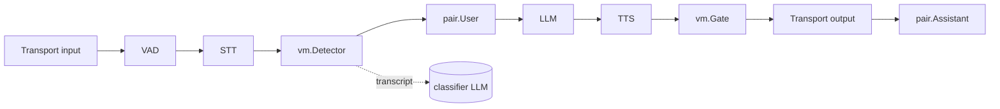

# Voicemail detection

When your bot places an outbound call, the other end may be a person or an answering machine. The voicemail detector listens to the first seconds of the call, decides which one it is, and either lets the conversation go ahead or leaves a message and hangs up. This guide shows you how to add it to a pipeline and tune it.

## Before you begin

- You can place outbound calls with your telephony provider. See [Telephony providers](telephony-providers.md) and the [outbound call recipe](../cookbook/outbound-call-with-voicemail.md).
- You have the `onnx-worker` running for VAD (voice activity detection, which tells speech from silence). Its socket path is in `ONNX_WORKER_SOCK`. See [Turn-taking](turn-taking.md#voice-activity-detection-vad).
- You have API keys for Deepgram (STT, speech-to-text), OpenAI (the LLM) and Cartesia (TTS, text-to-speech).

> [!NOTE]
> The `extensions/voicemail` package compiles but has no tests in this repository. Test it with real answering machines from your carrier before relying on it.

## How it works

The detector has two processors:

- **`Detector`** sits after STT. It sends what it hears to an LLM classifier, which answers `CONVERSATION` or `VOICEMAIL`.
- **`TTSGate`** sits after TTS. It holds the bot's audio until the decision is made, so a voicemail never records half a greeting.



The timeline of a call:

1. Each final transcription is added to a running transcript and classified.
2. The decision is made once the callee has been silent for `DecisionTimeout` (default 1 s). It uses the classifier's latest answer. With no answer yet, it assumes a conversation.
3. **Conversation**: the gate releases the held audio, the call continues normally, and your `OnConversationDetected` handler runs.
4. **Voicemail**: the gate discards the held audio, the bot is interrupted, and the detector blocks everything except system frames and end frames, so the LLM never answers the greeting. Once the greeting has been silent for `VoicemailResponseDelay` (default 2 s, restarted whenever the greeting continues), your `OnVoicemailDetected` handler runs, once.

## A complete example

```go
package main

import (
	"context"
	"log"
	"net/http"
	"os"
	"os/signal"
	"syscall"

	"github.com/square-key-labs/strawgo-ai/src/audio/vad"
	"github.com/square-key-labs/strawgo-ai/src/extensions/voicemail"
	"github.com/square-key-labs/strawgo-ai/src/frames"
	"github.com/square-key-labs/strawgo-ai/src/llm"
	"github.com/square-key-labs/strawgo-ai/src/logger"
	"github.com/square-key-labs/strawgo-ai/src/pipeline"
	"github.com/square-key-labs/strawgo-ai/src/processors"
	"github.com/square-key-labs/strawgo-ai/src/processors/aggregators"
	"github.com/square-key-labs/strawgo-ai/src/serializers"
	"github.com/square-key-labs/strawgo-ai/src/services/cartesia"
	"github.com/square-key-labs/strawgo-ai/src/services/deepgram"
	"github.com/square-key-labs/strawgo-ai/src/services/openai"
	"github.com/square-key-labs/strawgo-ai/src/transports"
)

const voicemailMessage = "Hi, this is Ana from Luigi's restaurant, calling about your booking on Friday. Please call us back. Thank you!"

func main() {
	logger.Init()
	srv, err := transports.NewServer(transports.ServerConfig{
		Addr: ":8080",
		Path: "/media",
		NewSerializer: func(*http.Request) serializers.FrameSerializer {
			return serializers.NewTwilioFrameSerializer(serializers.TwilioConfig{
				AccountSID: os.Getenv("TWILIO_ACCOUNT_SID"),
				AuthToken:  os.Getenv("TWILIO_AUTH_TOKEN"),
			})
		},
		Handler: runCall,
	})
	if err != nil {
		log.Fatal(err)
	}
	ctx, stop := signal.NotifyContext(context.Background(), os.Interrupt, syscall.SIGTERM)
	defer stop()
	if err := srv.ListenAndServe(ctx); err != nil {
		log.Fatal(err)
	}
}

func runCall(ctx context.Context, s *transports.Session) error {
	analyzer, err := vad.NewSileroVADAnalyzer(16000, vad.DefaultVADParams(), os.Getenv("ONNX_WORKER_SOCK"))
	if err != nil {
		return err
	}
	defer analyzer.Cleanup()

	stt := deepgram.NewSTTService(deepgram.STTConfig{APIKey: os.Getenv("DEEPGRAM_API_KEY"), Model: "nova-3", Language: "en"})
	llmSvc := openai.NewLLMService(openai.LLMConfig{
		APIKey:       os.Getenv("OPENAI_API_KEY"),
		Model:        "gpt-4.1-mini",
		SystemPrompt: "You are Ana from Luigi's restaurant, calling to confirm a booking for Friday. Keep answers short.",
	})
	classifier := openai.NewLLMService(openai.LLMConfig{APIKey: os.Getenv("OPENAI_API_KEY"), Model: "gpt-4.1-mini"})
	tts := cartesia.NewTTSService(cartesia.TTSConfig{APIKey: os.Getenv("CARTESIA_API_KEY"), VoiceID: os.Getenv("CARTESIA_VOICE_ID"), Model: "sonic-2", Language: "en"})

	vm, err := voicemail.New(classifier,
		voicemail.OnConversationDetected(func(d *voicemail.Detector) {
			log.Printf("a person answered")
		}),
		voicemail.OnVoicemailDetected(func(d *voicemail.Detector) {
			if err := d.PushFrame(frames.NewTTSSpeakFrame(voicemailMessage), frames.Downstream); err != nil {
				log.Printf("leave message: %v", err)
			}
			if err := d.PushFrame(frames.NewEndTaskFrame("voicemail"), frames.Upstream); err != nil {
				log.Printf("end call: %v", err)
			}
		}),
	)
	if err != nil {
		return err
	}

	pair := aggregators.NewContextAggregatorPair(llm.NewContext(), aggregators.ContextAggregatorPairParams{})
	pipe := pipeline.NewPipeline([]processors.FrameProcessor{
		s.Input(), vad.NewVADInputProcessor(analyzer), stt, vm.Detector(), pair.User(), llmSvc, tts, vm.Gate(), s.Output(), pair.Assistant(),
	})
	task := pipeline.NewPipelineTask(pipe)

	if err := task.QueueFrame(frames.NewTTSSpeakFrame("Hi, this is Ana from Luigi's restaurant.")); err != nil {
		return err
	}
	err = task.Run(ctx)
	log.Printf("call ended, verdict: %s", vm.Decision())
	return err
}
```

Walkthrough:

- **A separate classifier LLM.** `voicemail.New` takes anything with a `RunInference` method. The example uses a second OpenAI service with no system prompt, because `RunInference` adds the service's own system prompt to every request, and the bot's persona would confuse the classifier. The classifier service is not in the pipeline.
- **The greeting is queued at once.** The gate holds its audio until a person is detected, so a person hears it right after they finish saying "Hello?", and an answering machine never hears it.
- **Leaving the message.** After a voicemail verdict, the detector drops non-system frames that reach it. `task.QueueFrame` enters at the start of the pipeline and would be dropped, so the handler pushes the message from the detector itself with `d.PushFrame(..., frames.Downstream)`. The gate lets audio through after a voicemail verdict, so the message is recorded.
- **Hanging up.** `EndTaskFrame` pushed upstream asks the task to end; the task sends an `EndFrame` that passes the detector and finishes after the message has been spoken.

## Options

| Option | Default | Meaning |
| --- | --- | --- |
| `voicemail.WithDecisionTimeout(d)` | `DefaultDecisionTimeout` (1 s) | silence after the callee's speech before deciding |
| `voicemail.WithVoicemailResponseDelay(d)` | `DefaultVoicemailResponseDelay` (2 s) | silence after the voicemail greeting before `OnVoicemailDetected` runs |
| `voicemail.WithClassifyTimeout(d)` | `DefaultClassifyTimeout` (10 s) | how long one classification may take |
| `voicemail.WithClassifierSettings(s)` | none | `llm.Settings` passed to the classifier, for example a model or `MaxTokens` |
| `voicemail.WithPrompt(p)` | `voicemail.DefaultPrompt` | your own classifier prompt |
| `voicemail.WithMaxBufferedFrames(n)` | `DefaultMaxBufferedFrames` (4096) | how many TTS frames the gate holds; extra frames are dropped with a warning |
| `voicemail.OnConversationDetected(h)` | none | runs when a person answers |
| `voicemail.OnVoicemailDetected(h)` | none | runs once, when it is time to leave a message |

Tuning trade-offs:

| Setting | Shorter | Longer |
| --- | --- | --- |
| `DecisionTimeout` | the person hears the greeting sooner | fewer wrong "conversation" verdicts when a machine pauses mid-greeting |
| `VoicemailResponseDelay` | the message starts sooner | less risk of speaking before the beep |

A custom prompt must tell the model to answer `CONVERSATION` or `VOICEMAIL`; otherwise `voicemail.New` returns `voicemail.ErrInvalidPrompt`. The reply is read with `voicemail.ParseVerdict`, which takes whichever word appears first.

## Checking the verdict

`vm.Decision()` (or `d.Decision()` inside a handler) returns `voicemail.Undecided`, `voicemail.Conversation` or `voicemail.Voicemail`. The decision is made once per call and does not change afterwards.

## Next steps

- [Outbound call with voicemail](../cookbook/outbound-call-with-voicemail.md): the full recipe, including placing the call.
- [IVR navigation](ivr-navigation.md): when the call reaches a phone menu instead.
- [Turn-taking](turn-taking.md): VAD settings that affect when the callee is "silent".
- [Telephony providers](telephony-providers.md): hang-up support per provider.
