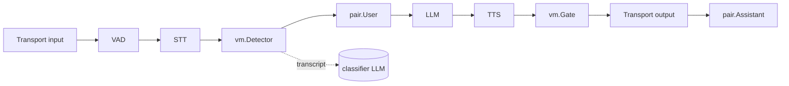

# Voicemail detection

When your bot places an outbound call, the other end may be a person or an answering machine. The voicemail detector listens to the first seconds of the call, decides which one it is, and either lets the conversation go ahead or leaves a message and hangs up. This guide shows you how to add it to a pipeline and tune it.

## Before you begin

- You can place outbound calls with your telephony provider. See [Telephony providers](telephony-providers.md) and the [outbound call recipe](../cookbook/outbound-call-with-voicemail.md).
- You have the `onnx-worker` running for VAD (voice activity detection, which tells speech from silence). Its socket path is in `ONNX_WORKER_SOCK`. See [Turn-taking](turn-taking.md#voice-activity-detection-vad).
- You have API keys for Deepgram (STT, speech-to-text), OpenAI (the LLM) and Cartesia (TTS, text-to-speech).

> [!NOTE]
> The `extensions/voicemail` and `audio/tone` packages are tested with scripted frames and synthetic audio (sine beeps, DTMF, noise and vowel-like signals at 8 kHz and 16 kHz). They have not been checked against live carriers. Try them with real answering machines and carrier announcements on your numbers before relying on them.

## How it works

The detector has two processors:

- **`Detector`** sits after STT. It sends what it hears to an LLM classifier, which answers `CONVERSATION` or `VOICEMAIL`. Optionally it also watches VAD timing and listens for the voicemail beep (see [Faster and finer detection](#faster-and-finer-detection)).
- **`TTSGate`** sits after TTS. It holds the bot's audio until the decision is made, so a voicemail never records half a greeting.



The timeline of a call:

1. Each final transcription is added to a running transcript and classified.
2. The decision is made once the callee has been silent for `DecisionTimeout` (default 1 s). It uses the classifier's latest answer. With no answer yet, it assumes a conversation.
3. **Conversation**: the gate releases the held audio, the call continues normally, and your `OnConversationDetected` handler runs.
4. **Voicemail**: the gate discards the held audio, the bot is interrupted, and the detector blocks everything except system frames and end frames, so the LLM never answers the greeting. Once the greeting has been silent for `VoicemailResponseDelay` (default 2 s, restarted whenever the greeting continues), your `OnVoicemailDetected` handler runs, once.

## A complete example

```go
package main

import (
	"context"
	"log"
	"net/http"
	"os"
	"os/signal"
	"syscall"

	"github.com/square-key-labs/strawgo-ai/src/audio/vad"
	"github.com/square-key-labs/strawgo-ai/src/extensions/voicemail"
	"github.com/square-key-labs/strawgo-ai/src/frames"
	"github.com/square-key-labs/strawgo-ai/src/llm"
	"github.com/square-key-labs/strawgo-ai/src/logger"
	"github.com/square-key-labs/strawgo-ai/src/pipeline"
	"github.com/square-key-labs/strawgo-ai/src/processors"
	"github.com/square-key-labs/strawgo-ai/src/processors/aggregators"
	"github.com/square-key-labs/strawgo-ai/src/serializers"
	"github.com/square-key-labs/strawgo-ai/src/services/cartesia"
	"github.com/square-key-labs/strawgo-ai/src/services/deepgram"
	"github.com/square-key-labs/strawgo-ai/src/services/openai"
	"github.com/square-key-labs/strawgo-ai/src/transports"
)

const voicemailMessage = "Hi, this is Ana from Luigi's restaurant, calling about your booking on Friday. Please call us back. Thank you!"

func main() {
	logger.Init()
	srv, err := transports.NewServer(transports.ServerConfig{
		Addr: ":8080",
		Path: "/media",
		NewSerializer: func(*http.Request) serializers.FrameSerializer {
			return serializers.NewTwilioFrameSerializer(serializers.TwilioConfig{
				AccountSID: os.Getenv("TWILIO_ACCOUNT_SID"),
				AuthToken:  os.Getenv("TWILIO_AUTH_TOKEN"),
			})
		},
		Handler: runCall,
	})
	if err != nil {
		log.Fatal(err)
	}
	ctx, stop := signal.NotifyContext(context.Background(), os.Interrupt, syscall.SIGTERM)
	defer stop()
	if err := srv.ListenAndServe(ctx); err != nil {
		log.Fatal(err)
	}
}

func runCall(ctx context.Context, s *transports.Session) error {
	analyzer, err := vad.NewSileroVADAnalyzer(16000, vad.DefaultVADParams(), os.Getenv("ONNX_WORKER_SOCK"))
	if err != nil {
		return err
	}
	defer analyzer.Cleanup()

	stt := deepgram.NewSTTService(deepgram.STTConfig{APIKey: os.Getenv("DEEPGRAM_API_KEY"), Model: "nova-3", Language: "en"})
	llmSvc := openai.NewLLMService(openai.LLMConfig{
		APIKey:       os.Getenv("OPENAI_API_KEY"),
		Model:        "gpt-4.1-mini",
		SystemPrompt: "You are Ana from Luigi's restaurant, calling to confirm a booking for Friday. Keep answers short.",
	})
	classifier := openai.NewLLMService(openai.LLMConfig{APIKey: os.Getenv("OPENAI_API_KEY"), Model: "gpt-4.1-mini"})
	tts := cartesia.NewTTSService(cartesia.TTSConfig{APIKey: os.Getenv("CARTESIA_API_KEY"), VoiceID: os.Getenv("CARTESIA_VOICE_ID"), Model: "sonic-2", Language: "en"})

	vm, err := voicemail.New(classifier,
		voicemail.OnConversationDetected(func(d *voicemail.Detector) {
			log.Printf("a person answered")
		}),
		voicemail.OnVoicemailDetected(func(d *voicemail.Detector) {
			if err := d.PushFrame(frames.NewTTSSpeakFrame(voicemailMessage), frames.Downstream); err != nil {
				log.Printf("leave message: %v", err)
			}
			if err := d.PushFrame(frames.NewEndTaskFrame("voicemail"), frames.Upstream); err != nil {
				log.Printf("end call: %v", err)
			}
		}),
	)
	if err != nil {
		return err
	}

	pair := aggregators.NewContextAggregatorPair(llm.NewContext(), aggregators.ContextAggregatorPairParams{})
	pipe := pipeline.NewPipeline([]processors.FrameProcessor{
		s.Input(), vad.NewVADInputProcessor(analyzer), stt, vm.Detector(), pair.User(), llmSvc, tts, vm.Gate(), s.Output(), pair.Assistant(),
	})
	task := pipeline.NewPipelineTask(pipe)

	if err := task.QueueFrame(frames.NewTTSSpeakFrame("Hi, this is Ana from Luigi's restaurant.")); err != nil {
		return err
	}
	err = task.Run(ctx)
	log.Printf("call ended, verdict: %s", vm.Decision())
	return err
}
```

Walkthrough:

- **A separate classifier LLM.** `voicemail.New` takes anything with a `RunInference` method. The example uses a second OpenAI service with no system prompt, because `RunInference` adds the service's own system prompt to every request, and the bot's persona would confuse the classifier. The classifier service is not in the pipeline.
- **The greeting is queued at once.** The gate holds its audio until a person is detected, so a person hears it right after they finish saying "Hello?", and an answering machine never hears it.
- **Leaving the message.** After a voicemail verdict, the detector drops non-system frames that reach it. `task.QueueFrame` enters at the start of the pipeline and would be dropped, so the handler pushes the message from the detector itself with `d.PushFrame(..., frames.Downstream)`. The gate lets audio through after a voicemail verdict, so the message is recorded.
- **Hanging up.** `EndTaskFrame` pushed upstream asks the task to end; the task sends an `EndFrame` that passes the detector and finishes after the message has been spoken.

## Options

| Option | Default | Meaning |
| --- | --- | --- |
| `voicemail.WithDecisionTimeout(d)` | `DefaultDecisionTimeout` (1 s) | silence after the callee's speech before deciding |
| `voicemail.WithVoicemailResponseDelay(d)` | `DefaultVoicemailResponseDelay` (2 s) | silence after the voicemail greeting before `OnVoicemailDetected` runs |
| `voicemail.WithClassifyTimeout(d)` | `DefaultClassifyTimeout` (10 s) | how long one classification may take |
| `voicemail.WithClassifierSettings(s)` | none | `llm.Settings` passed to the classifier, for example a model or `MaxTokens` |
| `voicemail.WithPrompt(p)` | `voicemail.DefaultPrompt` | your own classifier prompt |
| `voicemail.WithMaxBufferedFrames(n)` | `DefaultMaxBufferedFrames` (4096) | how many TTS frames the gate holds; extra frames are dropped with a warning |
| `voicemail.OnConversationDetected(h)` | none | runs when a person answers |
| `voicemail.OnVoicemailDetected(h)` | none | runs once, when it is time to leave a message |

Tuning trade-offs:

| Setting | Shorter | Longer |
| --- | --- | --- |
| `DecisionTimeout` | the person hears the greeting sooner | fewer wrong "conversation" verdicts when a machine pauses mid-greeting |
| `VoicemailResponseDelay` | the message starts sooner | less risk of speaking before the beep |

A custom prompt must tell the model to answer `CONVERSATION` or `VOICEMAIL`; otherwise `voicemail.New` returns `voicemail.ErrInvalidPrompt`. The reply is read with `voicemail.ParseVerdict`, which takes whichever word appears first.

## Checking the verdict

`vm.Decision()` (or `d.Decision()` inside a handler) returns `voicemail.Undecided`, `voicemail.Conversation` or `voicemail.Voicemail`. The decision is made once per call and does not change afterwards.

`vm.Result()` (or `d.Result()`) returns a `voicemail.Result` with the finer `Class` and the `Source` that decided it. It is the zero value until the decision is made.

## Faster and finer detection

Everything in this section is opt-in. Without these options the detector behaves exactly as described above.

| Option | What it adds |
| --- | --- |
| `voicemail.WithDetailedClasses()` | the classifier may answer human, voicemail, IVR, network announcement or unknown |
| `voicemail.WithTimingHeuristic(t)` | decides from VAD speech and silence timing, in parallel with the classifier |
| `voicemail.WithBeepDetection(fallback)` | listens for the voicemail beep and starts the message after it |
| `voicemail.WithBeepTone(cfg)` | tunes the beep detector (`tone.Config` from `src/audio/tone`) |
| `voicemail.OnResult(h)` | `func(d *voicemail.Detector, r voicemail.Result)`, runs once when the decision is made, before the other handlers |
| `d.ReportCarrierResult(class)` | feeds in an answering-machine result your carrier already produced |

Several signals can now decide. The first confident one wins and the decision is still made only once; later signals are ignored. `Result.Source` tells you which one it was:

| Source | Decided by |
| --- | --- |
| `SourceClassifier` | the LLM classifier, after `DecisionTimeout` of silence |
| `SourceTiming` | the timing heuristic |
| `SourceBeep` | a beep heard before any other decision |
| `SourceCarrier` | `ReportCarrierResult` |
| `SourceTimeout` | no answer by the end of `DecisionTimeout`, so the detector assumed a conversation |

### Result classes

With `WithDetailedClasses()` the detector uses `voicemail.DetailedPrompt`, and the classifier answers one of five words. Each class maps onto the existing verdicts and handlers, so code written for two classes keeps working:

| Classifier answer | `Result.Class` | `Decision()` | Handlers that run |
| --- | --- | --- | --- |
| `CONVERSATION` | `ClassHuman` | `Conversation` | `OnConversationDetected` |
| `VOICEMAIL` | `ClassVoicemail` | `Voicemail` | `OnVoicemailDetected` when it is time to leave the message |
| `IVR` | `ClassIVR` | `Conversation` | `OnConversationDetected`; the bot must interact with the menu, so frames keep flowing |
| `ANNOUNCEMENT` | `ClassAnnouncement` | `Voicemail` | `OnVoicemailDetected`; check the class and hang up instead of leaving a message |
| `UNKNOWN`, or no answer | `ClassUnknown` | `Conversation` | `OnConversationDetected`, as before |

`ANNOUNCEMENT` covers recordings from the phone network rather than from the person called: the number is switched off, not reachable, out of coverage, busy, does not exist, or out of service. These are common on Indian mobile networks, so the detailed prompt lists examples in English and in Hindi (both Devanagari and Latin spelling, since STT may return either). Leaving a message after an announcement records nothing, so look at the class:

```go
func announcementAware(task *pipeline.PipelineTask, message string) voicemail.Handler {
	return func(d *voicemail.Detector) {
		if d.Result().Class == voicemail.ClassAnnouncement {
			_ = d.PushFrame(frames.NewEndTaskFrame("unreachable"), frames.Upstream)
			return
		}
		_ = d.PushFrame(frames.NewTTSSpeakFrame(message), frames.Downstream)
		_ = d.PushFrame(frames.NewEndTaskFrame("voicemail"), frames.Upstream)
	}
}
```

Your own prompt still works: pass `WithPrompt(p)` together with `WithDetailedClasses()`. It must mention `CONVERSATION` and `VOICEMAIL`, and it should ask for one of the five words. `voicemail.ParseClass` reads the reply and takes the first of those words it finds (it also accepts `HUMAN`).

### Timing heuristic

`WithTimingHeuristic(voicemail.TimingThresholds{})` watches the `VADUserStartedSpeakingFrame` and `VADUserStoppedSpeakingFrame` frames that the VAD processor already sends, so it needs a VAD in the pipeline before the detector. It uses the frames' timestamps minus the VAD start and stop delays, so it measures when speech actually started and ended. A person usually says something short ("Hello?") and then waits; a recording talks on without pausing for a reply.

| Field | Default | Decides |
| --- | --- | --- |
| `HumanMaxGreeting` | 1.5 s | **human** when the only speech so far lasted at most this long... |
| `HumanSilence` | 0.8 s | ...and has been followed by this much silence. Pauses shorter than this do not split an utterance. |
| `MachineSpeech` | 3 s | **voicemail** when speech has gone on this long without a pause of `HumanSilence` |

Zero fields take the defaults. Anything in between, such as a two-second greeting followed by silence, or two separate short utterances, is left to the classifier.

Why these defaults: 1.5 s greeting and 0.8 s after-greeting silence are the defaults of Asterisk's long-standing `AMD()` application. Hosted detectors such as Twilio's treat about 2.4 s of continuous speech as a machine; the default here is 3 s, a little longer, because the heuristic should only decide when it is sure. With the default 0.2 s VAD stop time and 1 s `DecisionTimeout`, a short "Hello?" is decided about 0.4 s sooner than the classifier path, and without waiting for STT or the LLM.

The heuristic never overrules the classifier. If the classifier's latest answer says a machine, a short-greeting pattern does not decide human, and if it says human, long speech does not decide voicemail; the classifier decides after the silence as usual. When long speech decides a machine and the classifier has already answered `IVR` or `ANNOUNCEMENT`, the result takes that class. Before the classifier has answered, long speech is reported as `ClassVoicemail`, which closes the detector: if your calls often reach phone menus, leave the timing heuristic off or raise `MachineSpeech`.

### Beep detection

`WithBeepDetection(fallback)` runs a single-tone detector (`src/audio/tone`) on the input audio. The STT services forward input audio downstream, so the detector sees it when it sits after STT. A beep is a sustained, pure tone: by default between 440 and 1400 Hz, at least 250 ms long, louder than -40 dBFS, with at least 70% of each 20 ms block's energy in one frequency, and the same frequency throughout. DTMF key tones (two frequencies at once), speech and vowels (many harmonics), and the 400 and 425 Hz busy tones do not pass. It works on 8 kHz telephony audio and on wideband audio; stereo is mixed down to mono first.

After a voicemail decision, `OnVoicemailDetected` runs as soon as the beep ends, so the message starts after the tone. If no beep comes, it runs after `fallback` of silence (default `DefaultBeepTimeout`, 4 s, restarted while the greeting continues). With beep detection on, this fallback replaces `VoicemailResponseDelay`. A beep heard before any other decision decides voicemail by itself (`SourceBeep`). The handler runs once either way.

```go
func beepAware(classifier voicemail.Classifier, onVoicemail voicemail.Handler) (*voicemail.VoicemailDetector, error) {
	return voicemail.New(classifier,
		voicemail.WithBeepDetection(5*time.Second),
		voicemail.WithBeepTone(tone.Config{MinFrequency: 350, MaxFrequency: 2000}),
		voicemail.OnVoicemailDetected(onVoicemail),
	)
}
```

Zero fields in `tone.Config` take the defaults; the sample rate comes from the audio.

### Carrier answering-machine detection

Some carriers run their own answering-machine detection and report the result. None of Strawgo's serializers read such a field from the media stream today, so pass it in yourself with `d.ReportCarrierResult(class)` (also on `*VoicemailDetector`). It decides at once if nothing else has; called before the pipeline starts, it is applied when the detector starts. It returns `false` when it was ignored: an unknown class, or a decision already made.

Twilio reports its result as `AnsweredBy` (`human`, `machine_start`, `machine_end_beep`, `machine_end_silence`, `machine_end_other`, `fax` or `unknown`) when you enable its answering-machine detection on the call. `voicemail.ClassFromAnsweredBy` maps `human` to `ClassHuman`, `machine` and every `machine_*` value to `ClassVoicemail`, and anything else to `ClassUnknown`, which is ignored. Two ways to get the value to the detector:

- If your TwiML is generated per call by a webhook that receives `AnsweredBy`, add it as a stream `<Parameter name="AnsweredBy" .../>` and read it from `s.CallInfo().CustomParameters`.
- If the result arrives later on a status callback to your own HTTP handler, find the call's detector (for example in a map keyed by call SID) and call `ReportCarrierResult` from the handler.

```go
func applyCarrierAMD(s *transports.Session, vm *voicemail.VoicemailDetector) {
	if v, ok := s.CallInfo().CustomParameters["AnsweredBy"]; ok {
		vm.ReportCarrierResult(voicemail.ClassFromAnsweredBy(v))
	}
}
```

For other carriers, map their value to a `voicemail.Class` yourself. See your carrier's documentation for how to enable detection and which values it sends.

### Handing a phone menu to the IVR navigator

With `WithDetailedClasses()`, an `IVR` result can switch the [IVR navigator](ivr-navigation.md) into navigation mode. Put the navigator where the LLM service goes, after the detector, and in `OnResult` replace the context with the navigation prompt and lengthen the VAD stop time, as the navigator itself does when its own classifier hears a menu:

```go
func withIVRHandOff(classifier voicemail.Classifier, llmSvc processors.FrameProcessor, goal string, task **pipeline.PipelineTask) (*voicemail.VoicemailDetector, *ivr.Navigator, error) {
	var navigating atomic.Bool
	navigator := ivr.New(llmSvc, goal,
		ivr.OnIVRStatusChanged(func(p *ivr.Processor, status ivr.Status) {
			if status == ivr.StatusDetected {
				navigating.Store(true)
			}
		}),
	)
	vm, err := voicemail.New(classifier,
		voicemail.WithDetailedClasses(),
		voicemail.OnResult(func(d *voicemail.Detector, r voicemail.Result) {
			if r.Class != voicemail.ClassIVR || navigating.Swap(true) {
				return
			}
			_ = (*task).QueueFrame(frames.NewVADParamsUpdateFrame(frames.VADParams{StopSecs: ivr.DefaultIVRStopSecs}))
			_ = (*task).QueueFrame(frames.NewLLMMessagesUpdateFrame([]llm.Message{llm.Developer(ivr.NavigationPrompt(goal))}, true))
		}),
	)
	return vm, navigator, err
}
```

The pipeline is then `s.Input(), vad, stt, vm.Detector(), pair.User(), navigator, tts, vm.Gate(), s.Output(), pair.Assistant()`. The navigator's own classifier also hears the first words; the `navigating` flag makes sure only the first of the two switches to navigation. An IVR result maps to `Conversation`, so the gate opens and the navigator's spoken answers and key presses reach the call.

## Next steps

- [Outbound call with voicemail](../cookbook/outbound-call-with-voicemail.md): the full recipe, including placing the call.
- [IVR navigation](ivr-navigation.md): when the call reaches a phone menu instead.
- [Turn-taking](turn-taking.md): VAD settings that affect when the callee is "silent".
- [Telephony providers](telephony-providers.md): hang-up support per provider.
